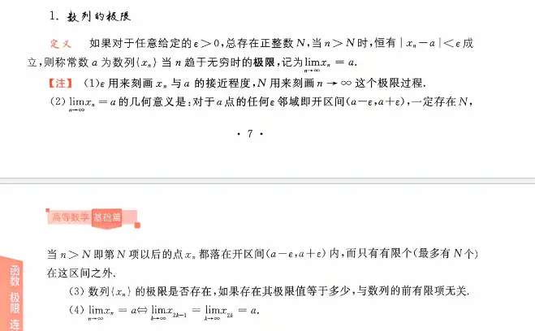
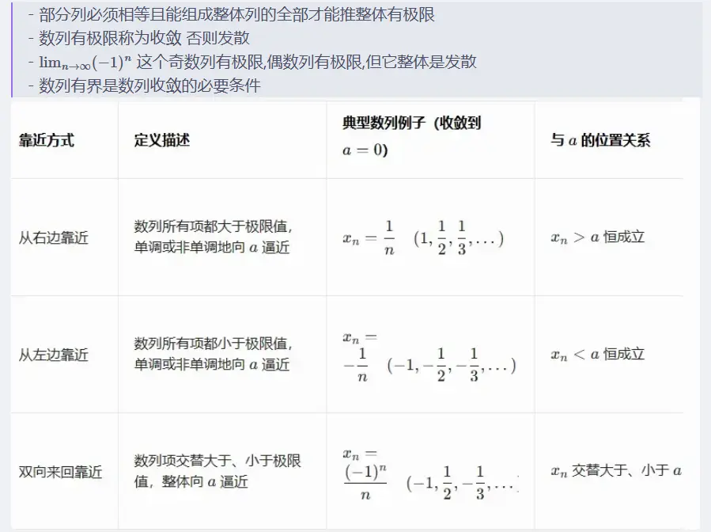

### 1. 定义域与变量的连续性

这是两者最根本的区别。

- **数列极限：** 自变量是项数 $n$。$n$ 只能取正整数（$\mathbb{N}^*$），即 $1, 2, 3 \dots$。因此，数列在坐标系中的图像是一系列**离散的点**。
    
- **函数极限：** 自变量是实数 $x$。$x$ 可以取实数集（$\mathbb{R}$）中某个区间内的所有值。因此，函数在坐标系中的图像通常是一条**连续的曲线**。
    

### 2. 逼近方向的多样性

- **数列极限：** 只有一个逼近方向，即 $n \to \infty$（严格来说是 $n \to +\infty$）。数列只能沿着正整数轴无限延伸，不存在“向左趋于无穷”或“趋于某个具体数字”的概念。
    
- **函数极限：** 逼近方式非常丰富。
    
    - **趋于某一点：** $x \to x_0$。并且还分为**左极限**（$x \to x_0^-$，从左侧逼近）和**右极限**（$x \to x_0^+$，从右侧逼近）。只有左右极限存在且相等时，该点的极限才存在。
        
    - **趋于无穷：** $x \to \infty$。它包含了趋于正无穷（$x \to +\infty$）和负无穷（$x \to -\infty$）两个方向。
        

### 3. 严格定义的语言区别

在数学分析中，两者使用了不同的逻辑语言来严谨化“无限逼近”这个词：

- **数列极限（$\varepsilon - N$ 语言）：**
    
    对于任意给定的极小正数 $\varepsilon > 0$，总存在一个正整数 $N$，使得当 $n > N$ 时，所有的数列项 $x_n$ 都满足 $|x_n - A| < \varepsilon$。
    
    _(不管你要求误差多小，只要项数足够靠后，后面的所有点都会落在这个误差范围内。)_
    
- **函数极限（$\varepsilon - \delta$ 语言，以 $x \to x_0$ 为例）：**
    
    对于任意给定的极小正数 $\varepsilon > 0$，总存在一个正数 $\delta > 0$，使得当 $0 < |x - x_0| < \delta$ 时，对应的函数值满足 $|f(x) - A| < \varepsilon$。
    
    _(不管你要求 $y$ 轴上的误差条有多窄，只要 $x$ 距离 $x_0$ 足够近，对应的图像就一定会穿过这个误差条。)
    
    
    _

# 函数去心邻域
### 核心结论

**可以，数列在趋近极限的过程中，完全可以等于这个极限。** 甚至可以有有限项、无限项，或者全部项都等于这个极限。

很多初学者会受到“趋近”这个词的汉语字面意思误导，认为“趋近”意味着“无限靠近但永远达不到”。但在严密的微积分数学体系中，数列的项能否等于极限，完全取决于数列本身的定义。

### 1. 原理剖析（$\epsilon-N$ 语言）

数列极限 $\lim_{n \to \infty} a_n = A$ 的严格数学定义是：

对于任意给定的正数 $\epsilon > 0$，总存在正整数 $N$，使得当 $n > N$ 时，都有 $\vert{}a_n - A\vert{} < \epsilon$。

请注意这个不等式：** $\vert{}a_n - A\vert{} < \epsilon$ **。

如果数列中的某一项 $a_n$ 刚好等于极限 $A$，那么 $\vert{}a_n - A\vert{} = 0$。因为 $\epsilon$ 是一个严格大于 $0$ 的数，所以 $0 < \epsilon$ 天然成立，且极其完美地满足了极限的定义。数学定义**从未规定** $\vert{}a_n - A\vert{}$ 必须严格大于 $0$。

### 2. 经典示例

以下几种情况，数列的项都等于了它的极限：

- **全部等于极限（常数数列）**
    
    数列：$1, 1, 1, 1, \dots$
    
    其通项公式为 $a_n = 1$。显然 $\lim_{n \to \infty} a_n = 1$。在这个数列中，**每一项都等于极限**。
    
- **无限次等于极限（震荡/交替数列）**
    
    数列：$1, 0, \frac{1}{2}, 0, \frac{1}{3}, 0, \frac{1}{4}, 0, \dots$
    
    其奇数项趋于 $0$，偶数项恒为 $0$。显然 $\lim_{n \to \infty} a_n = 0$。在这个趋近的过程中，**有无穷多个项刚好等于极限 $0$ **。
    
- **有限次等于极限**
    
    数列：$2, 2, 2, 1.1, 1.01, 1.001, \dots$
    
    极限为 $1$。虽然它在后面是真正意义上的“无限逼近但不等于”，但在前几项中，它可以等于任何值（当然也可以包含刚好等于极限值的情况，只是这里举例为常数过渡）。更典型的例子是分段定义的数列，前几项故意设为极限值，后面开始常规逼近。
    

### 3. 常见思维误区辨析

很多人之所以认为“不能等于”，是因为混淆了**函数极限中自变量的趋近**与**因变量（或数列项）的取值**。

在函数极限 $\lim_{x \to x_0} f(x) = A$ 中，自变量 $x$ 趋向于 $x_0$ 的数学表达是 $0 < \vert{}x - x_0\vert{} < \delta$。

这里的确有一个严格大于 $0$ 的限制，即**自变量 $x$ 绝对不能等于 $x_0$ **。

但数列极限讨论的是当下标 $n \to \infty$ 时，**数列的值 $a_n$ ** 的状态。自变量 $n$ 确实永远达不到真正的“无穷大”（因为无穷大不是一个确定的数），但是作为因变量的 $a_n$，是完全可以等于目标极限值 $A$ 的。  

**数列极限（$\epsilon-N$ 语言）**

数列极限 $\lim_{n \to \infty} a_n = A$ 的严格数学定义是：

对于任意给定的正数 $\epsilon > 0$，总存在正整数 $N$，使得当 $n > N$ 时，都有 $\vert{}a_n - A\vert{} < \epsilon$。

**函数极限（$\epsilon-\delta$ 语言，以 $x \to x_0$ 为例）**

函数极限 $\lim_{x \to x_0} f(x) = A$ 的严格数学定义是：

对于任意给定的正数 $\epsilon > 0$，总存在正数 $\delta > 0$，使得当 $0 < \vert{}x - x_0\vert{} < \delta$ 时，都有 $\vert{}f(x) - A\vert{} < \epsilon$。

_(注：定义中的 $0 < \vert{}x - x_0\vert{} < \delta$ 体现了函数极限中特有的“去心邻域”概念，即自变量 $x$ 绝对不能等于 $x_0$。)_