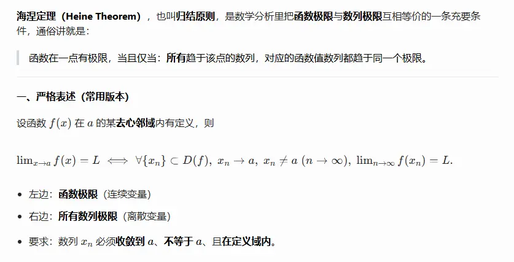
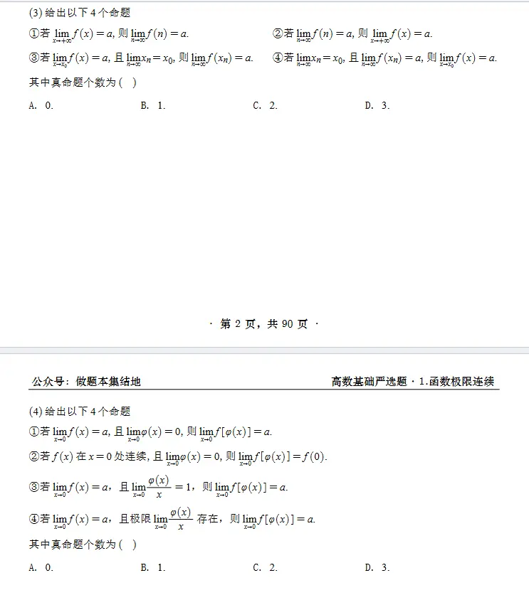

# 定义  
  
  
这里的极限 必须要有任意多个
这是一个非常敏锐的思考角度。很多初学者在学习海涅定理（归结原则）时，很容易把“数列的下标 $n$”**和**“数列的项 $x_n$（即函数的自变量）”混为一谈。

针对你的问题，给出直接的结论：**函数的自变量 $x$（也就是数列的项 $x_n$）完全可以是在负半轴取值；而数列的下标 $n$ 作为一个纯粹的计数器，通常默认从 1 开始，但这并不影响 $x_n$ 取负数。**

以下是具体的原理解析：

### 1. 下标 $n$ 和项 $x_n$ 的脱钩

在海涅定理中，我们构造的数列是 $\{x_n\}$。

- **下标 $n$ **：它表示的是“第几项”，本质上是一个纯粹的索引或计数器。在数学约定中，下标 $n$ 通常属于正整数集 $\mathbb{N}^+$，也就是从 $1, 2, 3, \dots$ 开始递增。它永远是正的。
    
- **项 $x_n$ **：它是这串数列具体落在坐标轴上的**数值**。这个数值是正还是负，完全取决于你如何构造这串数列。
    

### 2. 当函数定义在负半轴时如何构造？

假设我们有一个函数 $f(x)$ 定义在负半轴，且我们想研究当 $x \to 0^-$（从左侧趋近于 $0$）时的极限。

为了使用海涅定理，我们需要构造一个趋近于 $0$ 且全部在负半轴的数列 $\{x_n\}$。

我们可以这样构造：

$$x_n = -\frac{1}{n}$$

当 $n$ 按照正整数 $1, 2, 3, \dots$ 递增时，这个数列的具体取值展开如下：

- $n = 1$ 时，$x_1 = -1$
    
- $n = 2$ 时，$x_2 = -\frac{1}{2}$
    
- $n = 3$ 时，$x_3 = -\frac{1}{3}$
    
- $\dots$
    

你看，虽然下标 $n$ 是从 $1$ 开始的正整数，但构造出来的每一个 $x_n$ 完美地落在了负半轴，并且当 $n \to \infty$ 时，$x_n \to 0$。然后我们将这些负数项代入函数求 $\{f(x_n)\}$ 的极限即可。

### 3. $n$ 必须严格从 1 开始吗？

在严谨的数学分析中，数列的下标默认从 $1$ 开始（即 $n \in \mathbb{N}^+$），有时也会为了方便从 $0$ 开始。

但在研究**极限**时，下标从几开始**完全不重要**。极限研究的是当 $n \to \infty$ 时的“最终趋势”，前面的有限项（无论是前 $1$ 项、前 $10$ 项还是前 $10000$ 项）哪怕全是错乱的，都不会影响最终的极限结果。只要保证随着 $n$ 的无限增大，对应的 $x_n$ 能够无限逼近目标值 $x_0$ 且 $x_n \neq x_0$ 即可。

# 例题

# 细节区分  
这两个表达式看似只是符号位置的交换，但它们在数学上代表了**完全不同的运算顺序**。它们能否画上等号，直接取决于微积分中最核心的概念之一：**函数 $f(x)$ 的连续性**。

用一句话概括它们的区别：

- $f(\lim_{n \to \infty} x_n)$ 是“先求极限，后代入函数”。
    
- $\lim_{n \to \infty} f(x_n)$ 是“先代入函数，后求极限”。
    

以下是详细的拆解与对比：

### 一、 运算逻辑剖析

#### 1. $f(\lim_{n \to \infty} x_n)$：关注“终点”

- **动作顺序**：你先不去管外面的函数 $f$。你先死死盯着数列 $x_n$，算出它当 $n \to \infty$ 时的极限，假设这个极限值是 $a$（即 $a = \lim_{n \to \infty} x_n$）。
    
- **最后一步**：把算出来的这个实实在在的数字 $a$，直接代入到函数中，算出 $f(a)$。
    
- **潜台词**：这种写法要求数列 $x_n$ 必须自身有极限 $a$，而且这个点 $a$ 必须在函数 $f(x)$ 的定义域内。
    

#### 2. $\lim_{n \to \infty} f(x_n)$：关注“过程”

- **动作顺序**：你先把数列的每一项 $x_1, x_2, x_3 \dots$ 全部扔进函数 $f(x)$ 里，得到一个全新的**函数值数列**：$f(x_1), f(x_2), f(x_3) \dots$
    
- **最后一步**：去求这个全新数列在 $n \to \infty$ 时的极限。
    
- **潜台词**：它考察的是随着 $x_n$ 的不断变化，**函数值**的最终变化趋势。
    

### 二、 它们什么时候相等？（连续性的本质）

在微积分中，如果你能合法地把极限符号 $\lim$ 从函数外面“塞”到函数里面，即：

$$f(\lim_{n \to \infty} x_n) = \lim_{n \to \infty} f(x_n)$$

**这正是函数 $f(x)$ 在 $a$ 点（即 $\lim x_n$）连续的充要条件。**

这被称为连续性的**海涅定义（数列归结原则）**：如果函数是连续的，那么极限运算和函数映射就可以自由交换顺序。由于我们平时遇到的绝大多数初等函数（多项式、三角函数、指数函数等）在其定义域内都是连续的，所以我们在做计算题时，经常默认把它俩等同起来，直接把极限符号塞进去算。

### 三、 经典反例（当它们不相等时）

如果函数在 $a$ 点**不连续**（比如有跳跃间断点），这两个式子的结果就会发生严重分歧。

**举个极端的例子：阶跃函数**

定义函数 $f(x)$ 如下：

- 当 $x > 0$ 时，$f(x) = 1$
    
- 当 $x \le 0$ 时，$f(x) = 0$
    

现在我们取一个数列 $x_n = \frac{1}{n}$。显然，随着 $n \to \infty$，数列逐渐逼近 $0$。

**情况 1：计算 $f(\lim_{n \to \infty} x_n)$ **

1. 先算数列极限：$\lim_{n \to \infty} \frac{1}{n} = 0$
    
2. 代入函数：求 $f(0)$。根据定义，$f(0) = 0$。
    
3. **结果为 $0$ **。
    

**情况 2：计算 $\lim_{n \to \infty} f(x_n)$ **

1. 先代入函数：因为 $n$ 是正整数，所以 $x_n = \frac{1}{n}$ 永远大于 $0$。
    
2. 只要输入大于 $0$，函数输出永远是 $1$。所以产生的新数列是 $1, 1, 1, 1 \dots$
    
3. 求新数列极限：$\lim_{n \to \infty} 1 = 1$。
    
4. **结果为 $1$ **。
    

**结论**：在这个断层的函数中，$0 \neq 1$，即 $f(\lim x_n) \neq \lim f(x_n)$。这就生动地展示了“先到终点再看高度”和“一路看着高度走向终点”在遇到间断点时的巨大差异。