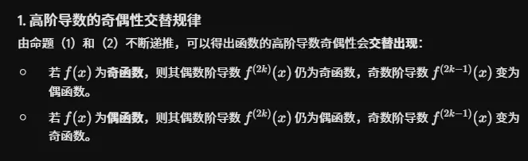

这是一个非常敏锐的延伸！关于 $0$ 点（即 $x=0$ 处）的导数值，我们可以结合“奇函数若在原点有定义，则其在原点的值必为 $0$（即 $g(0) = -g(0) \implies g(0) = 0$）”这一核心代数性质，推导出高阶导数在 $x=0$ 处的具体数值规律。

前提：假设函数在 $x=0$ 处具有所需的高阶导数。

### 1. 若 $f(x)$ 为奇函数

由于其偶数阶导数是奇函数，奇数阶导数是偶函数，因此在 $0$ 点处：

- **偶数阶导数必为 $0$ **：$f(0) = 0$，$f''(0) = 0$，$f^{(4)}(0) = 0$，以此类推，一般形式为 ** $f^{(2k)}(0) = 0$ **。
    
- **奇数阶导数不一定为 $0$ **：$f'(0)$，$f'''(0)$ 等奇数阶导数值由函数本身决定，没有强制必须为 $0$ 的限制。
    

### 2. 若 $f(x)$ 为偶函数

由于其偶数阶导数是偶函数，奇数阶导数是奇函数，因此在 $0$ 点处：

- **奇数阶导数必为 $0$ **：$f'(0) = 0$，$f'''(0) = 0$，$f^{(5)}(0) = 0$，以此类推，一般形式为 ** $f^{(2k-1)}(0) = 0$ **。
    
- **偶数阶导数不一定为 $0$ **：$f(0)$，$f''(0)$ 等偶数阶导数值由函数本身决定，没有强制必须为 $0$ 的限制。
      

### 重要应用场景：麦克劳林展开（Maclaurin Series）

这个关于 $0$ 点高阶导数的推论，在求解函数在 $x=0$ 处的泰勒展开（即麦克劳林级数）时极为关键。因为麦克劳林级数的各项系数公式正是 $\frac{f^{(n)}(0)}{n!}$：

- **奇函数的展开式**：因为在 $0$ 点的偶数阶导数全为 $0$（系数为 $0$），所以其展开式中**只存在奇数次幂的项**。
    
    > 例如：$\sin(x) = x - \frac{x^3}{3!} + \frac{x^5}{5!} - \cdots$
    
- **偶函数的展开式**：因为在 $0$ 点的奇数阶导数全为 $0$（系数为 $0$），所以其展开式中**只存在偶数次幂的项**（常数项视为 $0$ 次幂）。
    
    > 例如：$\cos(x) = 1 - \frac{x^2}{2!} + \frac{x^4}{4!} - \cdots$