**可以正常计算，但具体的计算方式完全取决于被积函数 $f(t)$ 的性质以及你的最终目的。**

在实际应用和做题中，对变上限积分 $\Phi(x) = \int_a^x f(t)dt$ 的“计算”通常分为以下三种截然不同的情况：

### 1. 常规计算：能找到初等原函数（使用牛顿-莱布尼茨公式）

如果 $f(t)$ 是一个我们熟悉的常规函数，且可以通过基本积分表或积分技巧（换元、分部等）求出它的一个原函数 $F(t)$，那么就可以直接使用**牛顿-莱布尼茨公式**进行代数计算。

- **计算公式**：
    
    $$\Phi(x) = \int_a^x f(t)dt = [F(t)]_a^x = F(x) - F(a)$$
    
- **具体示例**：
    
    假设 $f(t) = 2t$，下限 $a = 1$。
    
    $$\Phi(x) = \int_1^x 2t dt = [t^2]_1^x = x^2 - 1^2 = x^2 - 1$$
    
    此时，变上限积分被完美计算成了一个普通的代数表达式 $x^2 - 1$。
    

### 2. 数值计算：“积不出”的初等函数（使用近似算法）

如前所述，如果 $f(t)$ 是诸如 $e^{-t^2}$ 或 $\frac{\sin t}{t}$ 这类“积不出”的函数，你**无法**计算出一个由有限个基本初等函数组成的代数表达式。

但在工程计算或计算机程序中，如果给定了一个具体的 $x$ 值（例如 $x = 2$），计算机可以通过**数值积分方法**算出一个极其精确的近似值。

- **计算方法**：泰勒级数展开、辛普森法则（Simpson's rule）、梯形法则等。
    
- **具体示例**：对于 $\Phi(x) = \int_0^x e^{-t^2}dt$，虽然写不出表达式，但当 $x = 1$ 时，计算机可以切分面积并累加，算出 $\Phi(1) \approx 0.746824$。
    

### 3. 考研/考试中最核心的“计算”：求导运算

在微积分考试中，出题人给出一个变上限积分，往往**不是**让你去把它积出来（甚至故意给一个你积不出来的函数），而是让你把它作为整个复杂算式的一部分去**求导**或**求极限**（通常配合洛必达法则）。

此时，你不需要“算出”积分本身，而是直接套用**变上限积分求导公式**：

- **基础求导**：
    
    $$\frac{d}{dx} \int_a^x f(t)dt = f(x)$$
    
- **进阶求导（复合函数/链式法则）**：如果上限是一个关于 $x$ 的函数 $\varphi(x)$：
    
    $$\frac{d}{dx} \int_a^{\varphi(x)} f(t)dt = f(\varphi(x)) \cdot \varphi'(x)$$
    
    _(注意：一定要乘以 $\varphi(x)$ 的导数！)_
    
- **上下限皆为变量的求导**：
    
    $$\frac{d}{dx} \int_{\psi(x)}^{\varphi(x)} f(t)dt = f(\varphi(x))\varphi'(x) - f(\psi(x))\psi'(x)$$
    

**总结：**

当你看到 $\int_a^x f(t)dt$ 时，第一反应**不要**急着去把它积分积出来。先看题目的宏观要求：如果是求极限或求导，直接对其求导；如果是求表达式，再尝试寻找原函数使用牛顿-莱布尼茨公式。

# 拉布尼茨公式  

对于牛顿-莱布尼茨公式的使用，你可以自由选择是“先合并找原函数，再代入上下限”**，还是**“先分开各自找原函数代入上下限，最后再加减”。这两种方法在数学上是绝对等价的。

我们可以把这个过程拆解开来看：

### 1. 分开算（拆分法）

根据定积分的线性性质，你可以把多项式的每一项单独拆开，分别求定积分：

$$\int_{a}^{b} [f(x) \pm g(x)] dx = \int_{a}^{b} f(x) dx \pm \int_{a}^{b} g(x) dx$$

应用到牛顿-莱布尼茨公式上，就是各自找原函数，各自代入上下限：

$$= [F(x)]_a^b \pm [G(x)]_a^b$$

$$= (F(b) - F(a)) \pm (G(b) - G(a))$$

- **例子：** $\int_{0}^{1} (x^2 + x) dx$
    
- **分开算：** $\int_{0}^{1} x^2 dx + \int_{0}^{1} x dx = [\frac{1}{3}x^3]_0^1 + [\frac{1}{2}x^2]_0^1 = (\frac{1}{3} - 0) + (\frac{1}{2} - 0) = \frac{5}{6}$
    

### 2. 合并算（整体法）

你也可以先把整个多项式看作一个大的被积函数，直接求出它整体的原函数，然后再统一代入上下限：

$$\int_{a}^{b} [f(x) \pm g(x)] dx = [F(x) \pm G(x)]_a^b$$

$$= (F(b) \pm G(b)) - (F(a) \pm G(a))$$

- **例子：** $\int_{0}^{1} (x^2 + x) dx$
    
- **合并算：** 整体原函数是 $\frac{1}{3}x^3 + \frac{1}{2}x^2$。
    
    直接代入：$[\frac{1}{3}x^3 + \frac{1}{2}x^2]_0^1 = (\frac{1}{3} \cdot 1^3 + \frac{1}{2} \cdot 1^2) - (0 + 0) = \frac{5}{6}$
    

### 💡 实战做题策略：什么时候合并？什么时候分开？

虽然这两种方法结果一样，但在实际做题或考试时，选择哪种方法会直接影响你的计算速度和错误率。

**【绝大多数情况推荐：合并算】**

如果被积函数纯粹是由 $x^2, 3x, 5$ 这种**普通的多项式**构成的加减法，**强烈建议你整体合并算**。

- **原因：** 如果你分开算，你需要多次代入上限 $b$ 和下限 $a$。代入的次数越多，出现正负号算错、通分算错的概率就呈指数级上升。合并在一起，只需要集中代入一次上限和一次下限，算式最干净。
    

**【特殊情况推荐：分开算】**

只有当多项式中混入了**需要用不同积分解法**的项，或者具有**特殊对称性**的项时，才必须分开算。

- **情形 A（解法不同）：** 比如 $\int (x^2 + x\sin x) dx$。前面 $x^2$ 直接套公式，后面 $x\sin x$ 需要用分部积分法。这时候必须拆开，各算各的。
    
- **情形 B（利用对称性秒杀）：** 比如在对称区间 $[-1, 1]$ 上算 $\int_{-1}^{1} (x^3 + x^2) dx$。
    
    这时候一定要拆开！拆成 $\int_{-1}^{1} x^3 dx + \int_{-1}^{1} x^2 dx$。
    
    因为 $x^3$ 是奇函数，在对称区间上的积分为 $0$（直接秒杀）；你只需要算后面的偶函数 $x^2$ 即可。如果这时候你不拆开去强行整体算，反而给自己增加了不必要的计算量。
    

为了让你在几何上直观地看到“分开算”和“合并算”为什么结果必然相等（即面积的线性叠加），你可以看看下面这个交互图象：
# 奇偶对称性  
  
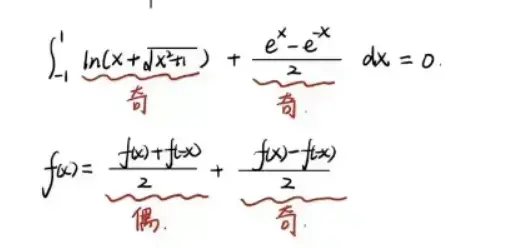  
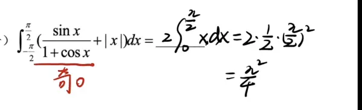
  
这里直接用圆的面积来做

# 奇常函数  
  
  
关于点(a,b)对称  [轴对称和中心对称](../../1-1函数/记忆内容/函数基础知识/轴对称和中心对称.md)
f(x)+f(-x)=2 b  
关于(0,b)对称  
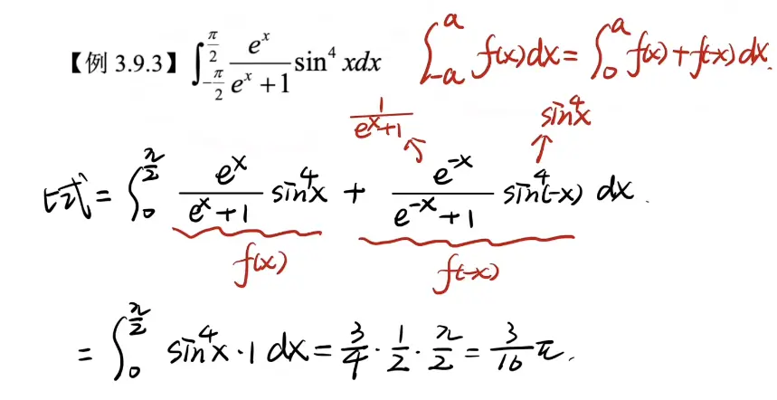  
  

# 区间再现  

^5e3eaf

 几何的证明  

## 例题
  
  
这里只要不求极限   
x 可以当做常数处理  

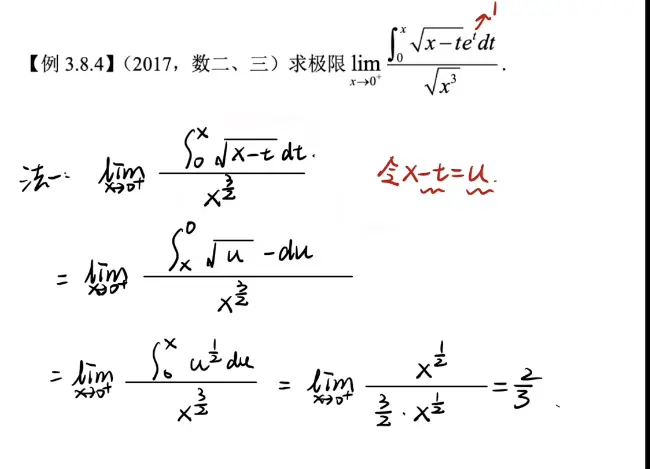  

# 周期性  
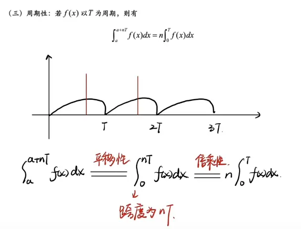  

# 重要公式(基于前三的推广)  
  
1 区间再现   在这个区间 sinx可以直接和 cosx 直接换
2 广义对称性  
不能换成 cosx 里面的函数 要关于区间中点对称   可以换成|cosx|  重点是关于区间重点对称
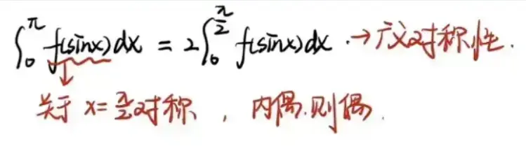
3  区间再现  
不能换成 cosx 里面的函数 要关于区间中点对称   可以换成|cosx|  重点是关于区间重点对称

## 1  
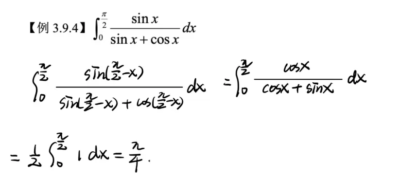  

## 2  
  
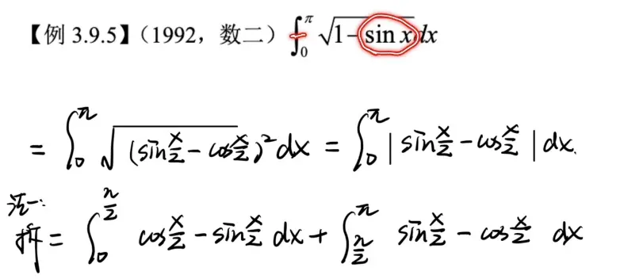
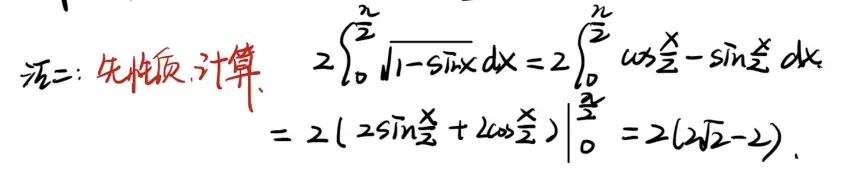  

## 3  
  

# 华里士公式(点火公式)  
必须是 本身上下限不能变  和别的公式一起用 结合用

几次幂 喊到 2 就停  
偶次幂  喊到 1 召唤 pi/2  

# 广义点火公式  
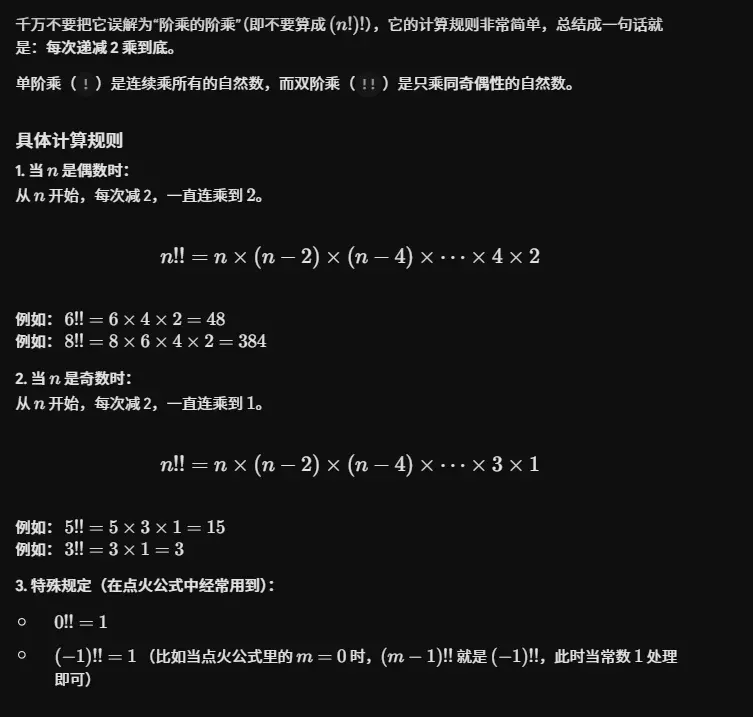
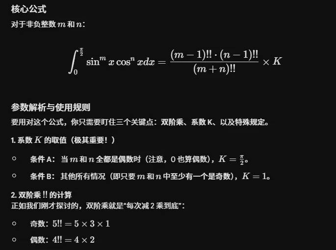
##  结合使用  

## 广义对称性和函数特性  

# 利用几何性质  
在微积分和考研数学中，利用定积分的几何意义（圆的面积）是最爽的“秒杀”技巧之一。当你看到特定的带根号的二次式时，千万不要去老老实实做三角代换，直接画图套面积公式才是正解。

以下是我为你整理的**四组最常用、最核心的圆面积快速计算公式**：

### 1. 标准圆（圆心在原点）

这是最基础的形式，特征是被积函数包含 $\sqrt{a^2 - x^2}$，对应圆心在 $(0,0)$，半径为 $a$ 的上半圆。

- **四分之一圆：** 积分下限为 $0$，上限为半径 $a$。
    
    $$\int_{0}^{a} \sqrt{a^2 - x^2} \, dx = \frac{\pi}{4} a^2$$
    
- **半圆：** 积分下限为 $-a$，上限为 $a$。
    
    $$\int_{-a}^{a} \sqrt{a^2 - x^2} \, dx = \frac{\pi}{2} a^2$$
    

### 2. 平移圆（圆心在坐标轴上）

这是考试中最爱出的**隐蔽变形**。特征是被积函数包含 $\sqrt{2ax - x^2}$。

如果你配方，会发现 $y^2 = 2ax - x^2 \implies (x-a)^2 + y^2 = a^2$。这是一个**圆心在 $(a, 0)$，半径为 $a$ **，且正好与 $y$ 轴相切的上半圆。

- **平移半圆：** 积分区间覆盖整个圆的宽度。
    
    $$\int_{0}^{2a} \sqrt{2ax - x^2} \, dx = \frac{\pi}{2} a^2$$
    
- **平移四分之一圆：** 积分区间只到圆心。
    
    $$\int_{0}^{a} \sqrt{2ax - x^2} \, dx = \frac{\pi}{4} a^2$$
    
    _(同理，$\int_{a}^{2a} \sqrt{2ax - x^2} \, dx$ 也是 $\frac{\pi}{4} a^2$)_
    

### 3. 奇偶性组合（终极秒杀杀手锏）

当圆的方程前面乘上或加上了其他一次项函数，并且**积分区间对称**时，直接拆分！

- **一次项 + 圆：**
    
    $$\int_{-a}^{a} (kx + b)\sqrt{a^2 - x^2} \, dx$$
    
    **破题心法：** 拆成两部分。
    
    前半部分 $\int_{-a}^{a} kx\sqrt{a^2 - x^2} \, dx$ 是**奇函数**在对称区间上的积分，结果直接为 ** $0$ **。
    
    后半部分 $b \int_{-a}^{a} \sqrt{a^2 - x^2} \, dx$ 就是常数 $b$ 乘以半圆面积。
    
    **公式：**
    
    $$\int_{-a}^{a} (kx + b)\sqrt{a^2 - x^2} \, dx = \frac{1}{2} b \pi a^2$$
    

### 4. 绝对值圆（双弧线）

有时题目会加上绝对值，比如 $\int_{-a}^{a} \sqrt{a^2 - |x|^2} \, dx$ 或者 $\int_{-a}^{a} \sqrt{a^2 - x^2} \, d|x|$。

但请注意，由于 $x^2 = |x|^2$，所以 $\sqrt{a^2 - x^2}$ 本身就不受绝对值影响。

但如果是类似 $\int_{0}^{2a} |\sqrt{a^2 - (x-a)^2}| \, dx$，因为根号出来默认非负，所以绝对值通常是多余的障眼法，依然直接算面积即可。

你可以通过下方的交互组件，直观地感受这几种常见定积分在坐标系中对应的真实几何面积。特别是“奇偶性组合”的情况，你可以看到奇函数部分增加的正负面积是如何完美抵消，最终只剩下纯粹的圆面积的。