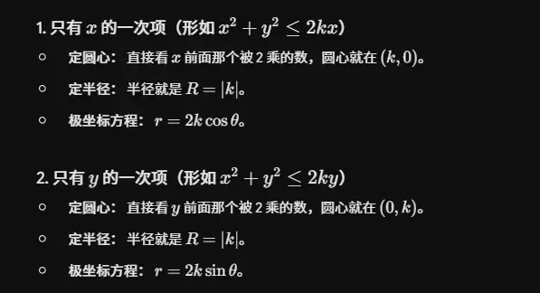

# 圆心在 xy 轴  

# 不在轴上  
有的！最快、最优雅的方法是**直接使用几何法（余弦定理）**，完全抛弃直角坐标系，在极坐标系内一步到位。

你可以这样想，在极坐标系中直接画一个三角形：

1. **确定三个关键点：**
    
    - 极点（原点）为 $O$。
        
    - 圆心为 $C$，假设其极坐标为 $(d, \alpha)$（即圆心到原点的距离为 $d$，极角为 $\alpha$）。
        
    - 圆上任意一点为 $P$，其极坐标为 $(r, \theta)$。
        
2. **分析 $\triangle OCP$ 的边和角：**
    
    - 边 $OC = d$
        
    - 边 $OP = r$
        
    - 边 $CP = R$ （因为 $P$ 在圆上，$C$ 是圆心，两点距离即为半径）
        
    - 边 $OC$ 和边 $OP$ 之间的夹角就是它们极角的差值，即 $(\theta - \alpha)$。
        
3. **直接套用余弦定理：**
    
    在 $\triangle OCP$ 中，根据余弦定理（$c^2 = a^2 + b^2 - 2ab \cos \gamma$）：
    
    $$CP^2 = OP^2 + OC^2 - 2 \cdot OP \cdot OC \cdot \cos(\angle COP)$$
    
    把已知的变量代入：
    
    $$R^2 = r^2 + d^2 - 2rd \cos(\theta - \alpha)$$
    
4. **移项整理：**
    
    $$r^2 - 2rd \cos(\theta - \alpha) + d^2 - R^2 = 0$$
    

**结论：**

通过构建这样一个简单的三角形并应用余弦定理，你只需**一行公式**就能直接写出该圆的极坐标一般方程，完全绕过了繁琐的代数展开和 $x, y$ 的三角代换。  

在这个极坐标方程 $R^2 = r^2 + d^2 - 2rd \cos(\theta - \alpha)$ 中，其实涉及到**两个**不同的角度。要确定它们，我们需要分别看待：

一个是**固定的常数角 $\alpha$ **（圆心的位置角），另一个是**变化的变量角 $\theta$ **（射线的扫描角）。

以下是具体确定这两个角度的方法：

### 1. 如何确定常数角 $\alpha$（圆心所在的极角）

$\alpha$ 是原点 $O$ 指向圆心 $C(a, b)$ 的向量与极轴（正 $x$ 轴）之间的夹角。它是一个固定的值，完全由圆心的直角坐标 $(a, b)$ 决定。

**计算方法：**

利用反正切函数来求：

$$\tan \alpha = \frac{b}{a}$$

**注意象限问题：**

因为 $\tan$ 函数的周期性，直接用 $\arctan(\frac{b}{a})$ 可能会导致象限错误（比如第一象限和第三象限的 $\tan$ 值都是正的）。在实际计算或编程中，我们通常使用 `atan2(b, a)` 函数，它会根据 $a$ 和 $b$ 的正负号自动确定正确的象限：

- 如果圆心在第一象限 ($a>0, b>0$)：$\alpha$ 在 $(0, \frac{\pi}{2})$ 之间。
    
- 如果圆心在第二象限 ($a<0, b>0$)：$\alpha$ 在 $(\frac{\pi}{2}, \pi)$ 之间。
    
- 如果圆心在第三象限 ($a<0, b<0$)：$\alpha$ 在 $(-\pi, -\frac{\pi}{2})$ 之间。
    
- 如果圆心在第四象限 ($a>0, b<0$)：$\alpha$ 在 $(-\frac{\pi}{2}, 0)$ 之间。
    

### 2. 如何确定变量角 $\theta$ 的取值范围（定义域）

$\theta$ 不是一个固定的值，而是极坐标系中一根绕着原点旋转的“扫描线”的角度。$\theta$ 取什么值，极径 $r$ 就会算出对应的值。

但是，** $\theta$ 并不总是能取 $0$ 到 $360^\circ$ 的所有角度**，这取决于原点和圆的位置关系：

- **情况 A：原点在圆内或圆上（$d \le R$）**
    
    此时你在原点，四面八方看过去都能看到圆。
    
    因此，扫描线转一整圈都能与圆相交，** $\theta$ 的取值范围是全区间**，即 $[0, 2\pi)$ 或 $[0, 360^\circ)$。
    
- **情况 B：原点在圆外（$d > R$）**
    
    这是最需要注意的情况。此时圆只占据了你视野的一部分。从原点看圆，视线会被两条**切线**限制住。$\theta$ 只能在这两条切线之间取值，否则射线根本碰不到圆（此时方程求不出实数根 $r$）。
    

**如何计算情况 B 下 $\theta$ 的范围？**

1. 首先，中心视角就是我们上面求出的 $\alpha$。
    
2. 然后，求出从原点看圆的“半视角”（设为 $\Delta$）。在直角三角形（原点、圆心、切点）中，斜边为 $d$，对边为半径 $R$，所以：
    
    $$\sin \Delta = \frac{R}{d} \implies \Delta = \arcsin\left(\frac{R}{d}\right)$$
    
1. 最终 ** $\theta$ 的有效取值范围**被限制在圆心角 $\alpha$ 的两侧：
    
    $$\theta \in [\alpha - \Delta, \alpha + \Delta]$$
    

你可以通过下方的交互组件，拖动圆心位置和改变半径，直观地观察 $\alpha$ 是如何计算的，以及当原点在圆外时，$\theta$ 的有效取值范围（即那片扇形阴影区域）是如何由切线决定的。