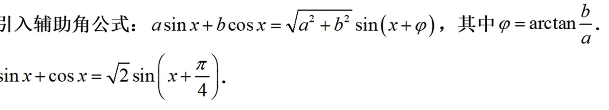

[《零基础学微积分（上）》, p.12](../../pdf/《零基础学微积分（上）》.pdf#page=12)
半角公式可以让二倍角公式中 2 a 变成 a,得出  

还有一个辅助角公式  

按照你的要求，我已将表格的行列互换，第一列为三角函数和反三角函数，每一行对应它们在不同取值下的特殊值。这种横向展开的方式也很适合对比记忆。

| **角度 (度)** | **角度 (弧度)**      | **sinα**             | **cosα**              | **tanα**              |
| ---------- | ---------------- | -------------------- | --------------------- | --------------------- |
| **0°**     | 0                | 0                    | 1                     | 0                     |
| **30°**    | $\frac{\pi}{6}$  | $\frac{1}{2}$        | $\frac{\sqrt{3}}{2}$  | $\frac{\sqrt{3}}{3}$  |
| **45°**    | $\frac{\pi}{4}$  | $\frac{\sqrt{2}}{2}$ | $\frac{\sqrt{2}}{2}$  | 1                     |
| **60°**    | $\frac{\pi}{3}$  | $\frac{\sqrt{3}}{2}$ | $\frac{1}{2}$         | $\sqrt{3}$            |
| **90°**    | $\frac{\pi}{2}$  | 1                    | 0                     | 不存在                   |
| **120°**   | $\frac{2\pi}{3}$ | $\frac{\sqrt{3}}{2}$ | $-\frac{1}{2}$        | $-\sqrt{3}$           |
| **135°**   | $\frac{3\pi}{4}$ | $\frac{\sqrt{2}}{2}$ | $-\frac{\sqrt{2}}{2}$ | -1                    |
| **150°**   | $\frac{5\pi}{6}$ | $\frac{1}{2}$        | $-\frac{\sqrt{3}}{2}$ | $-\frac{\sqrt{3}}{3}$ |
| **180°**   | $\pi$            | 0                    | -1                    | 0                     |
| **270°**   | $\frac{3\pi}{2}$ | -1                   | 0                     | 不存在                   |
| **360°**   | $2\pi$           | 0                    | 1                     | 0                     |
