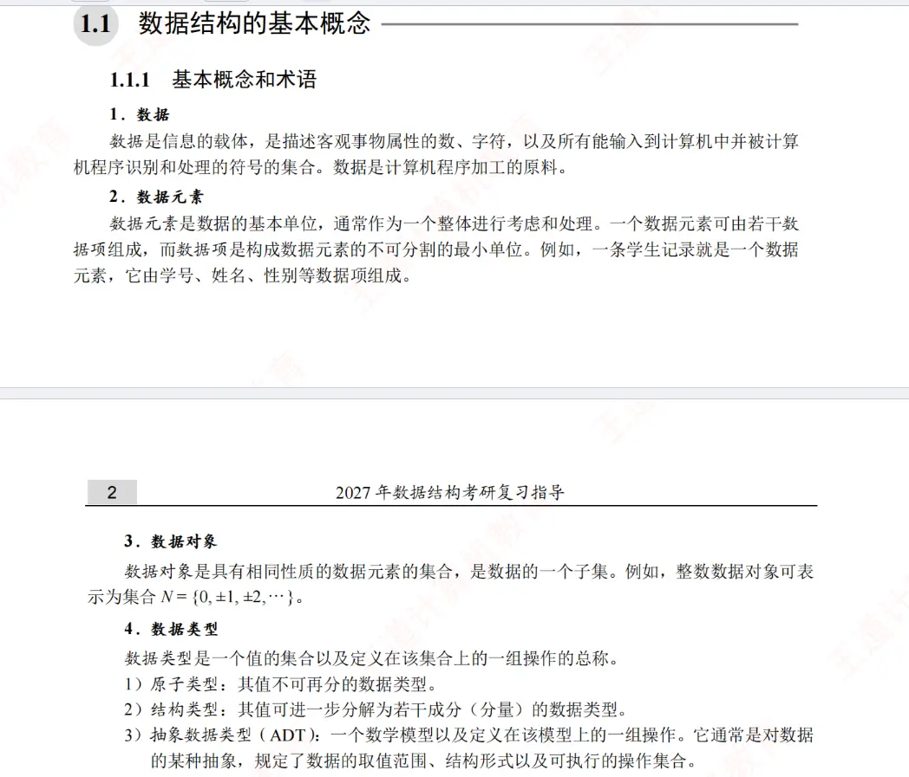
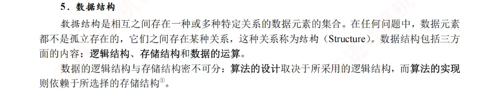

  
  


```
// 定义一个结构体
typedef struct {
    int id;         // 学号
    char name[20];  // 姓名
    char gender;    // 性别 ('M' 或 'F')
} Student;

// 声明变量
Student stu1 = {1001, "Alice", 'F'};
Student classList[50];
```

### 概念映射解析

**1. 数据项 (Data Item)**

- **对应代码：** 结构体内部的成员变量，即 `int id`、`char name[20]`、`char gender`。
    
- **说明：** 图片中指出数据项是“构成数据元素的不可分割的最小单位”。在程序中，学号（`id`）或性别（`gender`）已经是描述基本属性的最基础单位，通常不能再进一步拆分（或者拆分没有实际业务意义）。
    

**2. 数据元素 (Data Element)**

- **对应代码：** 结构体变量实例，例如 `stu1`。
    
- **说明：** 图片指出数据元素是“数据的基本单位，通常作为一个整体进行考虑和处理”。在代码中，`stu1` 包含了 `id`、`name` 和 `gender` 这三个**数据项**。当我们在链表或树中插入、删除一个节点时，我们通常是将 `stu1` 作为一个完整的实体（一条学生记录）进行移动或操作，而不是单独只操作它的学号。
    

**3. 数据对象 (Data Object)**

- **对应代码：** 结构体数组，例如 `Student classList[50]`。
    
- **说明：** 图片中定义数据对象是“具有相同性质的数据元素的集合”。`classList` 数组里存放了 50 个 `Student` 类型的**数据元素**。因为它们都是由相同的结构体实例化而来的，拥有完全相同的内部结构和性质，所以这个数组在逻辑上构成了一个数据对象。
    

**4. 数据类型 (Data Type)**

图片将数据类型分为了三类，我们同样可以在代码中找到完美对应：

- **原子类型：** 代码中的 `int`（用于 `id`）和 `char`（用于 `gender`）。它们的值不可再分，由编程语言底层直接支持。
    
- **结构类型：** 我们定义的 `Student` 结构体本身。它的值是由多个原子类型（或其它结构类型）组合而成的，可以进一步分解为若干成分（分量）。
    
- **抽象数据类型 (ADT)：** 如果我们不仅定义了 `Student` 结构体，还定义了一系列专门针对该学生数据的操作（例如 `insertStudent()`、`deleteStudent()`、`searchStudent()`），并将这些操作与数据结构在逻辑上封装在一起，规定了其取值范围和可执行的操作集合，这就构成了一个 ADT。在面向对象的语言（如 Java 或 C++）中，带有方法的类（Class）是实现 ADT 的典型方式。


  
