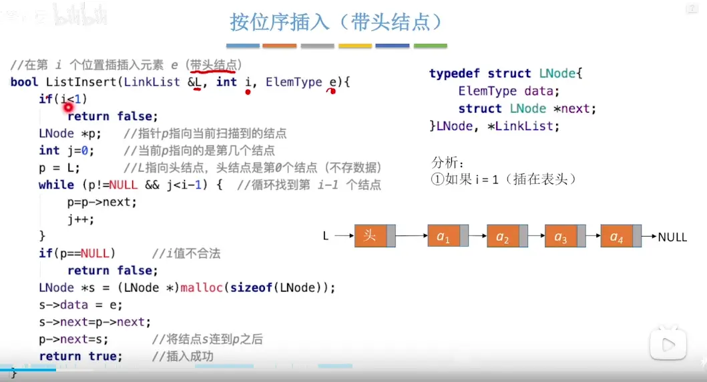
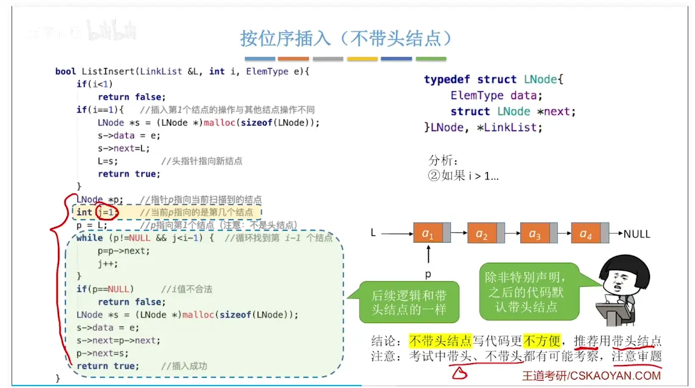
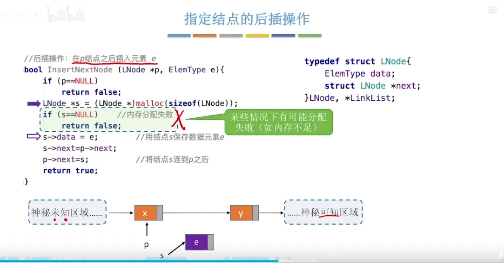
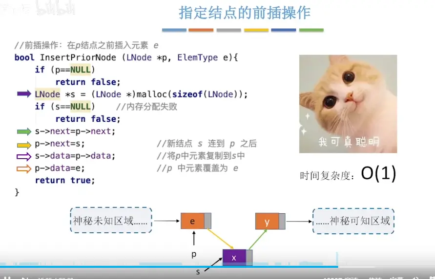
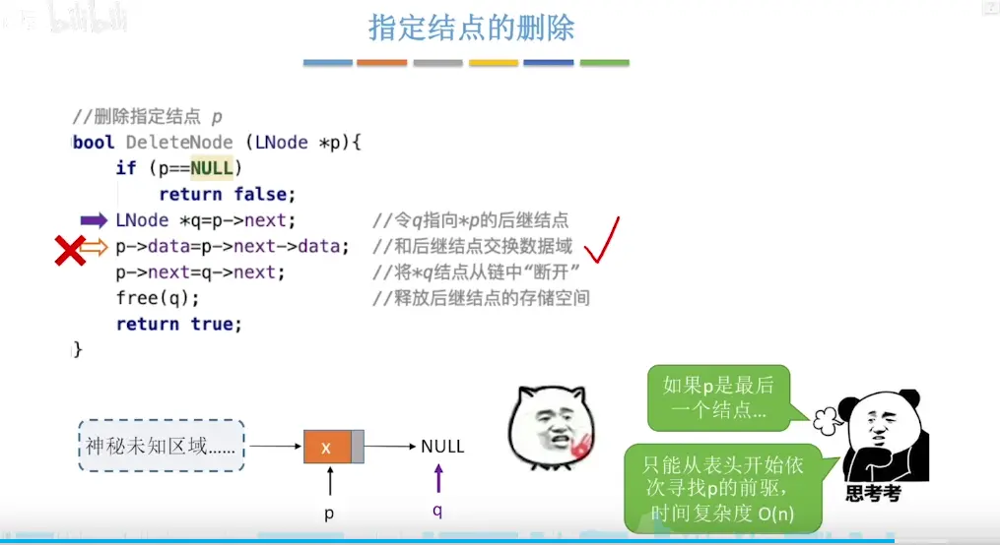
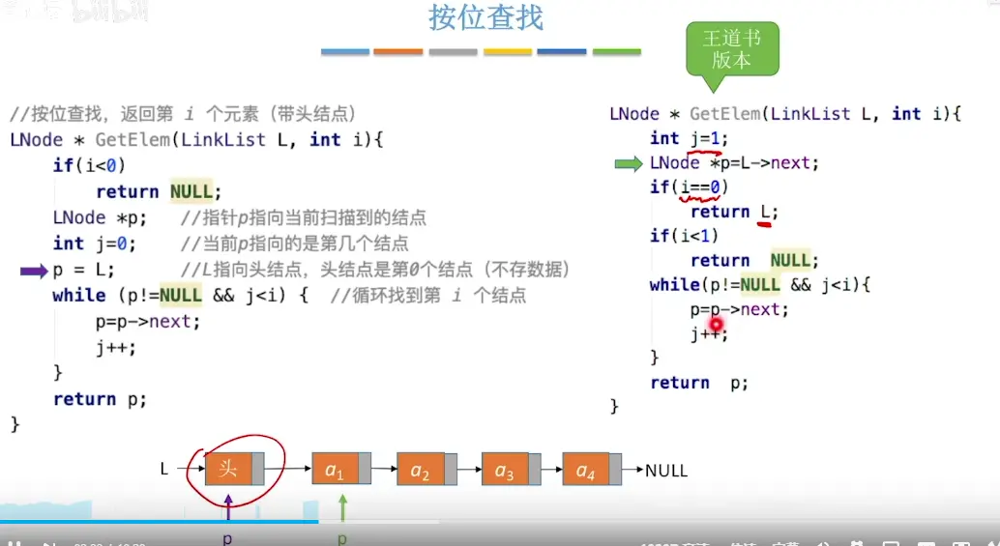
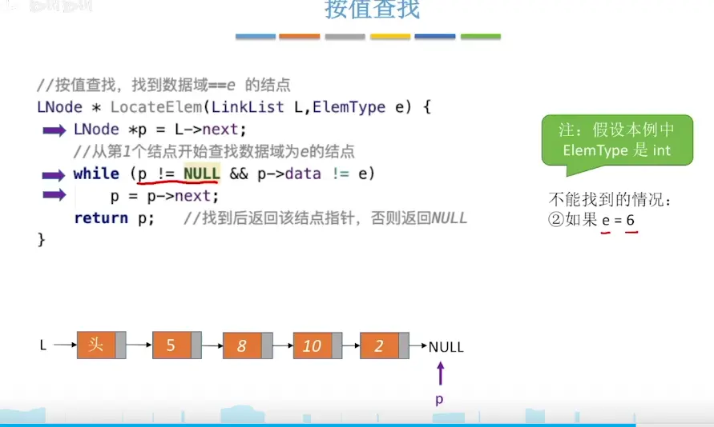
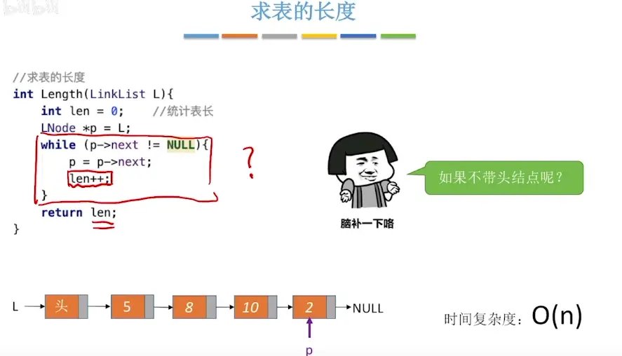

#  按位序插入  

# 指定节点后插操作    


# 指定节点前插操作  
  
# 按位序删除  
C++

```
bool ListDelete(LinkList &L, int i, ElemType &e) {
    if (i < 1) 
        return false; // i 值不合法

    // 特殊情况：如果删除的是第 1 个结点
    if (i == 1) {
        if (L == NULL) 
            return false; // 空表，无法删除
        
        LNode *q = L;     // 令 q 指向被删除的第 1 个结点
        e = q->data;      // 用 e 返回被删除元素的值
        L = q->next;      // 将头指针指向下一个结点（核心区别！）
        free(q);          // 释放存储空间
        return true;
    }

    // 常规情况：删除第 2 个及以后的结点
    LNode *p = L;         // 指针 p 指向当前扫描到的结点
    int j = 1;            // 当前 p 指向的是第 1 个结点 (注意这里 j=1，带头结点时 j=0)

    // 循环找到第 i-1 个结点
    while (p != NULL && j < i - 1) { 
        p = p->next;
        j++;
    }

    // p 为 NULL 说明 i 值超出了链表长度；p->next 为 NULL 说明第 i-1 个结点后已无其他结点
    if (p == NULL || p->next == NULL) 
        return false; 

    LNode *q = p->next;   // 令 q 指向被删除结点 (第 i 个结点)
    e = q->data;          // 用 e 返回元素的值
    p->next = q->next;    // 将 *q 结点从链中“断开”
    free(q);              // 释放结点的存储空间
    return true;          // 删除成功
}
```

如果是从 0 开始 计数 间隔数就是位序数  
如果是从 1 考试计数 间隔数是位序数-1  

# 删除指定节点  
  


# 按位序查找  


# 按值查找  


# 求表长  



# 时间复杂度  
没问题，我将所有操作合并为一个完整的大表，并统一加入了与顺序表（数组）的对比，方便你做全局的复习和记忆。这是单链表操作的“终极总结表”：


| **操作名称**                              | **平均时间复杂度** | **核心原因**                                       | **与顺序表(数组)的对比**                                      |
| ------------------------------------- | ----------- | ---------------------------------------------- | ---------------------------------------------------- |
| **按位序插入**                             | $O(n)$      | 需从头遍历寻找第 $i-1$ 个结点                             | 顺序表也是 $O(n)$，但原因是**移动元素**                            |
| **按位序删除**                             | $O(n)$      | 需从头遍历寻找第 $i-1$ 个结点                             | 顺序表也是 $O(n)$，但原因是**移动元素**                            |
| **指定结点的后插**                           | $O(1)$      | 直接修改指针即可                                       | 不适用（顺序表通过下标操作，无此概念）                                  |
| **指定结点的前插**                           | $O(1)$      | 采用**后插 + 数据交换**的技巧免去遍历                         | 不适用                                                  |
| **指定结点的删除**                           | $O(1)$      | 采用**复制后继数据 + 删除后继**的技巧免去遍历                     | 不适用                                                  |
| <font color="#ff0000">**按位查找**</font> | $O(n)$      | <font color="#ff0000">不支持随机存取，必须从头顺着指针数</font> | <font color="#ff0000">顺序表是 $O(1)$（**直接下标访问**）</font> |
| **按值查找**                              | $O(n)$      | 必须从头依次对比每个结点的值                                 | 顺序表也是 $O(n)$（无序情况下）                                  |
| **求链表长度**                             | $O(n)$      | 必须完整遍历整条链表进行计数                                 | 顺序表是 $O(1)$（结构体自带 `length` 属性）                       |

**复习核心口诀：**

- **查位置、查值、算长度** $\rightarrow$ 老老实实从头找 $\rightarrow$ $O(n)$
    
- **按位置增删** $\rightarrow$ 得先找到前面的位置 $\rightarrow$ $O(n)$
    
- **已知结点增删** $\rightarrow$ 巧用数据交换和指针修改 $\rightarrow$ $O(1)$