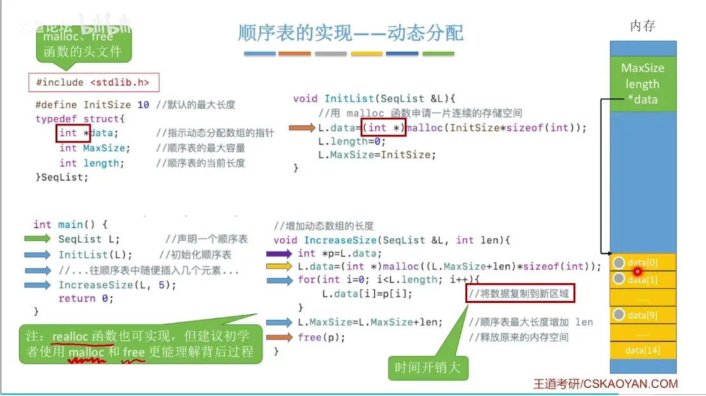
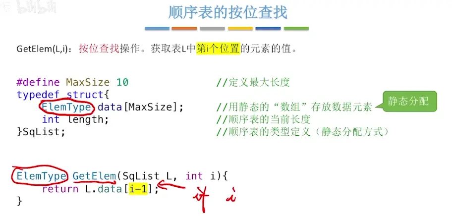
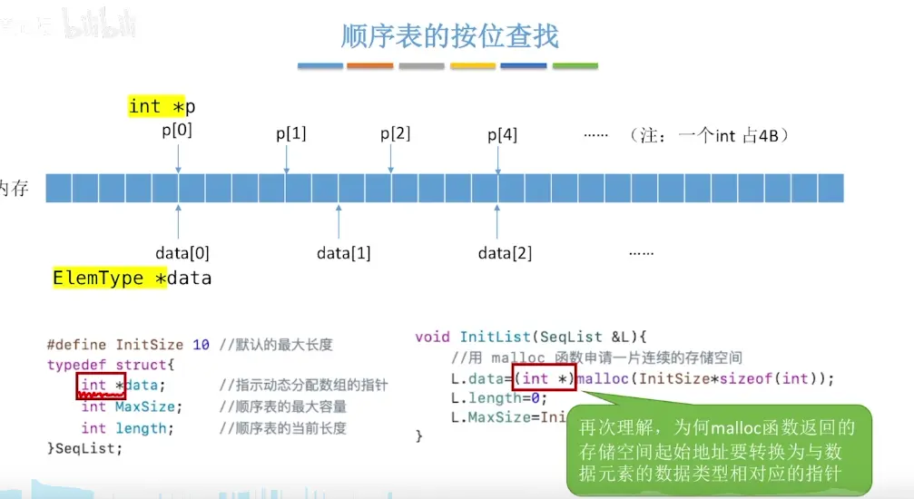

  
  

# 静态分配
  
length 是必须的   编译器默认初始值不确定   
初始化数据操作不是必须的  访问 len 里面的数据才是合法的
# 动态分配  
  

# 特点  
  
这里的位置计算使用的是下标
# 在 i 位序插入一个数  
在 i-1 下标插入一个数   
i-1 下标开始需要往后移  
第一次 length=length -1
最后一次 i=i-1

# 在 i 位序删除这个数
第一次 i-1=i  
最后一次 len -2=len-1
  

# 查找 i 位序值  （直接使用 i-1 下标）

  静态（数组形式的查找）
  

指针形式

# 按值查找  

# 时间复杂度   
| **操作名称**  | **最好情况** | **最坏情况** | **平均情况**   | **核心原因**                    |
| --------- | -------- | -------- | ---------- | --------------------------- |
| **按位序查找** | $O(1)$   | $O(1)$   | **$O(1)$** | 连续存储，支持数学公式直接计算地址 (随机访问)    |
| **按值查找**  | $O(1)$   | $O(n)$   | **$O(n)$** | 需要从头到尾进行线性遍历对比              |
| **插入**    | $O(1)$   | $O(n)$   | **$O(n)$** | 平均需要向后移动表中一半的元素 ($n/2$)     |
| **删除**    | $O(1)$   | $O(n)$   | **$O(n)$** | 平均需要向前移动表中一半的元素 ($(n-1)/2$) |
