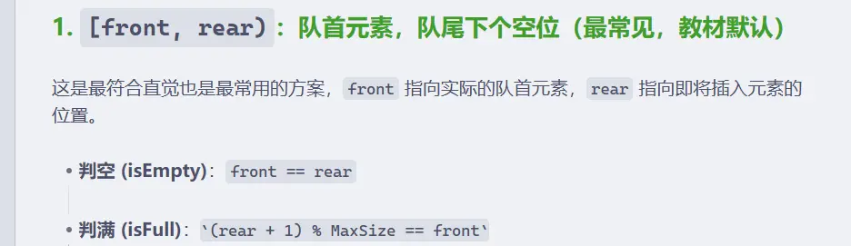
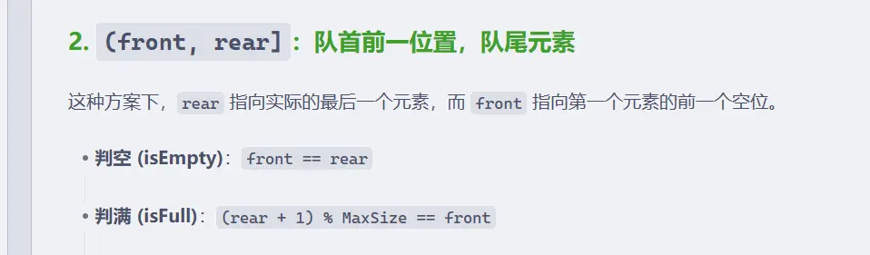
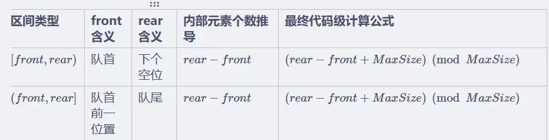

  要将循环队列的长度计算彻底“公式化”和“模板化”，我们可以从数学中**区间开闭**的角度来穷尽所有可能的情况。

无论题目怎么变形，`front` 和 `rear` 指针的物理含义无非只有两种状态：**包含有效数据（闭区间边界）** 或 **不包含有效数据（开区间边界）**。

- **`front` 的 2 种定义：**
    
    1. 指向真实的队首元素（**包含**，记为 `[` ）
        
    2. 指向队首元素的前一个位置（**不包含**，记为 `(` ）
        
- **`rear` 的 2 种定义：**
    
    1. 指向真实的队尾元素（**包含**，记为 `]` ）
        
    2. 指向队尾元素的下一个空位置（**不包含**，记为 `)` ）
        

将它们两两组合，**循环队列的长度计算在逻辑上只有这 4 种终极形态**。

### 循环队列长度计算 4 大基本型

假设数组总容量为 $MaxSize$，队列长度记为 $L$。为了处理指针倒挂，所有公式的基底都是 `+ MaxSize` 然后 `\pmod{MaxSize}`。

#### 1. 左闭右开区间 $[front, rear)$

- **定义：** `front` 指向队首，`rear` 指向下一个空位置。
    
- **特点：** 王道教材默认方式，最常见。
    
- **直线长度推导：** 上界 $-$ 下界 $= rear - front$
    
- **最终公式：**
    
    $$L = (rear - front + MaxSize) \pmod{MaxSize}$$
求数组的长度 这里就是  定义数组的大小的时候其实就是定义这个 rear  

#### 2. 左开右闭区间 $(front, rear]$

- **定义：** `front` 指向队首前一位置，`rear` 指向队尾。
    
- **特点：** 经典考题变体（如上一题的图片所示）。
    
- **直线长度推导：** 从数学上看，$(a, b]$ 区间内包含的整数个数和 $[a, b)$ 是一模一样的，都是 上界 $-$ 下界 $= rear - front$。
    
- **最终公式：**
    
    $$L = (rear - front + MaxSize) \pmod{MaxSize}$$
    

#### 3. 全闭区间 $[front, rear]$

- **定义：** `front` 指向队首，`rear` 指向队尾。
    
- **特点：** 不牺牲空间时（结合 `size` 变量或特判）常用的指向方式。
    
- **直线长度推导：** 两端点都包含，个数为 上界 $-$ 下界 $+ 1 = rear - front + 1$。
    
- **最终公式：**
    
    $$L = (rear - front + 1 + MaxSize) \pmod{MaxSize}$$
    

#### 4. 全开区间 $(front, rear)$

- **定义：** `front` 指向队首前一位置，`rear` 指向队尾下一个位置。
    
- **特点：** 极端罕见。因为这种定义下，当队列为空时，公式算出的长度是错的，必须强行写 `if` 分支处理。
    
- **直线长度推导：** 两端点都不包含，有效数据被夹在中间，个数为 上界 $-$ 下界 $- 1 = rear - front - 1$。
    
- **最终公式：**
    
    $$L = (rear - front - 1 + MaxSize) \pmod{MaxSize}$$
    

### 总结速查表

只要在做题时判断出指针的开闭性质，直接查表或按区间长度推导即可，无需再画图数格子。

| **区间类型**            | **front 含义** | **rear 含义** | **内部元素个数推导**       | **最终代码级计算公式**                                 |
| ------------------- | ------------ | ----------- | ------------------ | --------------------------------------------- |
| **$[front, rear)$** | 队首           | 下个空位        | $rear - front$     | $(rear - front + MaxSize) \pmod{MaxSize}$     |
| **$(front, rear]$** | 队首前一位置       | 队尾          | $rear - front$     | $(rear - front + MaxSize) \pmod{MaxSize}$     |
| **$[front, rear]$** | 队首           | 队尾          | $rear - front + 1$ | $(rear - front + 1 + MaxSize) \pmod{MaxSize}$ |
| **$(front, rear)$** | 队首前一位置       | 下个空位        | $rear - front - 1$ | $(rear - front - 1 + MaxSize) \pmod{MaxSize}$ |


在循环队列的设计中，判空、判满以及入队、出队的操作逻辑完全取决于 `front` 和 `rear` 指针的定义（即你总结的区间开闭情况）。

为了在仅依靠 `front` 和 `rear` 指针的情况下区分“队空”和“队满”，通常采用的通用策略是**牺牲一个数组空间**（即实际最多存放 `MaxSize - 1` 个元素）。

基于你的区间定义，以下是这四种情况对应的完整代码级逻辑（假设底层数组为 `data`，容量为 `MaxSize`）：

### 1. `[front, rear)`：队首元素，队尾下个空位（最常见，教材默认）

这是最符合直觉也是最常用的方案，`front` 指向实际的队首元素，`rear` 指向即将插入元素的位置。

- **判空 (isEmpty)**：`front == rear`
    
- **判满 (isFull)**：`(rear + 1) % MaxSize == front`
    
- **入队 (Enqueue)**：
    
    先存入数据，再后移 `rear` 游标。
    
    C
    
    ```
    data[rear] = x;
    rear = (rear + 1) % MaxSize;
    ```
    
- **出队 (Dequeue)**：
    
    先取出数据，再后移 `front` 游标。
    
    C
    
    ```
    x = data[front];
    front = (front + 1) % MaxSize;
    ```
    

### 2. `(front, rear]`：队首前一位置，队尾元素

这种方案下，`rear` 指向实际的最后一个元素，而 `front` 指向第一个元素的前一个空位。

- **判空 (isEmpty)**：`front == rear`
    
- **判满 (isFull)**：`(rear + 1) % MaxSize == front`
    
- **入队 (Enqueue)**：
    
    先因为 `rear` 指向的是最后一个已存在的元素，所以要先后移 `rear`，再存入数据。
    
    C
    
    ```
    rear = (rear + 1) % MaxSize;
    data[rear] = x;
    ```
    
- **出队 (Dequeue)**：
    
    `front` 指向的是头结点的前一个位置，所以必须先后移 `front` 到真正的队首，再取出数据。
    
    C
    
    ```
    front = (front + 1) % MaxSize;
    x = data[front];
    ```
    

### 3. `[front, rear]`：队首元素，队尾元素

这种方案两端都是闭区间，意味着刚初始化或队空时，`rear` 在逻辑上必须在 `front` 的前面一位。

- **判空 (isEmpty)**：`(rear + 1) % MaxSize == front`
    
- **判满 (isFull)**：`(rear + 2) % MaxSize == front` （因为牺牲了一个空间，队满时 `rear` 距离 `front` 差两个身位）
    
- **入队 (Enqueue)**：
    
    `rear` 当前指向最后一个元素，必须先后移，再存入。
    
    C
    
    ```
    rear = (rear + 1) % MaxSize;
    data[rear] = x;
    ```
    
- **出队 (Dequeue)**：
    
    `front` 指向当前第一个元素，先取出，再后移。
    
    C
    
    ```
    x = data[front];
    front = (front + 1) % MaxSize;
    ```
    

### 4. `(front, rear)`：队首前一位置，队尾下个空位

这种方案两端都是开区间，`front` 和 `rear` 都不指向实际有效元素。队空时，`rear` 正好是 `front` 逻辑上的下一位。

- **判空 (isEmpty)**：`(front + 1) % MaxSize == rear`
    
- **判满 (isFull)**：`front == rear` （牺牲一个空间后，满的状态正好表现为指针相遇）
    
- **入队 (Enqueue)**：
    
    `rear` 指向空位，先存入，再后移。
    
    C
    
    ```
    data[rear] = x;
    rear = (rear + 1) % MaxSize;
    ```
    
- **出队 (Dequeue)**：
    
    `front` 指向空位，必须先后移到有效元素位置，再取出。
    
    C
    
    ```
    front = (front + 1) % MaxSize;
    x = data[front];
    ```
    

### 💡 核心总结与记忆技巧

如果觉得四种情况容易混淆，可以记住以下**两条通用定律**：

1. **关于入队和出队顺序**：
    
    - 如果指针指向的是**实位置**（即闭区间 `[]`，如队首元素或队尾元素），操作该指针时必须**先移动指针，后读写数据**（出队先动 `front`，入队先动 `rear`，除了 `[front, rear)` 中的 `front` 取决于读取逻辑，通常是读完再挪）。
        
    - 如果指针指向的是**虚位置**（即开区间 `()`，如前一个空位或下一个空位），操作该指针时必须**先读写数据，后移动指针**。
        
2. **关于指针公式中的 $+1$ 和 $-1$ **：
    
    任何时候推导计算公式，只要明确当前处于“虚”还是“实”，利用 $\pmod{MaxSize}$ 进行环形偏移修正即可。大部分工业界和考试（如 408）中，如果不做特殊说明，**默认采用的是 `[front, rear)` 的形式**。 

# 有两个一样的  
  
  
