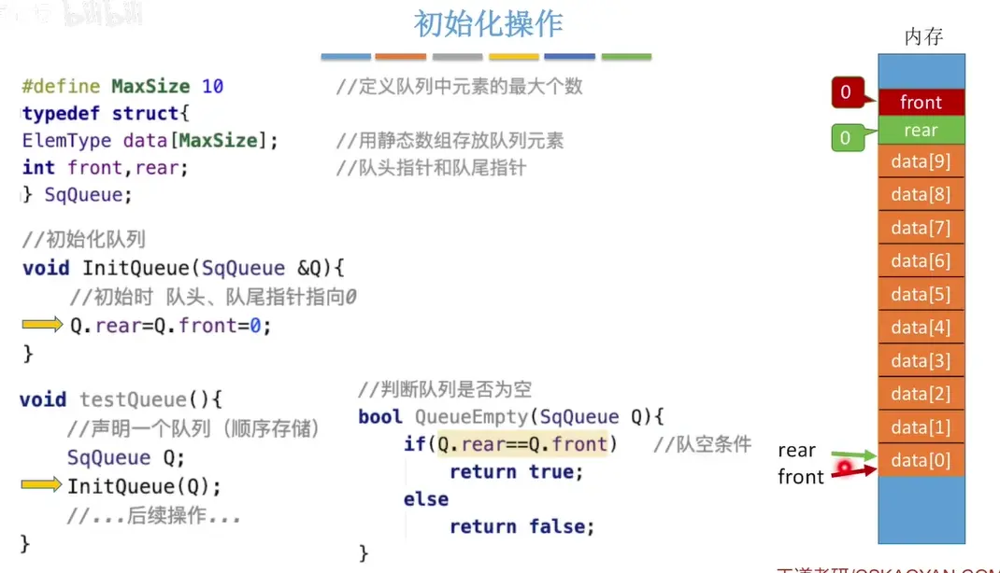
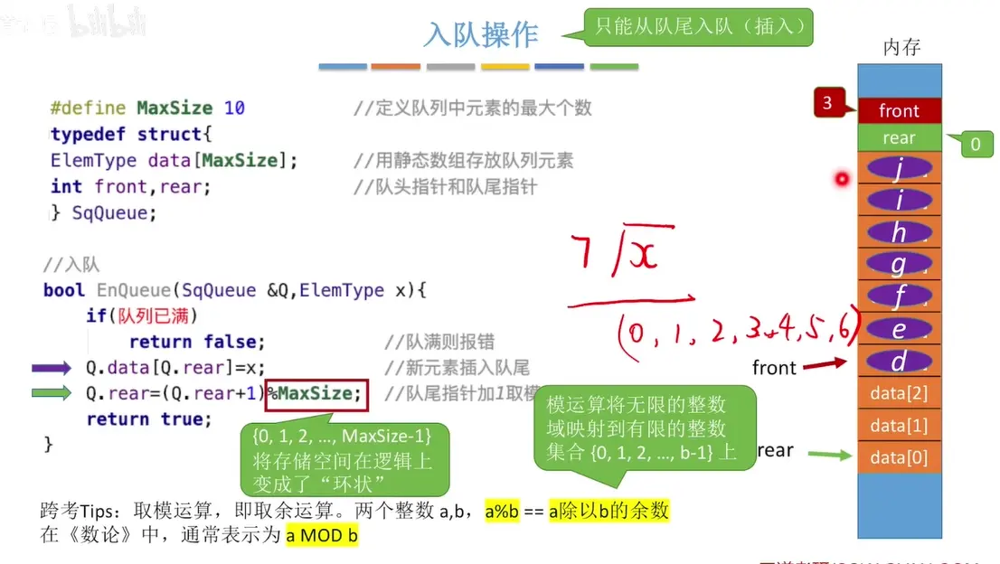
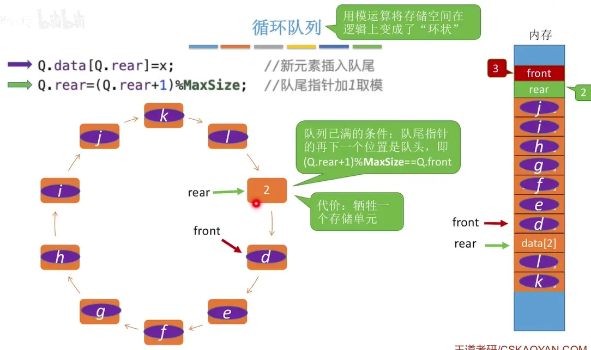
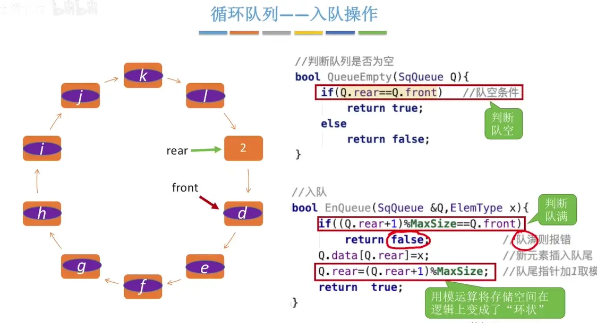
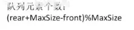
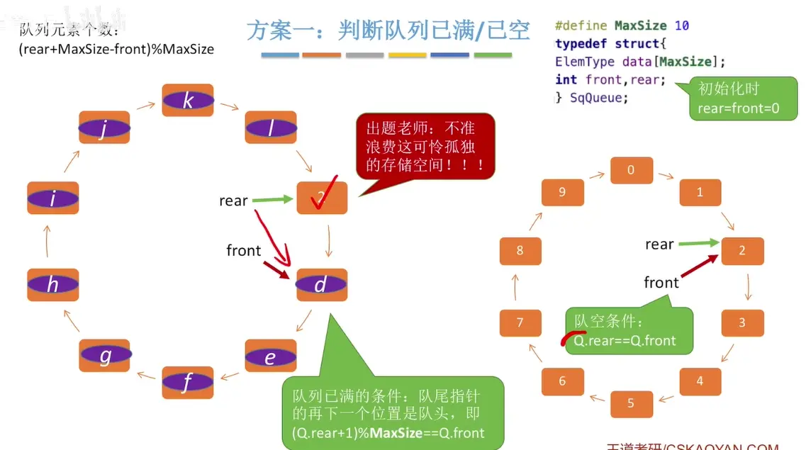
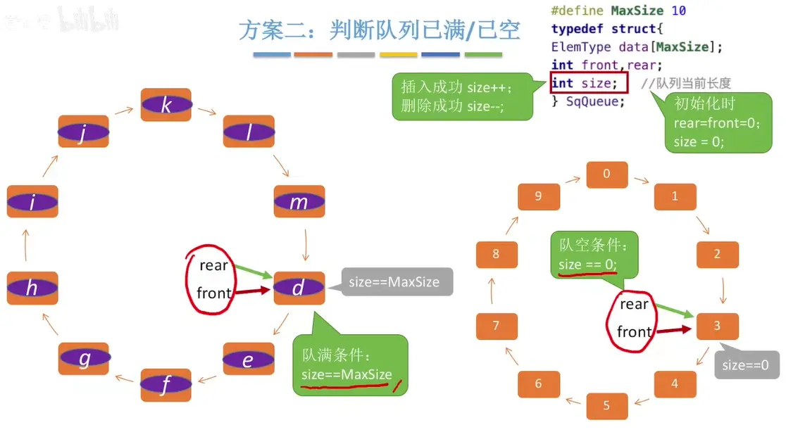
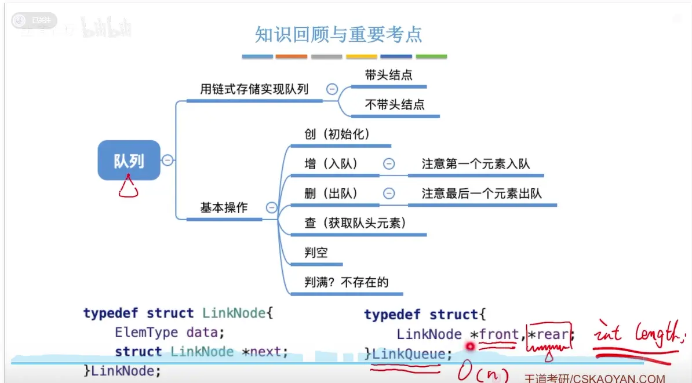

# 队列的初始化 判空  
  

# 入队操作  (循环队列)
  
  
  

# 出队操作  获取队头元素  (循环队里)

# 判断队列 已满/已空操作  
## 队列元素个数  

## 牺牲一个存储空间  
  
## 定义一个 size  
  

## 设置标志位 tag  
  

# 队尾指针指向队尾元素（先加后填）

  
第二种(rear+2)%Maxsize＝=front  是这样判断队满

# 总结  
  
如果需要经常用到长度  
可以加一个长度变量  
没出队入队相应的加减  
