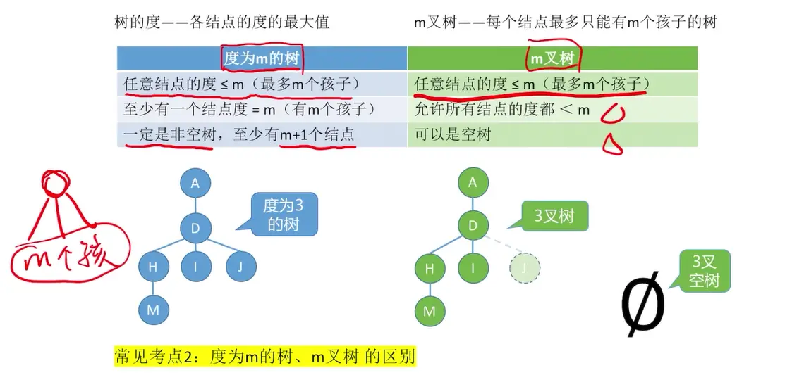
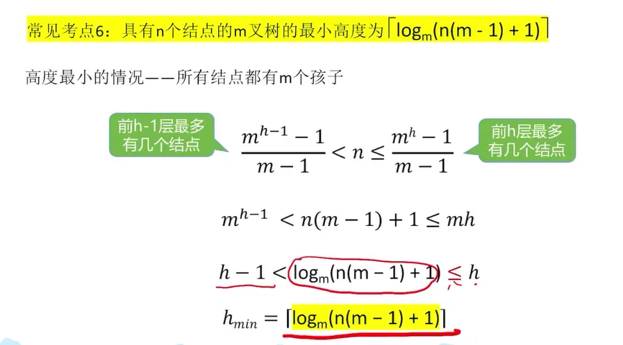
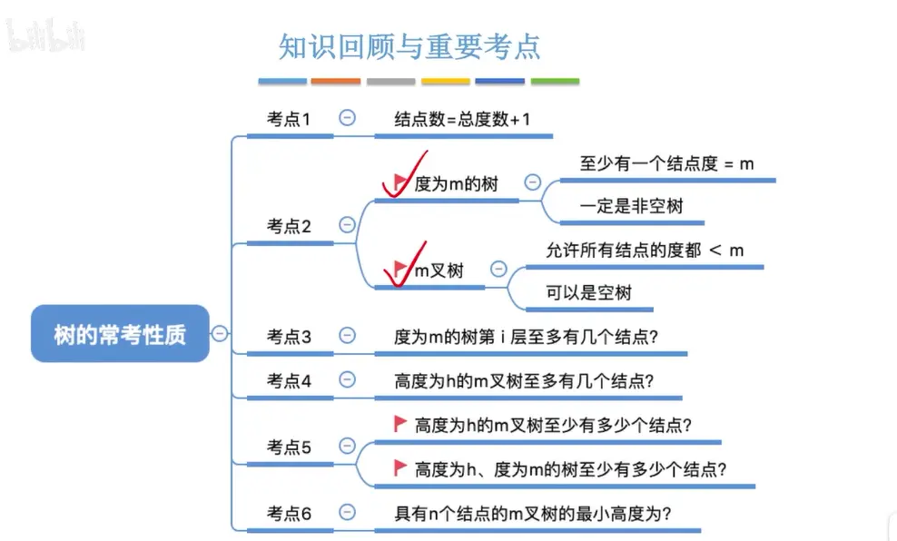

# 树的常考性质  
  

  

# 总结性质  
  

这是一份根据你提供的幻灯片内容整理的树与 $m$ 叉树核心性质总结表。为了方便对比和记忆，我将“度为 $m$ 的树”与“$m$ 叉树”的异同点进行了横向归纳：

### 树与 $m$ 叉树常见考点总结表

| **常见考点**                     | **度为 m 的树**                                        | **m 叉树**                                          |
| ---------------------------- | -------------------------------------------------- | ------------------------------------------------- |
| **基本关系**                     | 结点总数 = 总度数 + 1                                     | 结点总数 = 总度数 + 1                                    |
| **结点度数限制**                   | 任意结点度 $\le m$      **至少有一个**结点的度 $= m$ | 任意结点度 $\le m$      **允许**所有结点的度 $< m$ |
| **是否可为空树**                   | **一定是非空树**      （至少有 $m+1$ 个结点）        | **可以**是空树                                         |
| **第 $i$ 层最多结点数** ($i \ge 1$) | $m^{i-1}$                                          | $m^{i-1}$                                         |
| **高度为 $h$ 时的最多结点数**          | $\frac{m^h-1}{m-1}$                                | $\frac{m^h-1}{m-1}$                               |
| **高度为 $h$ 时的最少结点数**          | $h+m-1$                                            | $h$                                               |
| **具有 $n$ 个结点的最小高度**          | $\lceil \log_m(n(m-1)+1) \rceil$                   | $\lceil \log_m(n(m-1)+1) \rceil$                  |

### 💡 核心易错点提炼

- **概念区分**：考研或期末考试中常考的文字陷阱就在于**空树的允许度**和**最大度的约束**。“度为 $m$ 的树”是一个基于实际存在的树的**客观描述**（既然说度为 $m$，那就必须得有个结点真的有 $m$ 个孩子）；而“$m$ 叉树”是一种**结构规定**（规定最多只能有 $m$ 个分叉，但具体长出几个无所谓，甚至一棵树都没有也符合规定）。
    
- **最少结点数差异**：
    
    - ** $m$ 叉树**：高度为 $h$ 时，最极端的情况就是每一层只有一个单传结点（退化成链表），所以至少有 $h$ 个结点。
        
    - **度为 $m$ 的树**：高度为 $h$ 时，每一层至少有一个单传结点（共 $h$ 个），但因为要求必须有一个结点的度数为 $m$，所以必须再额外补齐 $m-1$ 个孩子，因此总共至少是 $h+m-1$ 个结点。