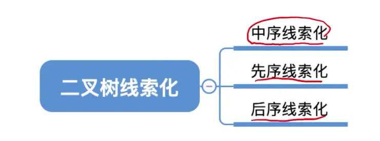
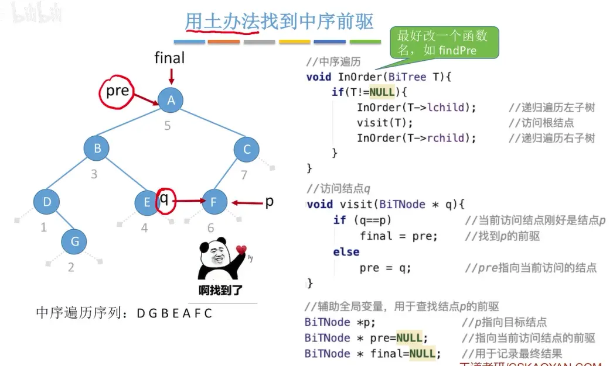
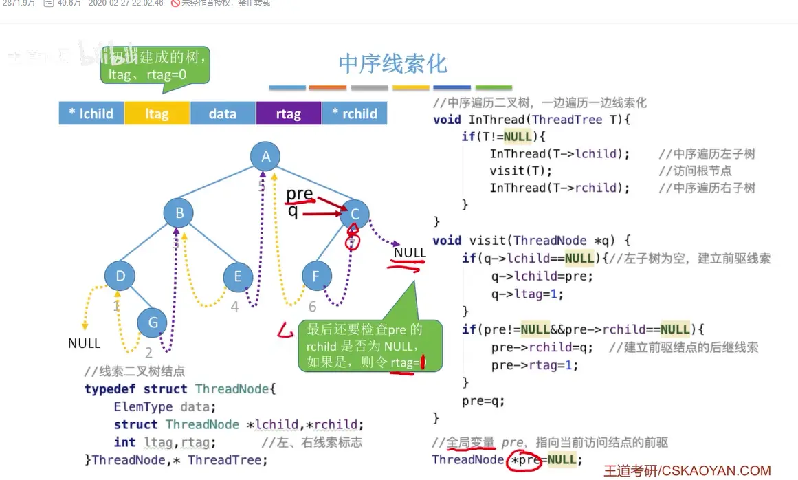
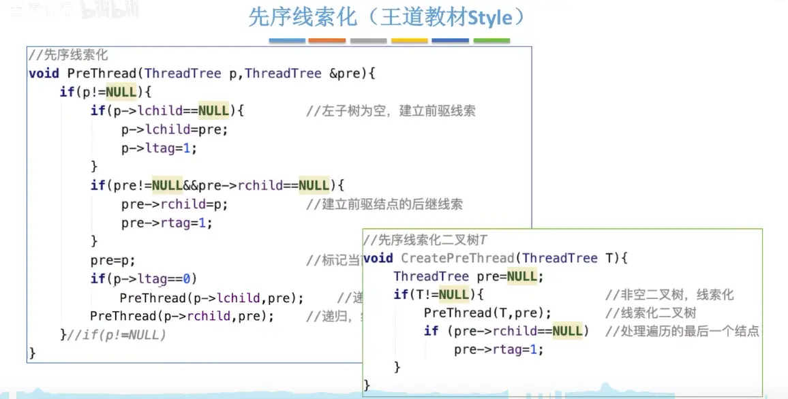
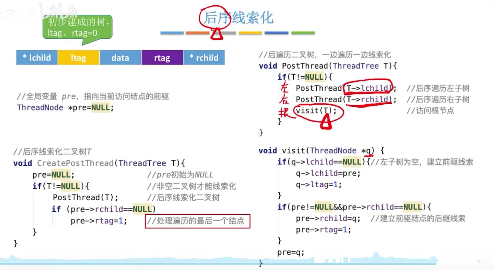
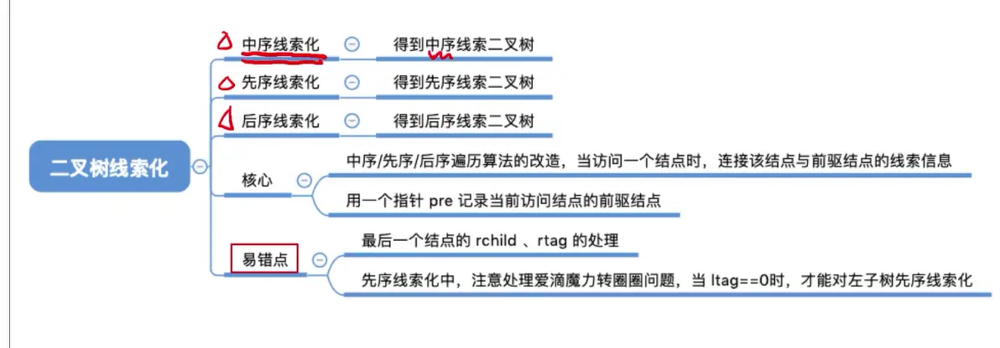

  

# 中序线索化
    
王道教材没有判断 null，直接设置为了 null，因为是中序遍历  
这是中序遍历的特性  

# 先序线索化  有循环转圈问题  

  

# 后序线索化  
  
  

# 总结  
在整棵树遍历结束时，最后一个结点 `pre` 的 `rchild` **不为 NULL 的情况，在“中序”和“前序”中是不可能发生的，只有在“后序”中才会出现！**  
后序最后的节点一定是树的根节点