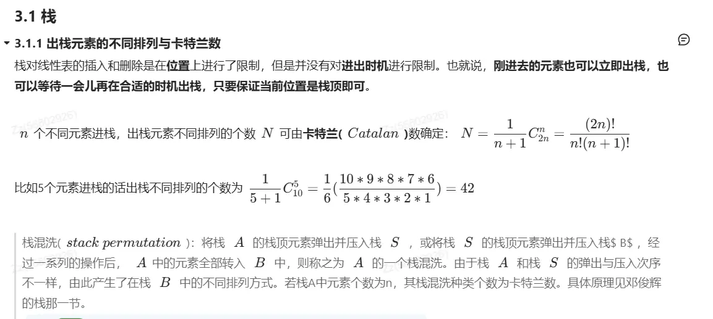
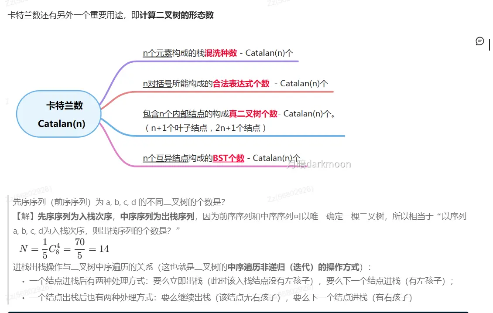

### 1. “卡特兰数”家族的绝对等价（最硬核的数学关联）

你刚才做的“判断合法出栈序列”不仅是一个验证题，它背后隐藏着一个巨大的数学同构网络。以下三个问题的**答案数值是完全相等的**，它们都服从**卡特兰数 (Catalan Number)**：

1. **栈的合法出栈序列数：** n 个元素依次进栈，有多少种合法的出栈序列？
    
2. **二叉树的形态数：** 给定 n 个结点，能构成多少种形态不同的二叉树？
    
3. **括号匹配的合法序列数：** n 对左右括号，有多少种合法的嵌套排列方式？
    

它们背后的通项公式都是：

$$C_n = \frac{1}{n+1} \binom{2n}{n}$$

**考场启发：** 如果题目问“3 个结点的二叉树有几种形态？”，你不需要去画树，直接联想“123 进栈有几种出栈可能？”（答案是 5 种），两者的底层逻辑是完全等同的。  

