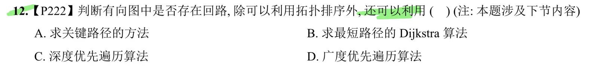

## 408 数据结构：图的回路（环）检测方法速查笔记

在图论算法中，判断是否存在回路必须严格区分**有向图**与**无向图**。不同算法的适用边界是常考陷阱。

### 一、 拓扑排序 (Topological Sort)

- **适用范围**：仅限有向图。
    
- **核心原理**：不断删除入度为 $0$ 的顶点及其发出的边。若图中存在回路，回路上所有顶点的入度永远无法减为 $0$，从而无法被输出。
    
- **判断条件**：若最终输出的顶点总数 $< n$（$n$ 为图的总顶点数），则说明原有向图中必定存在回路。
    
- **408 考点延伸**：基于 Kahn 算法（维护入度数组与队列）的拓扑排序，本质上是广度优先搜索（BFS）在有向图判环中的唯一正确应用。
    

### 二、 深度优先搜索 (DFS)

- **适用范围**：有向图、无向图均可。
    
- **核心原理与判断条件 (有向图)**：在 DFS 遍历中，若遇到一个已访问且**当前仍在递归调用栈中**的顶点（即遇到了一条指向祖先节点的“后向边/回边”），则存在回路。通常需维护一个 `onStack` 数组或通过节点状态（如 $0$ 未访问、$1$ 访问中、$2$ 已完成）来追踪。
    
- **核心原理与判断条件 (无向图)**：在 DFS 遍历中，若遇到一个已访问的顶点，且该顶点**不是当前顶点的直接前驱（父节点）**，则存在回路。
    

### 三、 并查集 (Disjoint Set/Union-Find)

- **适用范围**：仅限无向图。
    
- **核心原理**：将图的顶点看作不同的集合。遍历所有边 $(u, v)$，判断 $u$ 和 $v$ 是否属于同一集合。
    
- **判断条件**：处理边 $(u, v)$ 时，若 `Find(u)==Find(v)`（即两顶点在合并前已连通），则添加该边必定形成回路。这是 Kruskal 最小生成树算法防环的核心机制。
    
- **致命陷阱 (为何不能用于有向图)**：并查集只能维护连通性，无法维护方向性。对于有向无环图（DAG），例如存在边 $A \rightarrow B$、$A \rightarrow C$、$B \rightarrow C$。处理前两条边后 $A,B,C$ 同属一个集合，处理 $B \rightarrow C$ 时会误判为有环，但这实质上只是两条路径汇聚（交叉边），并非回路。
    

### 四、 广度优先搜索 (BFS)

- **适用范围**：无向图（常规 BFS）。
    
- **判断条件 (无向图)**：在队列层序遍历时，记录每个节点的前驱。若遍历到边 $(u, v)$ 发现 $v$ 已访问，且 $v$ 不是 $u$ 的父节点，则存在回路。
    
- **致命陷阱 (有向图)**：纯粹的普通 BFS **无法**用于有向图判环。因为它难以区分导致回路的“回边”和殊途同归的“交叉边 (Cross Edge)”。有向图中利用 BFS 判环的唯一方式是剥离入度为 $0$ 的节点，但这已等同于拓扑排序（Kahn 算法）。
    

### 五、 图论性质 (顶点与边数的度量)

- **适用范围**：无向图（常用于选择题秒杀）。
    
- **判断条件**：包含 $n$ 个顶点的无向图中，若总边数 $\vert{}E\vert{} \ge n$，则必定存在回路。
    
- **逻辑支撑**：$n$ 个顶点构成的无环连通图（树）最多有 $n-1$ 条边。边数一旦达到 $n$，必然产生回路。

### 考点核心总结表(完整版)

|**判断方法**|**适用图类型**|**判定有环的条件**|**408关联考点**|
|---|---|---|---|
|**拓扑排序**|仅有向图|输出的顶点数$<n$|AOV网,关键路径|
|**DFS**|有向/无向图|有向:遇到回边(在递归栈中的节点)      无向:遇到非父节点的已访问节点|图的遍历,连通性|
|**BFS**|仅无向图|遇到非父节点的已访问节点(有向图纯BFS失效)|图的层序遍历,最短路径|
|**并查集**|仅无向图|连边前两端点属于同一集合(`Find(u)==Find(v)`)|Kruskal最小生成树|
|**图论性质**|无向图|总边数$\vert E\vert\ge n$|树与图的性质界限|

- **致命陷阱 (有向图)**：纯粹的普通 BFS **无法**用于有向图判环。因为它难以区分导致回路的“回边”和殊途同归的“交叉边 (Cross Edge)”。有向图中利用 BFS 判环的唯一方式是剥离入度为 $0$ 的节点，但这已等同于拓扑排序（Kahn 算法）。
    

就拓补排序和 DFS 可以判断有向图 其他的都是只能无向图  

# 例题  
这张图片 `image_303784.png` 的正确答案是 **C. 深度优先遍历算法**。

在应对计算机统考的图论题目时，区分不同遍历算法在特定场景下的“边界能力”非常重要。以下是详细的选项拆解：

**为什么选 C（深度优先遍历算法）？**

在有向图的深度优先搜索（DFS）中，如果从某个顶点出发进行递归遍历，在递归返回之前（即该节点仍在当前递归调用栈中），又一次访问到了这个顶点，就说明图中存在一条指向祖先节点的“回边”（Back Edge）。**有向图中只要存在回边，就必然存在回路。** 因此，DFS 是除拓扑排序外，检测有向图环路最标准、最直接的方法。

**为什么其他选项不合适？**

- **A. 求关键路径的方法**：
    
    求关键路径（AOE 网）的前提条件是这个图**必须已经是一个有向无环图（DAG）**。实际上，在计算关键路径之前，往往需要先跑一遍拓扑排序来确保无环。如果图里有环，关键路径的推导逻辑（事件的最早/最晚发生时间）直接就崩溃了。因此它不能作为“判断”是否有环的普适方法。
    
- **B. 求最短路径的 Dijkstra 算法**：
    
    Dijkstra 算法的核心是贪心策略，用于寻找单源最短路径。它的运行机制是通过维护一个已确定最短路径的顶点集合来进行松弛操作。它并不关心图的整体结构是否存在回边，遇到环也无法直接报告“这里有一个环”，不能用于回路检测。
    
- **D. 广度优先遍历算法 (BFS)**：
    
    这是一个极易混淆的陷阱。在**无向图**中，BFS 确实可以用来判断是否有环（如果遇到已访问且不是前驱的节点，就有环）。但在**有向图**中，普通的 BFS（不统计入度）很难区分出一条边到底是导致回路的“回边”，还是仅仅是殊途同归的“交叉边”（Cross Edge）。
    
    有向图中利用 BFS 判环的唯一有效方式，就是每次寻找入度为 0 的节点并剥离——但这恰恰就是**拓扑排序**的 Kahn 算法实现！题目明确说了“除可以利用拓扑排序外”，所以纯粹的普通 BFS 不能选。