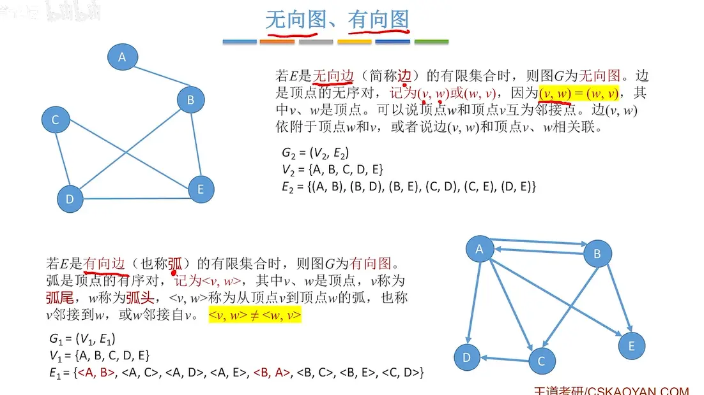
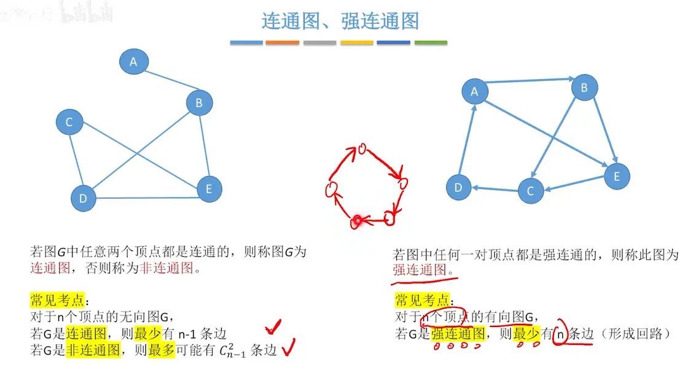
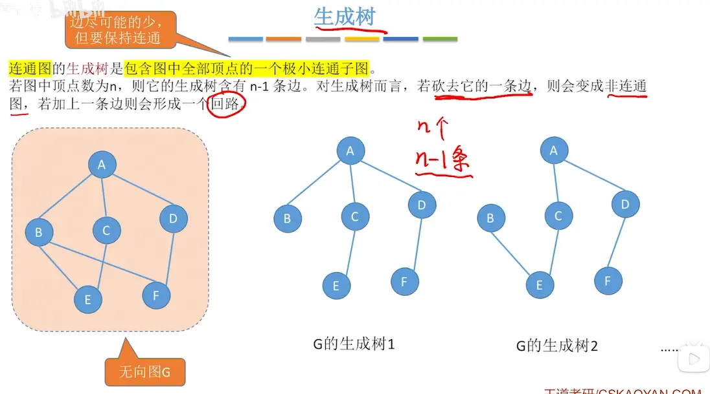
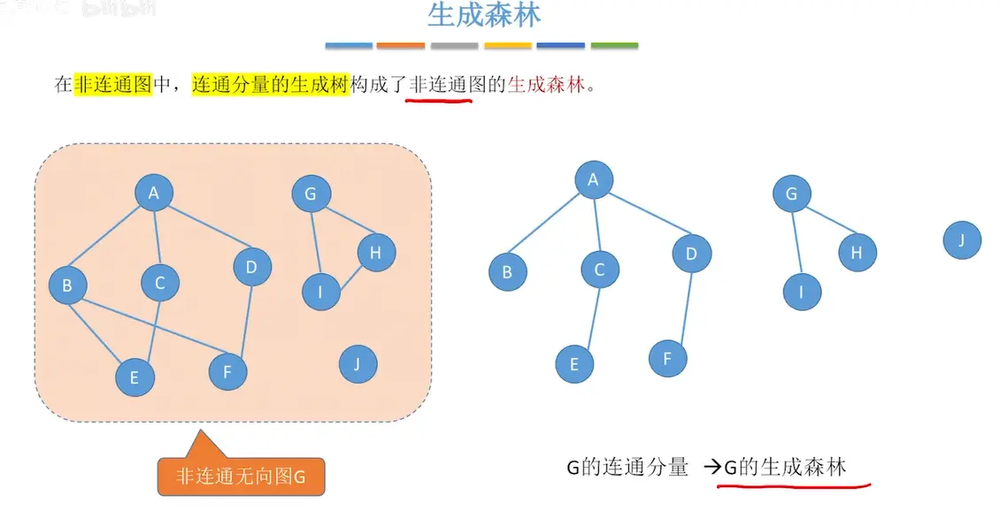
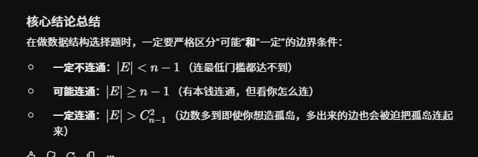

# 图的定义  
    

# 有向图 无向图  

有箭头的一边是弧头    

# 简单图 多重图  

  

# 顶点的度 入度 出度  

  

# 顶点和顶点关系描述  
  

# 连通图 强连通图  
  

# 子图  
  
有向图也同理  

# 连通分量  （无向图）
  

# 强连通分量  （有向图）  
  

# 生成树  （连通图）

  

# 生成森林（非连通分量）  
  

# 边的权、带权图、网  
  

# 几种特殊的图  
  

# 稀疏图/稠密图  
  
预制不绝对  

# 树  
  
有向树是连通的但不是强连通图  

# 总结  

可得  

这张图片 `image_228d74.png` 中总结的结论是数据结构中图论部分的经典定理。这些概念在计算机考研（尤其是 408 数据结构）的选择题中是非常高频的“挖坑”点。

要真正记住这些结论，最好的方法不是死记硬背，而是理解它们背后的**物理意义**或**极端情况的构造**。以下是对这些考点的详细拆解：

### 一、 对于 $n$ 个顶点的无向图 $G$

**1. 所有顶点的度之和 = $2\vert{}E\vert{}$ **

- **如何理解**：这就是著名的“握手定理”。每一条边（$\vert{}E\vert{}$）必然连接两个顶点。当你计算所有顶点的“度”时，每条边都会在它的两个端点处各被计算一次。因此，总度数一定是边数的两倍。
    
- **推论**：无向图中的奇数度顶点必然有偶数个（否则总和凑不出偶数）。
    

**2. 若 $G$ 是连通图，则最少有 $n-1$ 条边（树）；若 $\vert{}E\vert{} > n-1$，则一定有回路**

- **如何理解**：要把 $n$ 个原本孤立的顶点“刚刚好”连通起来，最省边的方式就是连成一棵树。一棵包含 $n$ 个节点的树，边数严格等于 $n-1$。
    
- **引申**：如果边数 $\vert{}E\vert{} > n-1$，意味着在树的基础上又强行加了边，这必然会在某两个已经连通的顶点间形成第二条路径，从而构成**回路**（环）。
    

**3. 若 $G$ 是非连通图，则最多可能有 $C_{n-1}^2$ 条边**

- **如何理解**：这是一个极其经典的极限构造题。要求图**非连通**，又要**边数最多**，你应该怎么分配顶点？
    
    - 策略是：把 $n$ 个顶点分成两部分，一部分只有 1 个孤立的顶点，另一部分有 $n-1$ 个顶点，并且让这 $n-1$ 个顶点构成一个“完全图”（内部两两相连）。
        
    - 这 $n-1$ 个顶点的完全图包含的边数就是从 $n-1$ 个点中任选 2 个点连线，即组合数 $C_{n-1}^2$ 或写作 $\frac{(n-1)(n-2)}{2}$。
        
    - （反证：如果分成 2 个和 $n-2$ 个，边数会变少，因为 $C_{n-1}^2 > C_{n-2}^2 + C_2^2$）。
        

**4. 无向完全图共有 $C_n^2$ 条边**

- **如何理解**：完全图意味着**任意两个顶点之间都有且仅有一条边**。从 $n$ 个顶点中任意选出 2 个顶点连边，利用高中排列组合知识，总边数就是 $C_n^2$ ，即 $\frac{n(n-1)}{2}$。
    

### 二、 对于 $n$ 个顶点的有向图 $G$

**1. 所有顶点的出度之和 = 入度之和 = $\vert{}E\vert{}$ **

- **如何理解**：有向图里的每一条边都有且仅有一个“起点”和一个“终点”。它为起点贡献了 1 个出度，为终点贡献了 1 个入度。所以所有边的起点数（出度之和）、终点数（入度之和）、以及边的总数（$\vert{}E\vert{}$）这三者是完全相等的。
    

**2. 所有顶点的度之和 = $2\vert{}E\vert{}$ **

- **如何理解**：在有向图中，一个顶点的“度”定义为“出度 + 入度”。既然出度之和为 $\vert{}E\vert{}$，入度之和也是 $\vert{}E\vert{}$，那把它们全加起来自然就是 $2\vert{}E\vert{}$。这和无向图的结论殊途同归。
    

**3. 若 $G$ 是强连通图，则最少有 $n$ 条边（形成回路）**

- **如何理解**：**强连通**的要求很高，要求任意两个顶点 $A$ 和 $B$ 之间，既有 $A \rightarrow B$ 的路径，也有 $B \rightarrow A$ 的路径。
    
    - 怎么用最少的边做到这一点？把所有 $n$ 个顶点串成一个大环（单向回路：$1 \rightarrow 2 \rightarrow 3 \dots \rightarrow n \rightarrow 1$）。
        
    - $n$ 个顶点构成一个环，正好需要 $n$ 条边。
        

**4. 有向完全图共有 $2C_n^2$ 条边**

- **如何理解**：有向完全图要求任意两个顶点之间，都有**方向相反的两条边**互相连接。既然无向完全图是每两点 1 条边（共 $C_n^2$ 条），那有向完全图就是每两点 2 条边，直接乘 2 即可，即 $2C_n^2$ 或写成 $n(n-1)$。