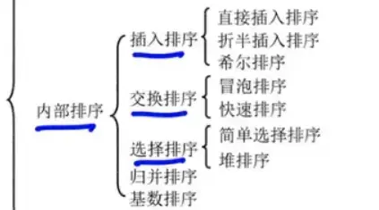
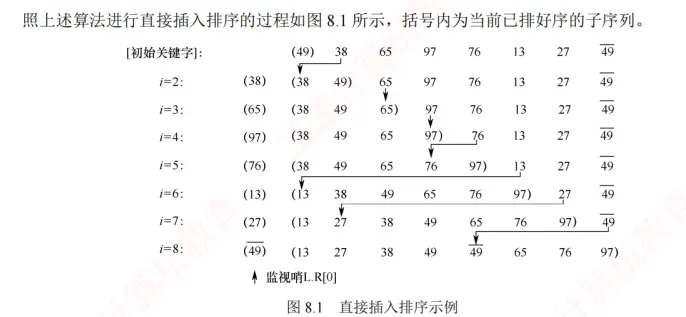
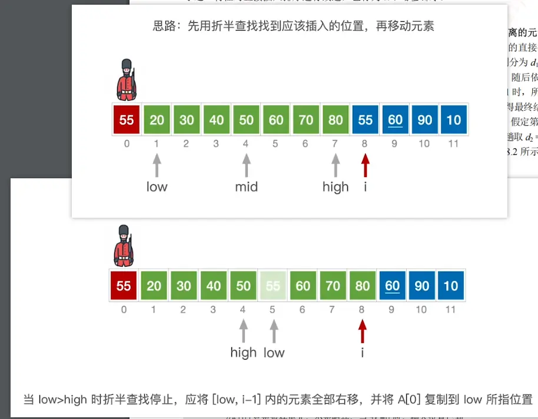
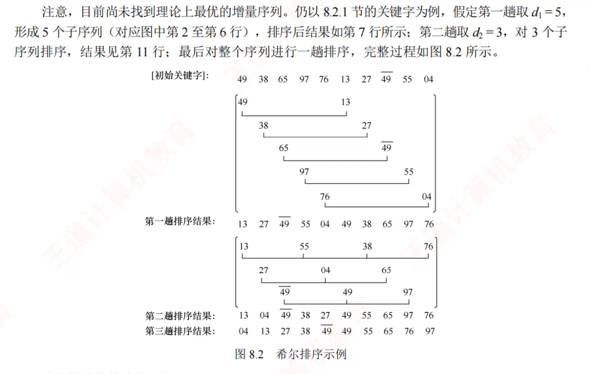
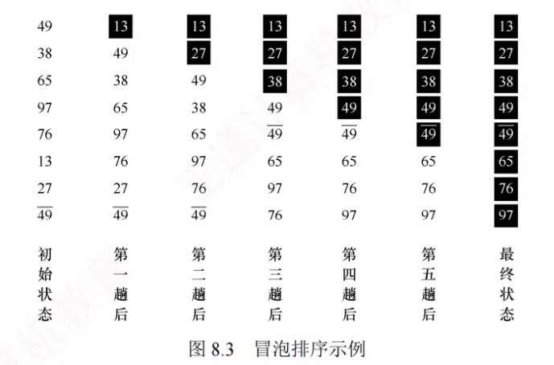
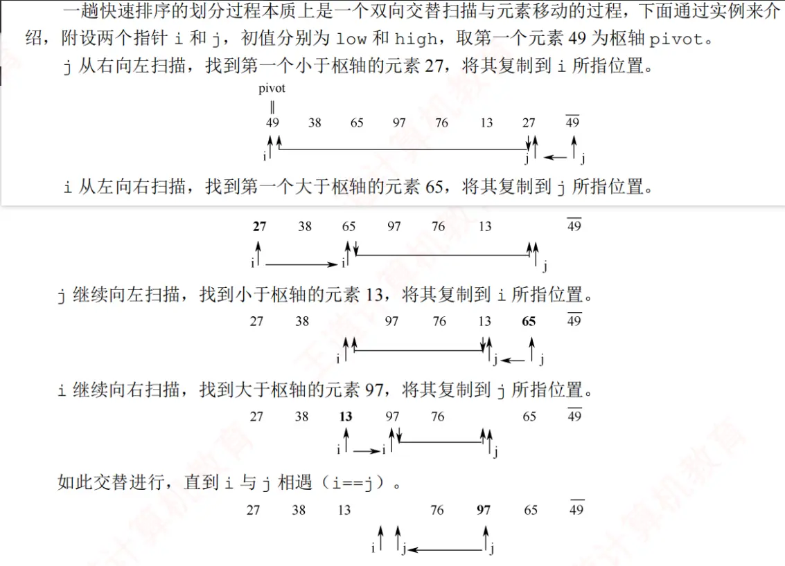
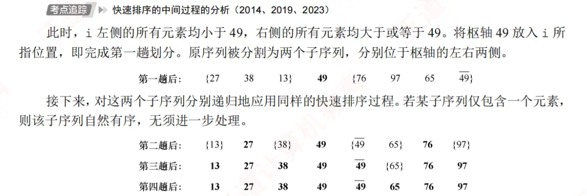

# 插入排序  
## 直接插入排序（哨兵 非哨兵   区别不大）
  

## 折半插入排序  （对前面有序的进行折半查找 确定插入位置）
  
## 希尔排序  （标记）

增量 d 的递减规则 题目会给出  当为 1 时就是整体进行插入排序
# 交换排序  
## 冒泡排序  （可以从前往后 也可以从后往前）

## 快速排序  （分治法）（标记）  
第一次
、  

左右都处理了叫一趟  
左边/右边 处理了叫一次划分
# 选择排序  
## 简单选择排序  
每次从为排序序列中选出最小的排在前面  
遍历的时候就是

## 堆排序（标记）  
# 归并排序（标记）  
# 基数排序（标记）  
# 计数排序（标记）