| **排序类别** | **算法名称** | **最好时间复杂度**   | **平均时间复杂度**    | **最坏时间复杂度**   | **空间复杂度**   | **稳定性** | **适用存储结构** |
| -------- | -------- | ------------- | -------------- | ------------- | ----------- | ------- | ---------- |
| 插入排序     | 直接插入排序   | $O(n)$        | $O(n^2)$       | $O(n^2)$      | $O(1)$      | 稳定      | 顺序表/链表     |
|          | 折半插入排序   | $O(n \log n)$ | $O(n^2)$       | $O(n^2)$      | $O(1)$      | 稳定      | 仅顺序表       |
|          | 希尔排序     | -             | 约 $O(n^{1.3})$ | $O(n^2)$      | $O(1)$      | 不稳定     | 仅顺序表       |
| 交换排序     | 冒泡排序     | $O(n)$        | $O(n^2)$       | $O(n^2)$      | $O(1)$      | 稳定      | 顺序表/链表     |
|          | 快速排序     | $O(n \log n)$ | $O(n \log n)$  | $O(n^2)$      | $O(\log n)$ | 不稳定     | 顺序表/链表     |
| 选择排序     | 简单选择排序   | $O(n^2)$      | $O(n^2)$       | $O(n^2)$      | $O(1)$      | 不稳定     | 顺序表/链表     |
|          | 堆排序      | $O(n \log n)$ | $O(n \log n)$  | $O(n \log n)$ | $O(1)$      | 不稳定     | 仅顺序表       |
| 归并排序     | 2-路归并排序  | $O(n \log n)$ | $O(n \log n)$  | $O(n \log n)$ | $O(n)$      | 稳定      | 顺序表/链表     |
| 基数排序     | 基数排序     | $O(d(n+r))$   | $O(d(n+r))$    | $O(d(n+r))$   | $O(r)$      | 稳定      | 顺序表/链表     |
**408 统考核心考点提示：**

- **必须依赖顺序表的算法（要求随机存取）：**
    
    - **折半插入排序：** 依赖二分查找，需要直接计算中间元素下标。
        
    - **希尔排序：** 依赖增量（gap）进行跳跃式访问，链表无法高效实现跨步访问。
        
    - **堆排序：** 依赖基于数组下标的完全二叉树性质（通过 $i$ 找 $2i$ 和 $2i+1$ 父子节点）。
        
- **非常适合链表实现的算法：**
    
    - **2-路归并排序：** 链表合并只需修改指针，不需要像顺序表那样额外开辟 $O(n)$ 的辅助数组，在链表上实现时空间复杂度可降至 $O(1)$。
        
    - **基数排序：** 分配和收集过程纯粹是队列的入队和出队，用链表指针串接可以完全避免大量数据的物理移动，效率极高。
        
- **快速排序的细节：** 经典快排的 Hoare 划分逻辑需要首尾双指针向中间靠拢，这在单链表上很难做；但如果采用单向遍历的 Lomuto 划分法，快排也可以在单链表上完美实现。但在一般的考题语境中，如果不加特殊说明，默认快排主要基于顺序表。

考研中的时间复杂度是指的  最坏时间复杂度  
- **不稳定**的排序算法只有四个：**快**（快速排序）、**些**（希尔排序）、**选**（简单选择排序）、**堆**（堆排序）。
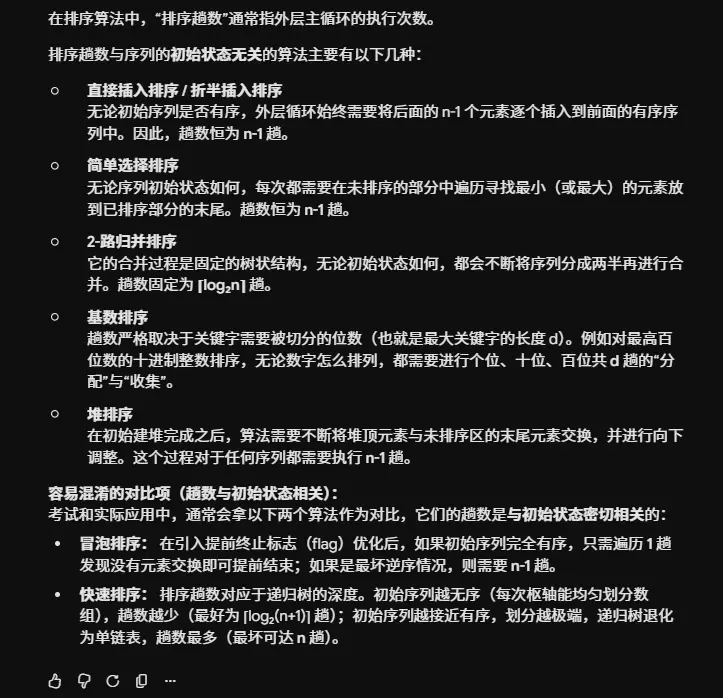

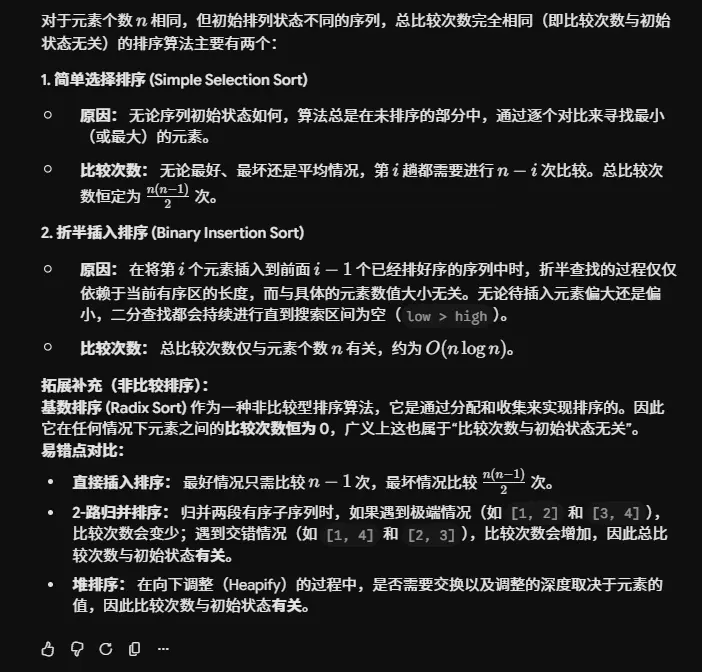
# 插入排序  
## 直接插入排序（哨兵 非哨兵   区别不大）
  

## 折半插入排序  （对前面有序的进行折半查找 确定插入位置）
  
## 希尔排序  （标记）

增量 d 的递减规则 题目会给出  当为 1 时就是整体进行插入排序
# 交换排序  
## 冒泡排序  （可以从前往后 也可以从后往前）

## 快速排序  （分治法）（标记）  
第一次
、  

左右都处理了叫一趟  
左边/右边 处理了叫一次划分  
块间有序  块内无序  
# 选择排序  
## 简单选择排序  （简单）
每次从为排序序列中选出最小的排在前面  
遍历的时候就是 int i=min（a[i]，i）  
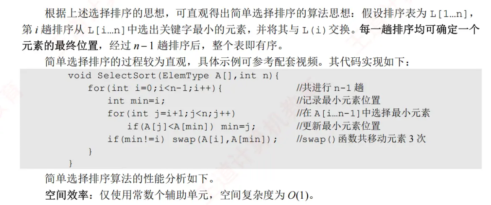
## 堆排序（标记）  
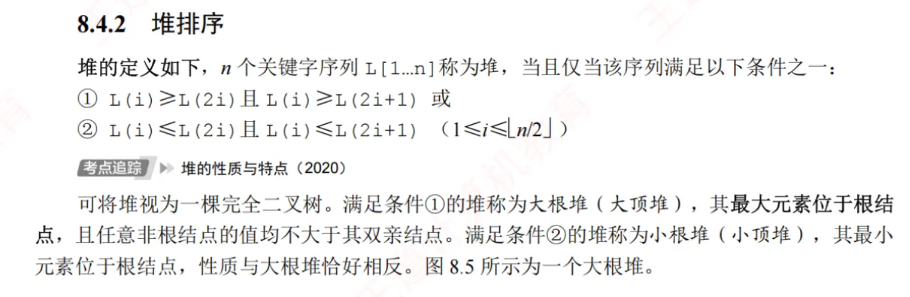
### 堆的建立  （持续下坠）
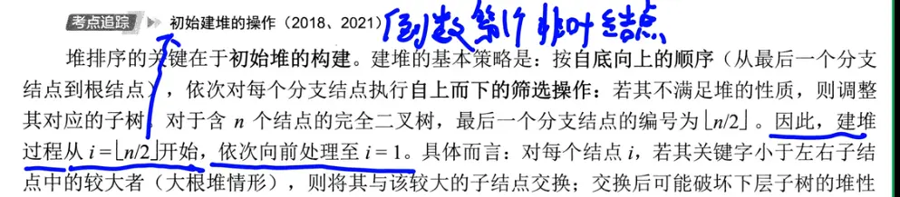
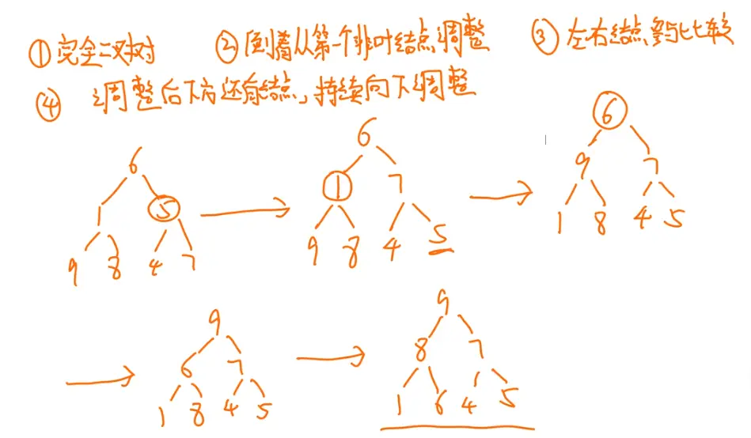
9 和 6 比 ，6 往下调整，调整后，下面还有节点，还需要判断来调整
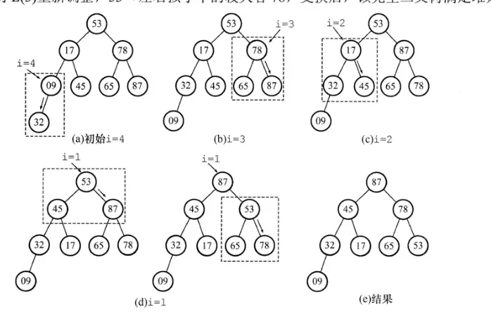
### 堆的插入   （只需要上升）
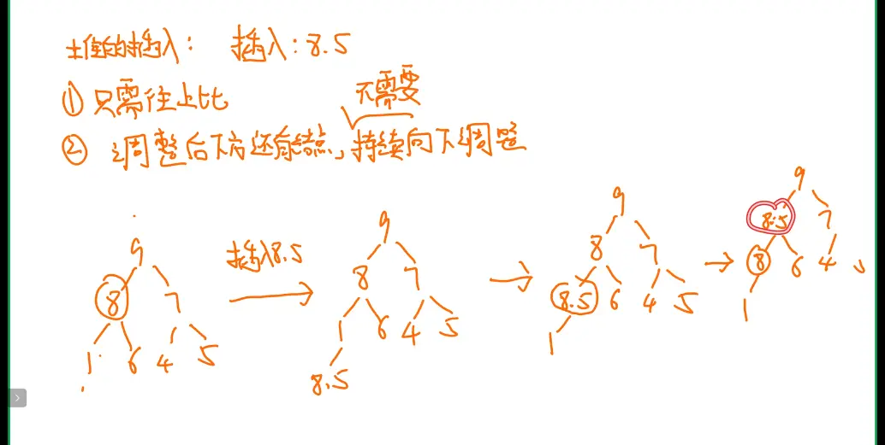
不管换不换 都需要和上面的来比    通过比较来判断换还是不换  
### 堆的删除  （持续下坠）

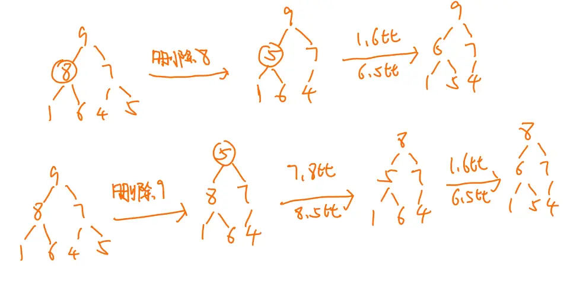
### 用堆进行排序  （不断地删除堆顶元素）  

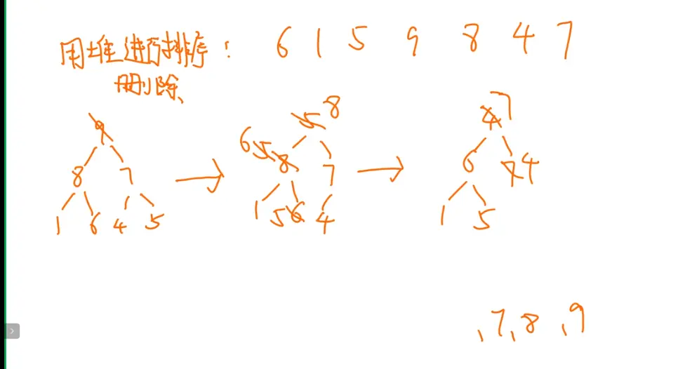

# 归并排序（标记）  
可以不止 二路
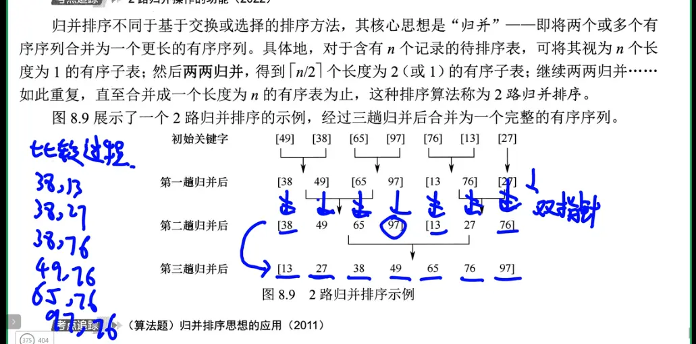  
求 归并的比较次数
# 基数排序（标记）（个十百位）  
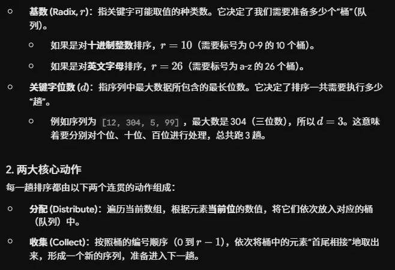  
这里的收集  直接是进行指针的拼接  

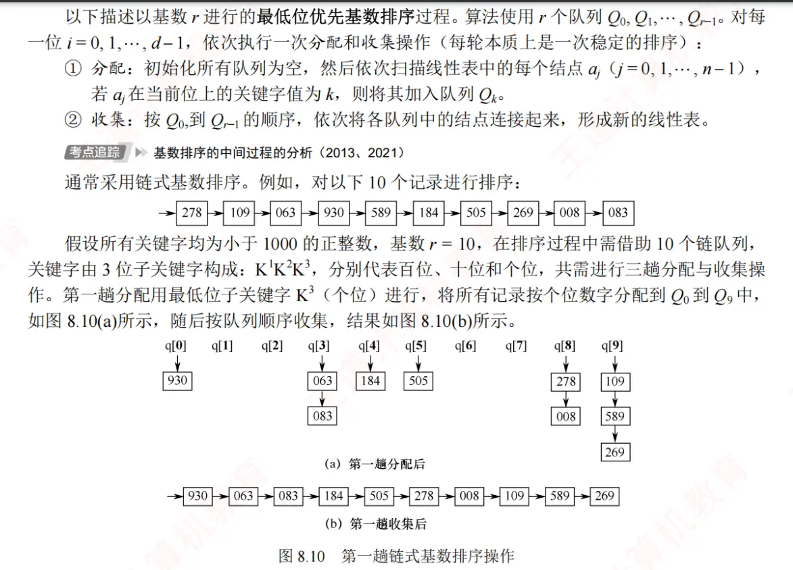
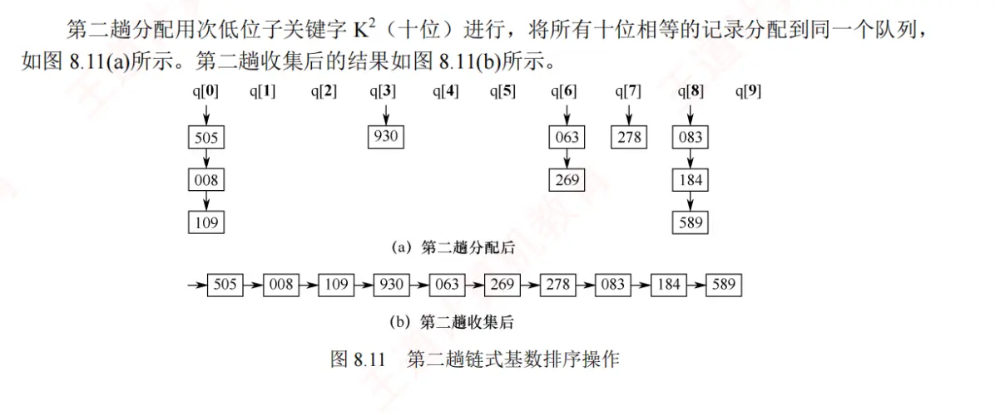
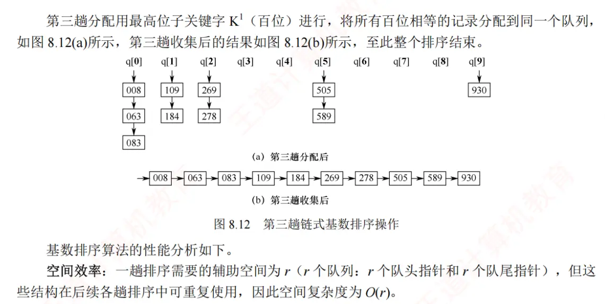
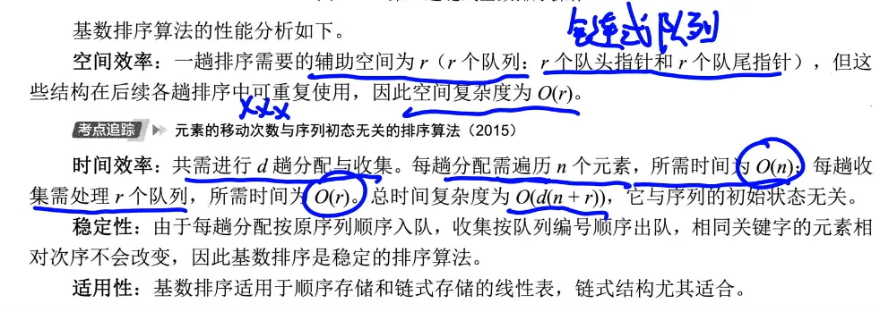  
#   计数排序（标记）  
# 适用性和特征  
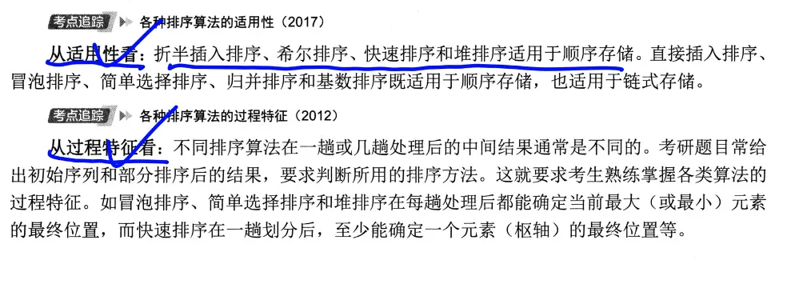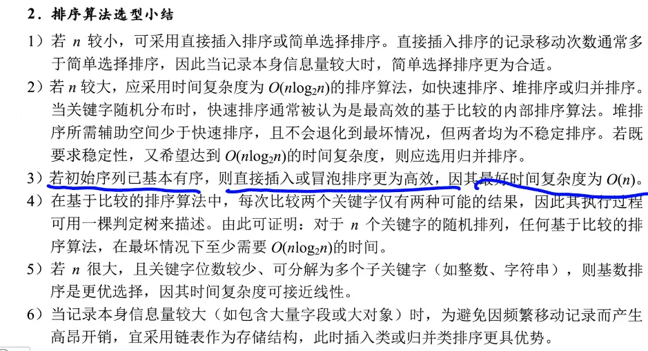  
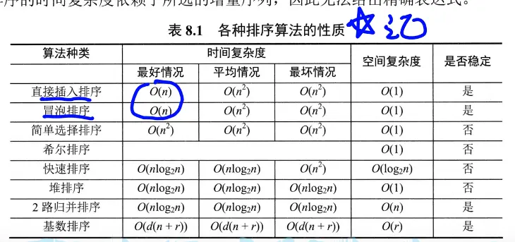