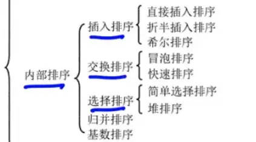

### 内部排序算法复杂度与稳定性汇总

|**排序类别**|**算法名称**|**最好时间复杂度**|**平均时间复杂度**|**最坏时间复杂度**|**空间复杂度**|**稳定性**|
|---|---|---|---|---|---|---|
|**插入排序**|直接插入排序| $O(n)$ | $O(n^2)$ | $O(n^2)$ | $O(1)$ |稳定|
||折半插入排序| $O(n \log n)$ | $O(n^2)$ | $O(n^2)$ | $O(1)$ |稳定|
||希尔排序|-|约 $O(n^{1.3})$ | $O(n^2)$ | $O(1)$ |**不稳定**|
|**交换排序**|冒泡排序| $O(n)$ | $O(n^2)$ | $O(n^2)$ | $O(1)$ |稳定|
||快速排序| $O(n \log n)$ | $O(n \log n)$ | $O(n^2)$ | $O(\log n)$ |**不稳定**|
|**选择排序**|简单选择排序| $O(n^2)$ | $O(n^2)$ | $O(n^2)$ | $O(1)$ |**不稳定**|
||堆排序| $O(n \log n)$ | $O(n \log n)$ | $O(n \log n)$ | $O(1)$ |**不稳定**|
|**归并排序**|2-路归并排序| $O(n \log n)$ | $O(n \log n)$ | $O(n \log n)$ | $O(n)$ |稳定|
|**基数排序**|基数排序| $O(d(n+r))$ | $O(d(n+r))$ | $O(d(n+r))$ | $O(r)$ |稳定|

### 空间复杂度核心考点说明

绝大多数就地排序算法的空间复杂度都是 $O(1)$，你只需要重点记住以下**三个特例**：

1. **快速排序：$O(\log n)$ **
    
    - 快排本身没有额外开辟数组，但它是基于递归实现的。递归执行时系统需要开辟**工作栈**来保存每层递归的参数。
        
    - **最好/平均情况**：递归树的深度为 $\log n$，空间复杂度为 $O(\log n)$。
        
    - **最坏情况**：数组初始已有序，递归树退化成单链表，空间复杂度骤增至 $O(n)$。
        
2. **2-路归并排序：$O(n)$ **
    
    - 归并排序在将两个有序子序列合并为一个时，必须借助一个与原数组大小完全相同的**辅助数组**来暂存合并过程中的数据。因此空间开销是所有排序中最大的。
        
3. **基数排序：$O(r)$ **
    
    - 不需要辅助数组，但在“分配”和“收集”的过程中，需要用到 $r$ 个队列（例如十进制就是 10 个桶）。这就需要 $r$ 个头指针和 $r$ 个尾指针，因此空间复杂度为 $O(r)$。
### 核心考点补充说明

**1. 复杂度的特殊情况**

- **折半插入排序**：虽然通过二分查找将比较次数降到了 $O(n \log n)$，但元素的**移动次数**并没有改变，因此整体的时间复杂度依然是 $O(n^2)$。
    
- **快速排序**：平均情况下最快的内部排序算法。当数组初始状态为**完全有序或逆序**时，时间复杂度会退化到最坏情况 $O(n^2)$。
    
- **基数排序**：公式中的 $d$ 代表关键字的位数（分配和收集的趟数），$r$ 代表关键字的基数（例如十进制数字 $r=10$），$n$ 代表元素个数。它不基于比较，因此突破了比较排序 $O(n \log n)$ 的理论下限。
    

**2. 稳定性的记忆口诀**

- **不稳定**的排序算法只有四个：**快**（快速排序）、**些**（希尔排序）、**选**（简单选择排序）、**堆**（堆排序）。
    
- 其余的算法（直接插入、折半插入、冒泡、归并、基数）均是**稳定**的。

以下是这 9 种内部排序算法的核心执行流程简述，语言按照 408 考研数据结构的标准术语进行了精简，适合复习背诵：

### 插入排序类

- **直接插入排序 (Straight Insertion Sort)**
    
    将数组分为“已排序”和“待排序”两部分。每次取待排序部分的第一个元素，从后向前扫描已排序部分，找到合适的位置并将其插入，直到所有元素插入完毕。
    
- **折半插入排序 (Binary Insertion Sort)**
    
    流程与直接插入排序基本一致。区别在于，寻找插入位置时不再是从后向前顺序查找，而是利用二分查找（折半查找）在已排序区间内快速定位插入点，然后再统一移动元素并插入。
    
- **希尔排序 (Shell Sort)**
    
    又称缩小增量排序。选取一个增量步长 $d$（逐渐缩小至 1），将整个数组分割成若干个相距为 $d$ 的子序列。对每个子序列分别进行直接插入排序。随着步长 $d$ 的缩小，数组越来越接近宏观有序，最后当 $d=1$ 时进行一次全局微调即可完成排序。
    

### 交换排序类

- **冒泡排序 (Bubble Sort)**
    
    从前向后两两比较相邻元素，如果逆序则交换它们的位置。每一趟遍历都会把当前未排序部分的最大值（或最小值）像气泡一样“浮”到序列的末尾。重复此过程，直到某一趟遍历没有任何元素发生交换为止。
    
- **快速排序 (Quick Sort)**
    
    基于**分治法**。在数组中任选一个基准元素（通常是第一个），通过一趟划分（Partition）将数组分成独立的两部分：左边所有元素都小于基准，右边所有元素都大于基准，基准元素因此被放到了最终的确切位置。然后递归地对左右两部分分别执行该过程。
    

### 选择排序类

- **简单选择排序 (Simple Selection Sort)**
    
    将数组分为“已排序”和“待排序”两部分。每一趟在待排序部分中顺序扫描，选出最小（或最大）的元素，将它与待排序部分的第一个元素进行交换。重复此过程直到只剩一个元素。
    
- **堆排序 (Heap Sort)**
    
    将数组初始序列构造成一个大顶堆（或小顶堆）。此时，整个序列的最大值就是堆顶的根节点。将堆顶元素与数组末尾元素交换，然后将剩余的 $n-1$ 个元素重新调整为大顶堆。重复执行“交换-调整”过程，直到堆中仅剩 1 个元素。
    

### 归并排序类

- **2-路归并排序 (Merge Sort)**
    
    同样基于**分治法**。将长度为 $n$ 的数组不断地二分拆解，直到每个子序列只包含 1 个元素（天然有序）。然后两两进行合并，把两个有序的子序列合并成一个更大的有序序列，层层向上归并，最终得到完全有序的数组。
    

### 基数排序类

- **基数排序 (Radix Sort)**
    
    不基于比较，而是基于**分配与收集**。以十进制数字为例，先建立 10 个队列（0-9 号桶）。从数字的个位开始，根据个位数值将元素“分配”入桶，再按 0-9 的顺序将元素“收集”倒出。接着按十位、百位重复分配与收集的过程，直到最高位处理完毕，序列即为最终有序状态。