# B 树的插入
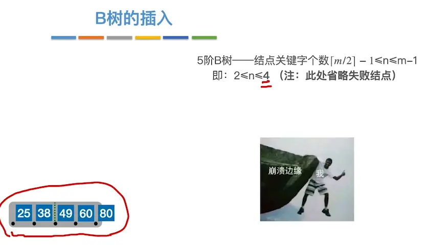

## 分裂 1
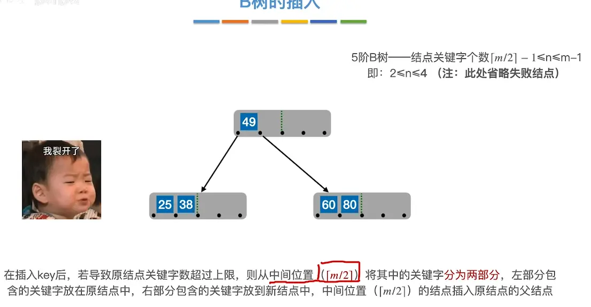

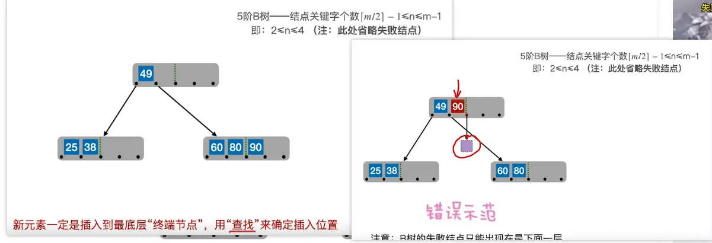  
## 分裂 2
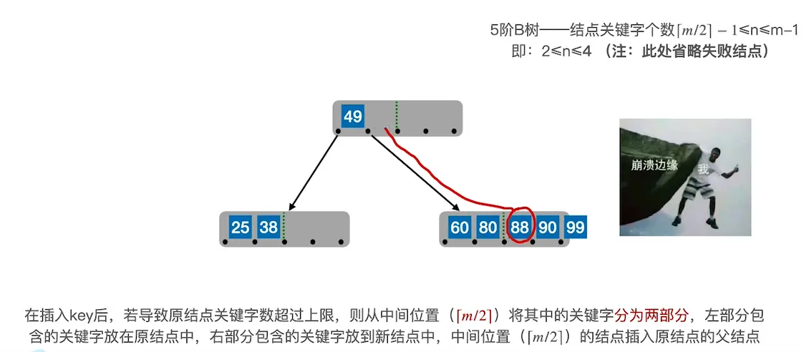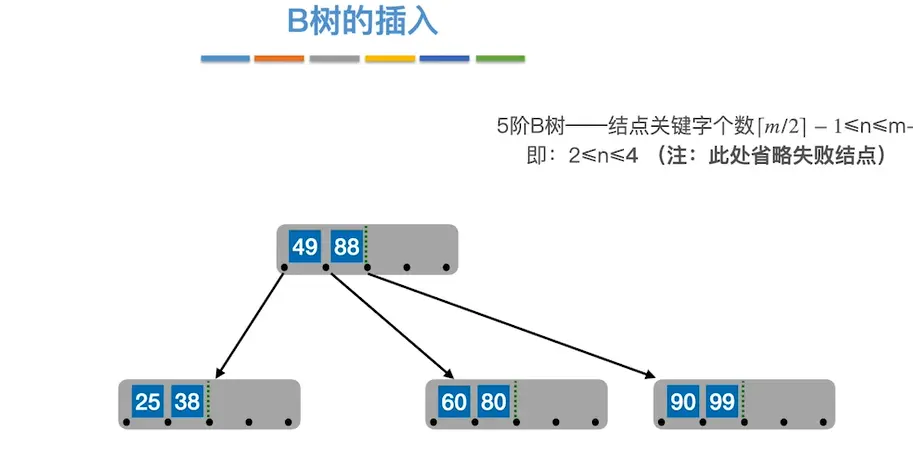  

## 分裂 3  
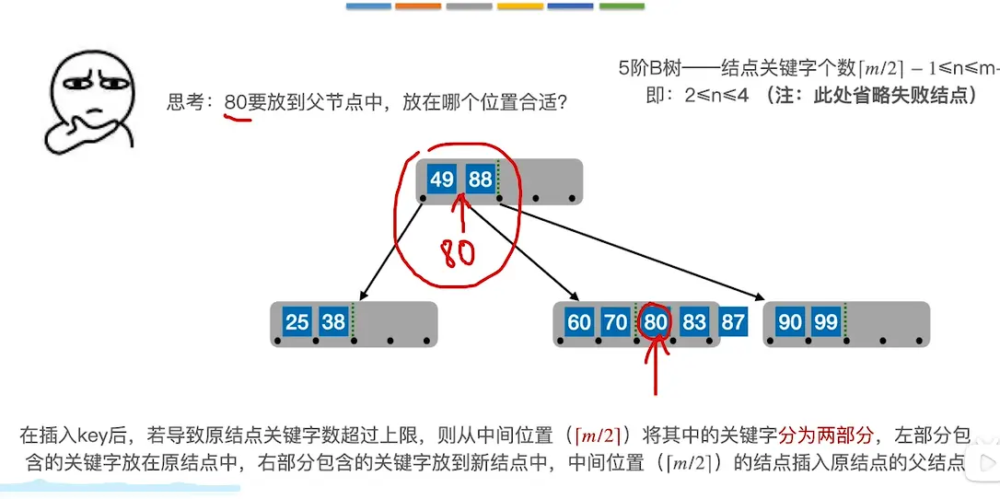  

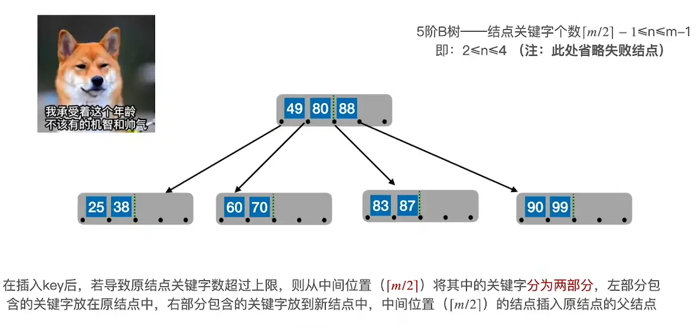  

## 分裂 4  
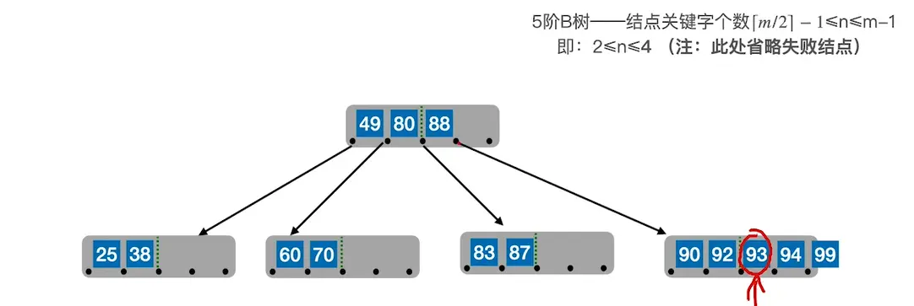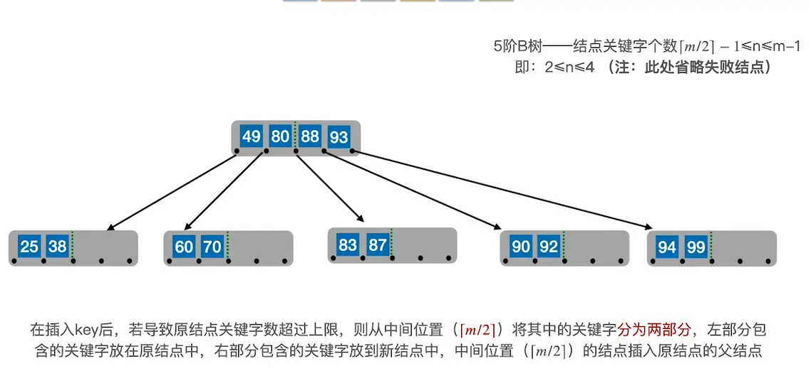  

# 分裂 5（父节点的关键字个数也超出上限）  

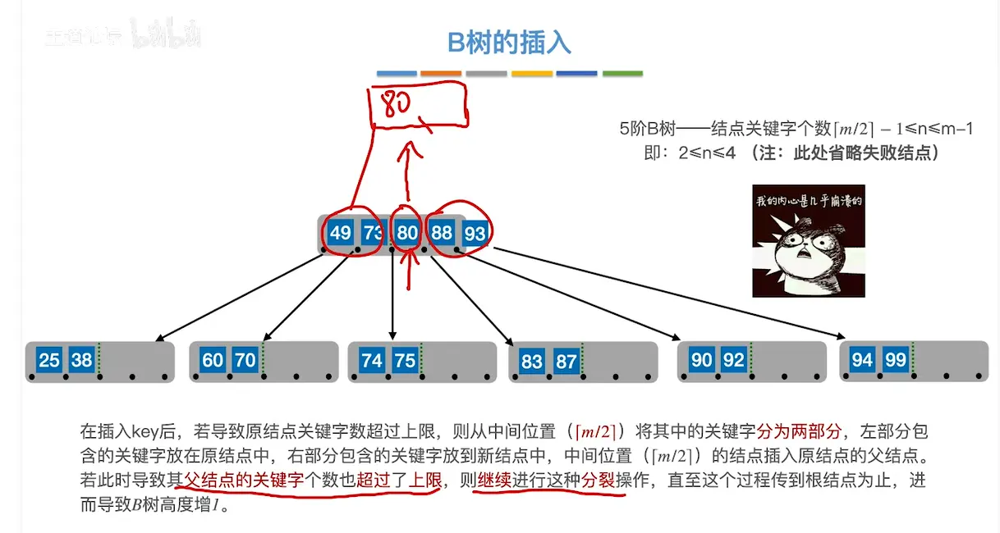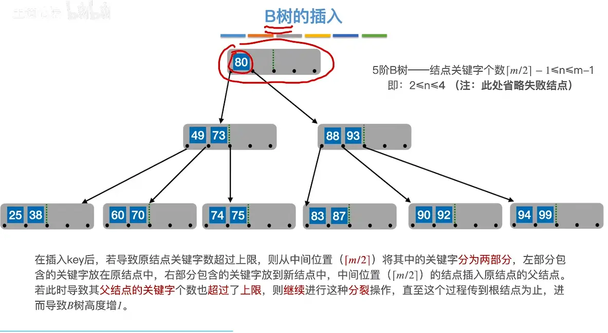 根节点可以只有一个节点  

## 插入总结
  
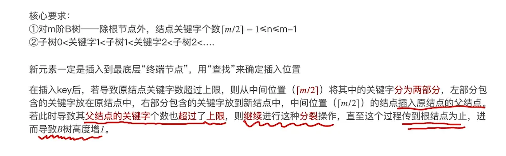  

# B 树的删除  

## 终端节点  （删除后不低于下限的情况）
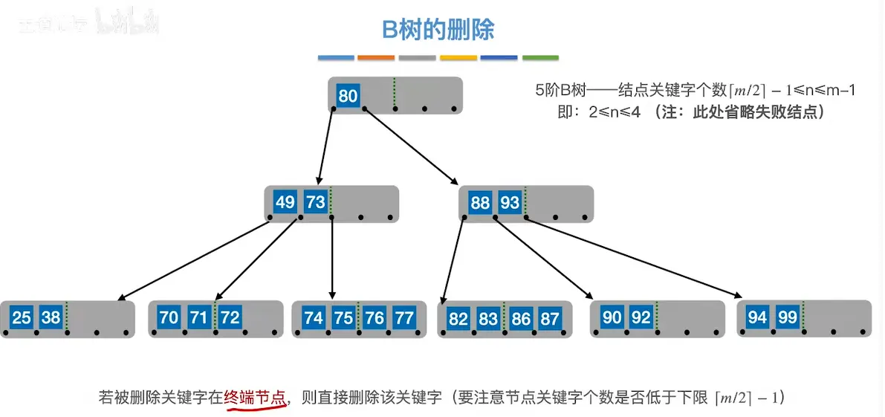  

## 非终端节点 

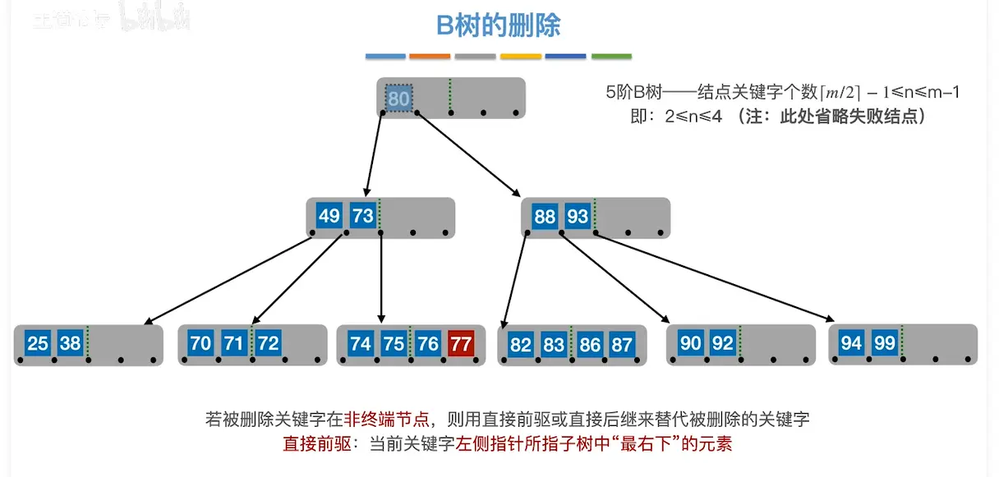  
（将非终端转换为终端的操作   直接前驱为左子树的最右端的节点）  
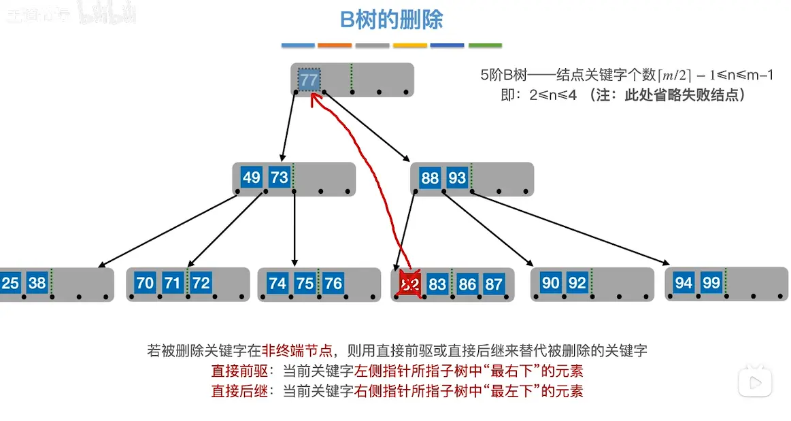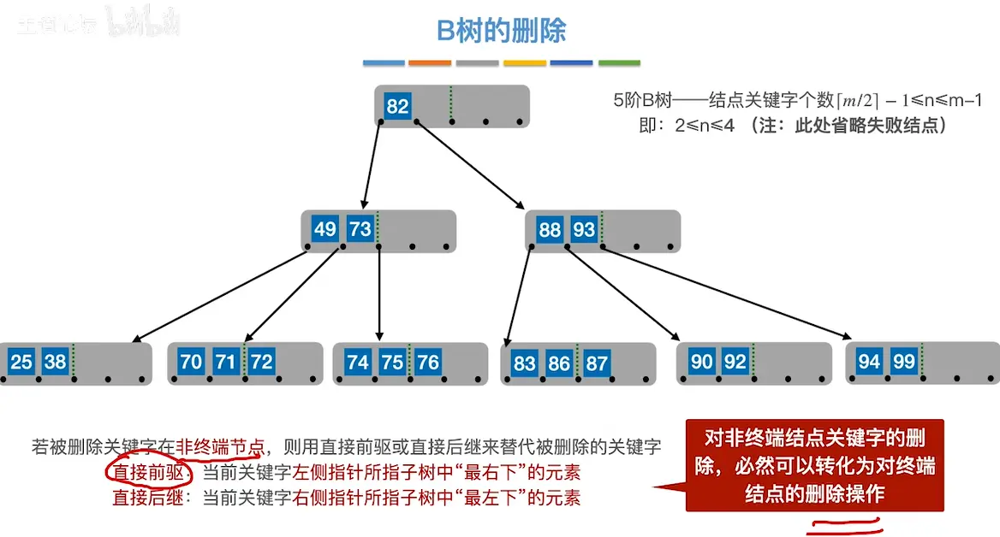  

## 终端节点（删除后低于下限了）  

## 借右兄弟
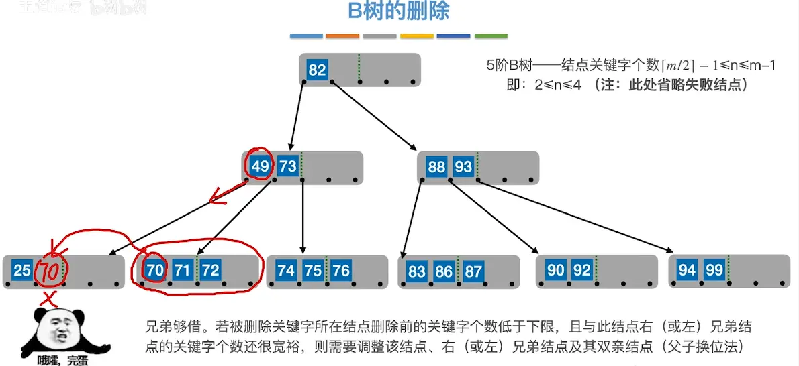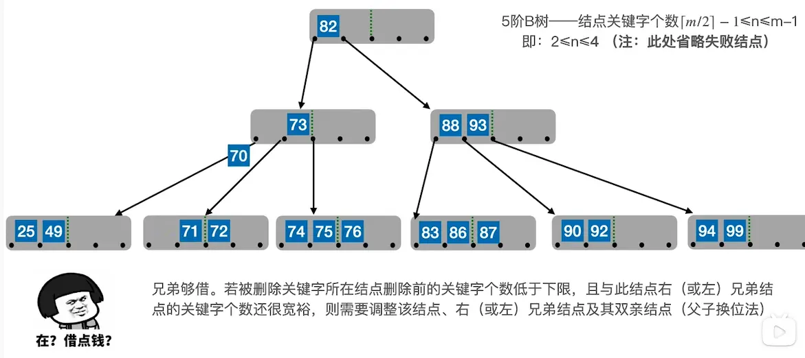  
## 借左兄弟  

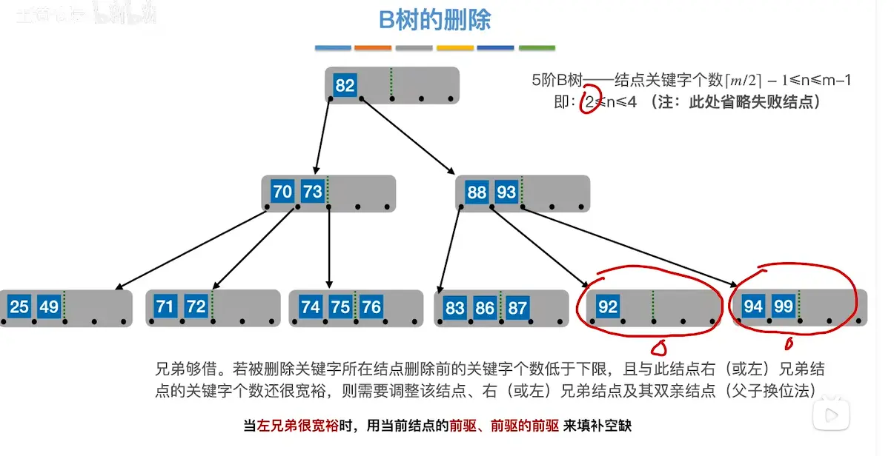