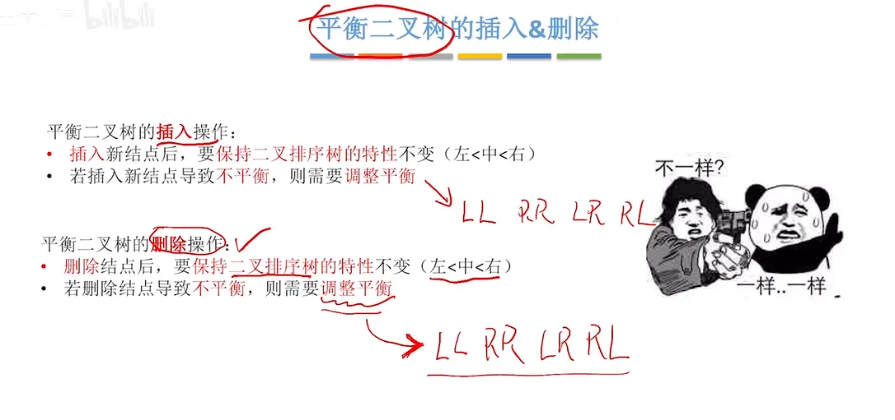  

# 删除流程  
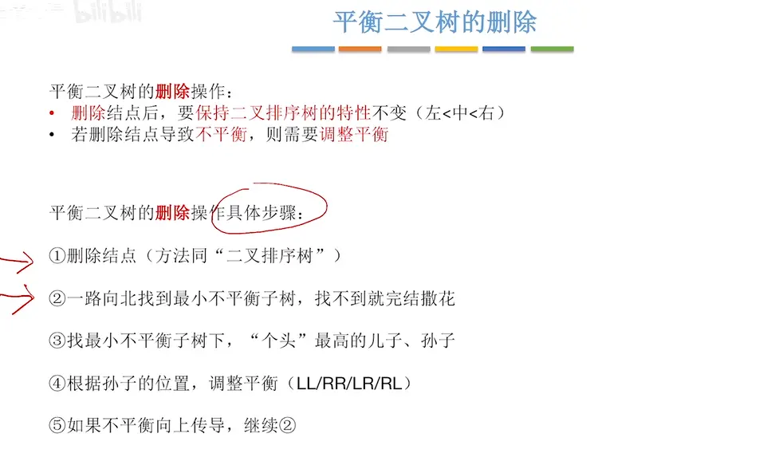  

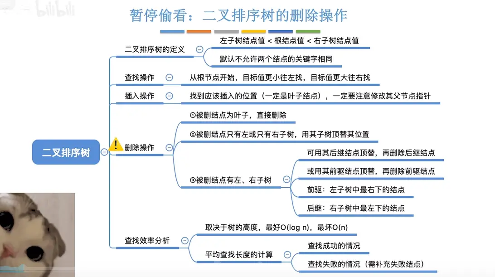  

# 不需要处理的情况 （叶子节点）
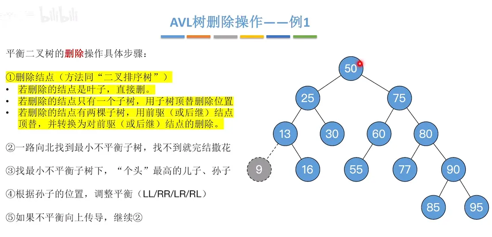  
没有不平衡的情况

# 一次旋转 不平衡向上传导 （叶子节点）

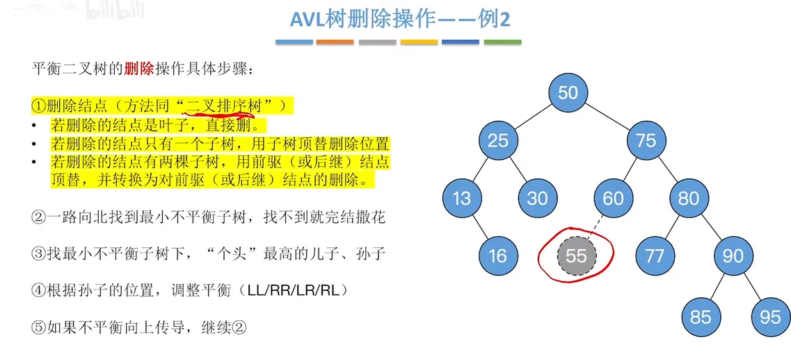  

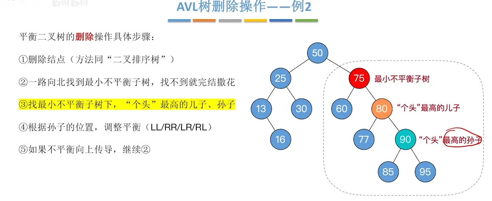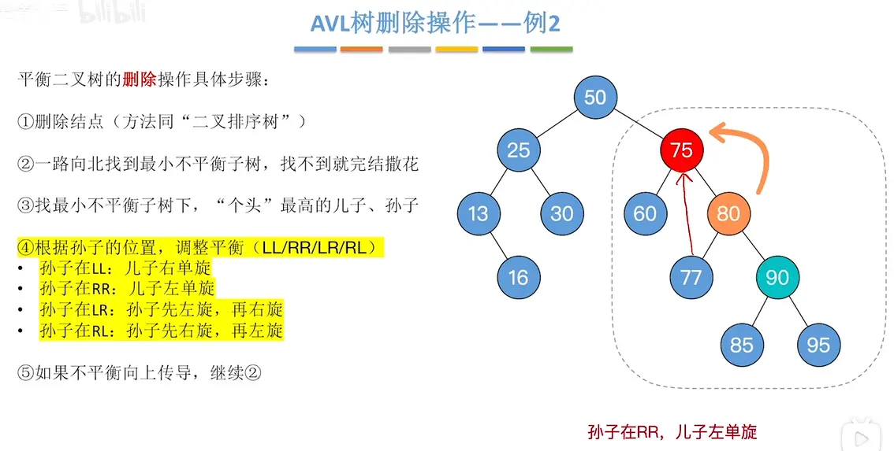  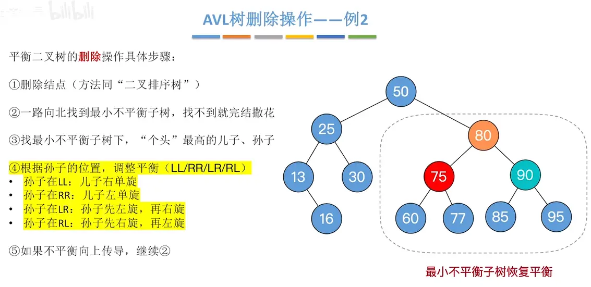  旋转后的操作 会导致高度的变化 可能导致平衡向上传导    在这个例子中没有  

# 两次旋转  不平衡没有向上传导  

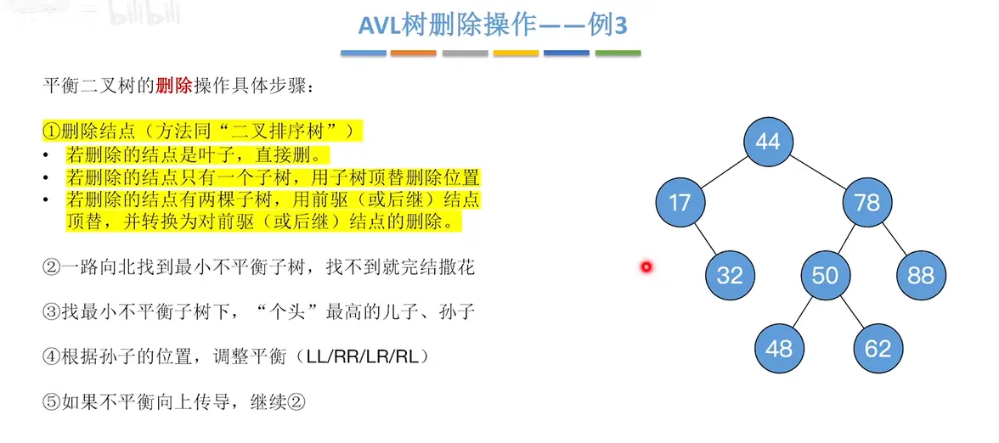  

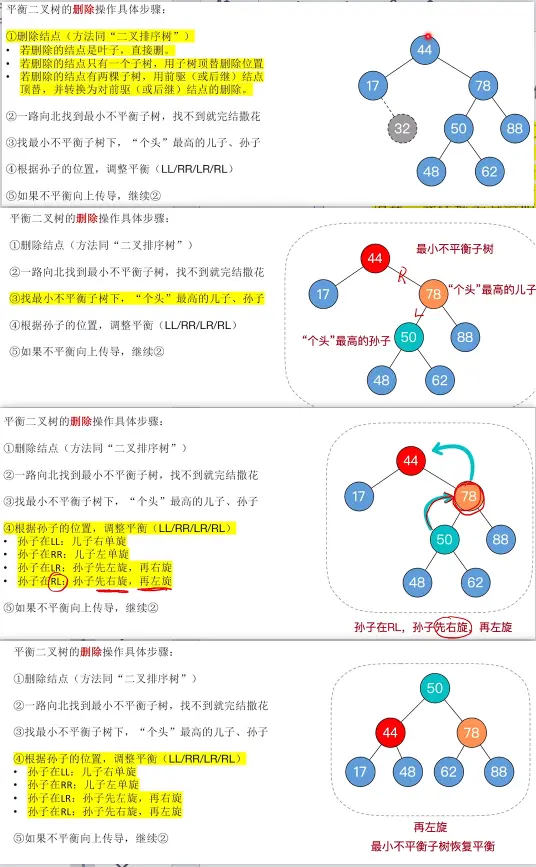  

# 不平衡向上传导  

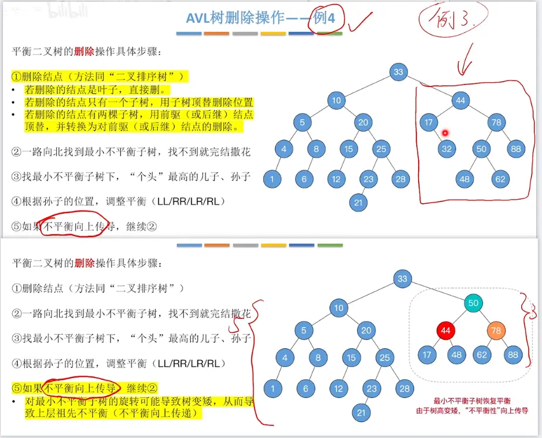  
删除的是 32 这个节点    不平衡向上传导了  回到 2 步骤  

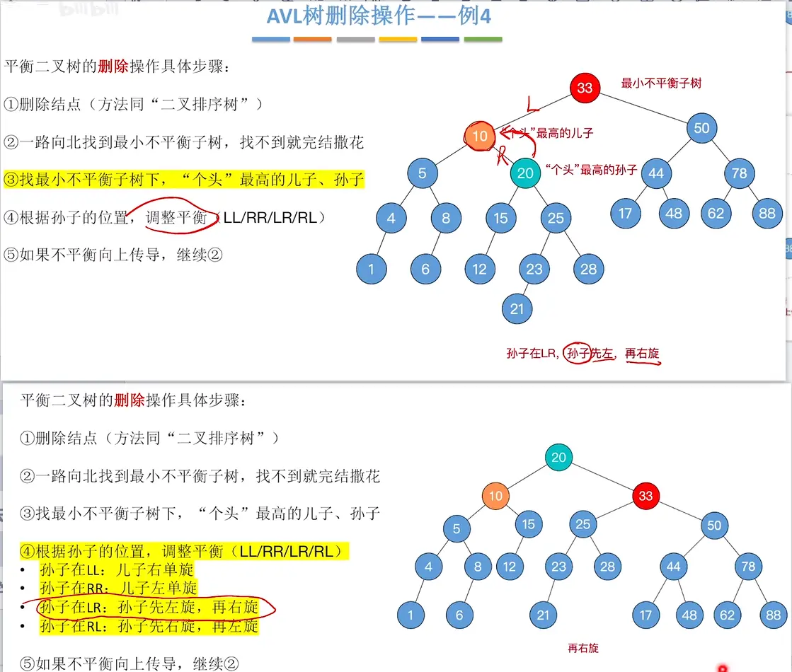

# 删除的不是叶子节点  
