# 1速率  
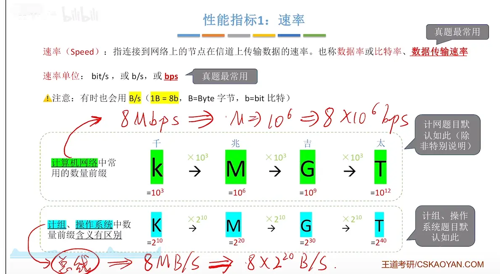  

# 2带宽  
  

# 节点通信实际达到的最高速率由两者共同实现  
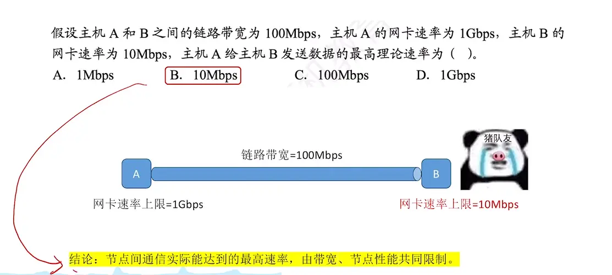  

# 带宽的另外一种含义  
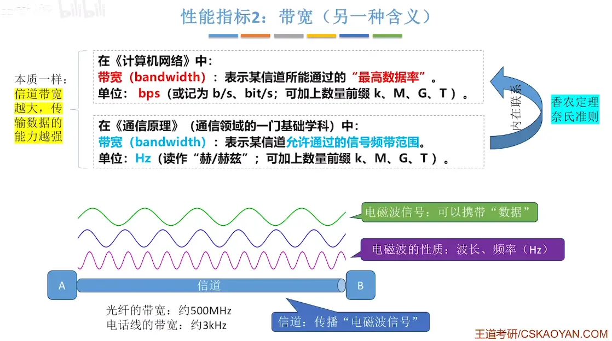  
**可用 Hz 越多 $\rightarrow$ 物理波形切换得越快（周期越密集） $\rightarrow$ 每秒能发送的码元就越多 $\rightarrow$ 最终能换算出的比特率（bps）就越高。** 这正是通信原理和计算机网络物理层中最核心的底层逻辑。
#  3吞吐量  （了解即可）
  

# 4时延  
考试中一般不考虑  处理时延 和排队时延
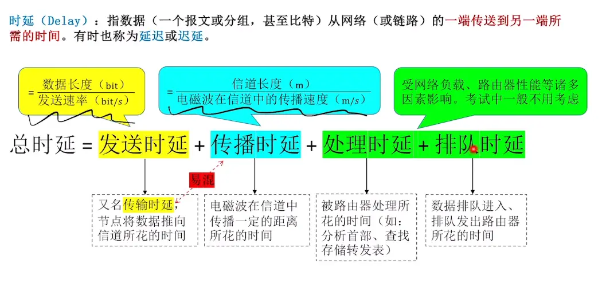
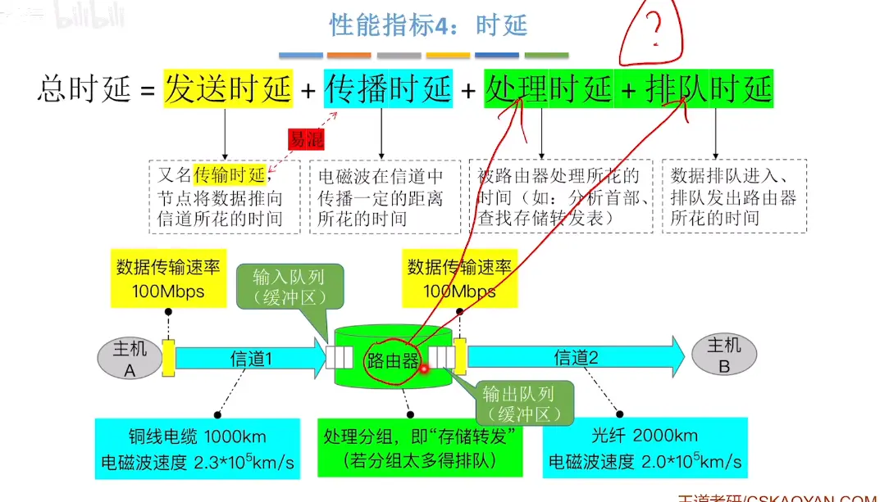
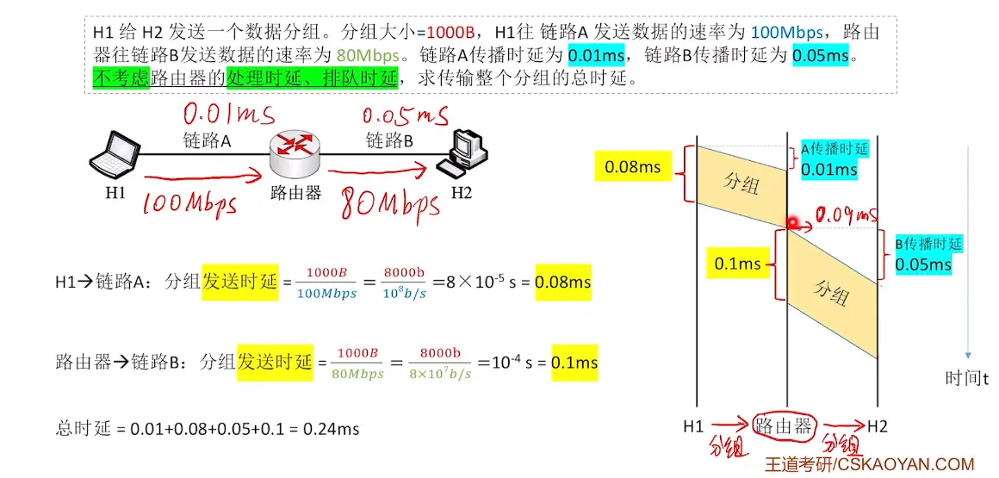

# 5时延带宽积  （只考了一次）
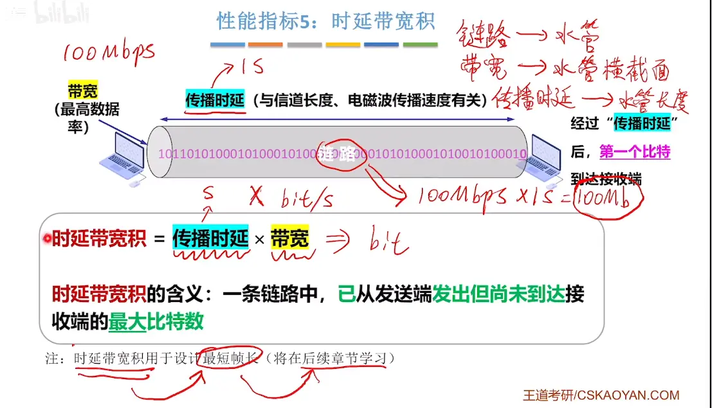  

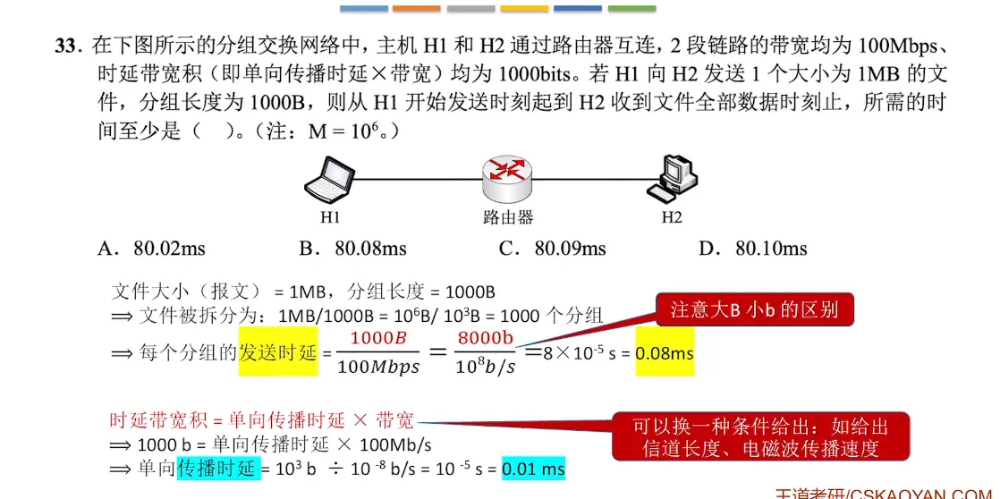  

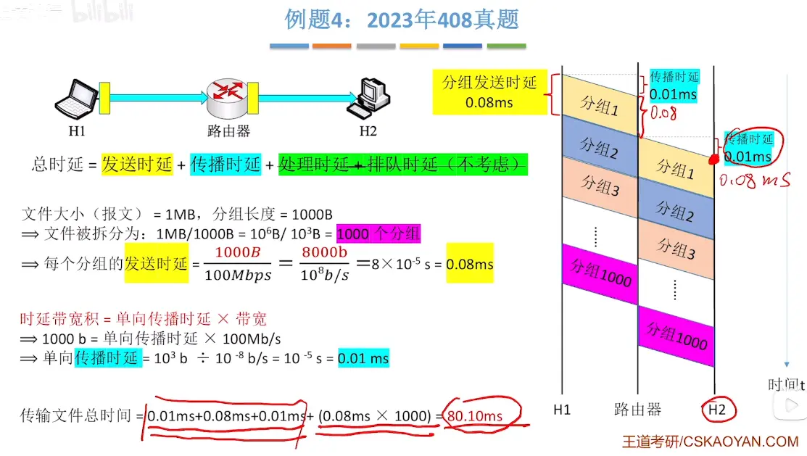

  
# 6往返时延  

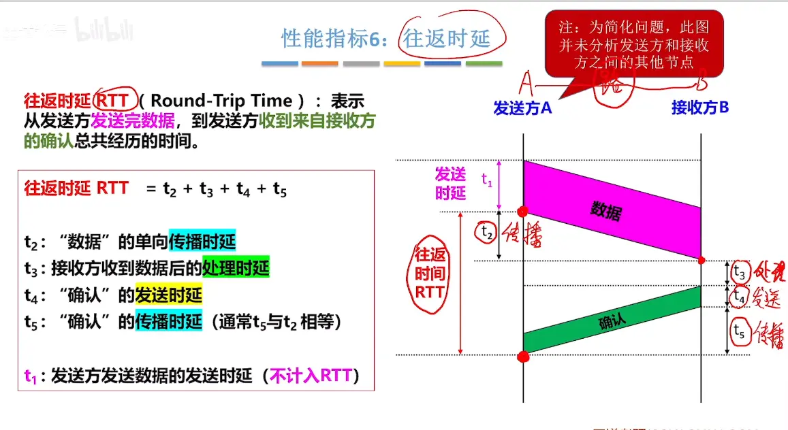
游戏延迟

# 7信道利用率  

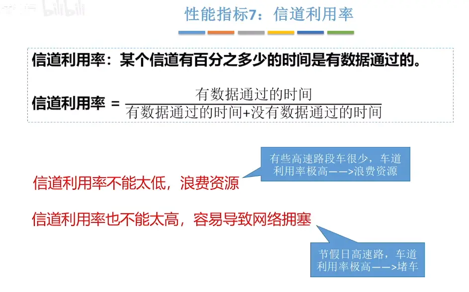

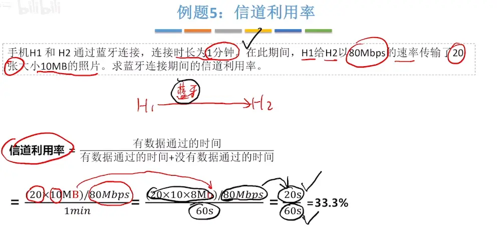

# 总结  （发送和传播时延重点）
  
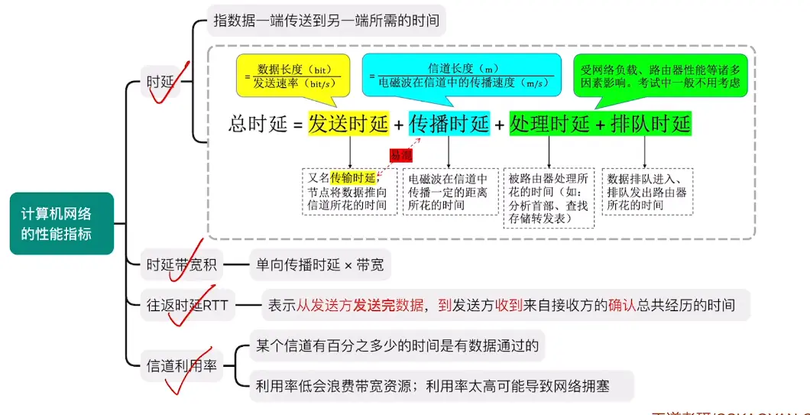