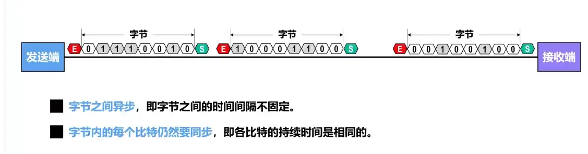

  
网卡的串并转换
并行传输：多条线同时传多个比特，短距离速度快；但长线时，线之间干扰、时延差异（串扰 / 歪斜）严重，成本高。串行传输：单条（一对）线逐比特传输，规避并行的信号同步问题，长距离更稳定、布线成本低。  

  曼彻斯特编码具有  自同步能力  

**异步传输：**以字符为传输单位，在每个字符前后添加起始位、停止位实现同步。字符间隔不固定，收发时钟不需要长期同步，开销大，效率低，适合低速通信。

**同步传输：**以数据块（帧）为单位，收发双方时钟保持同步，帧前设置同步标志，连续传输比特流，无需字符级起止位，开销小，传输效率高，用于高速通信。

