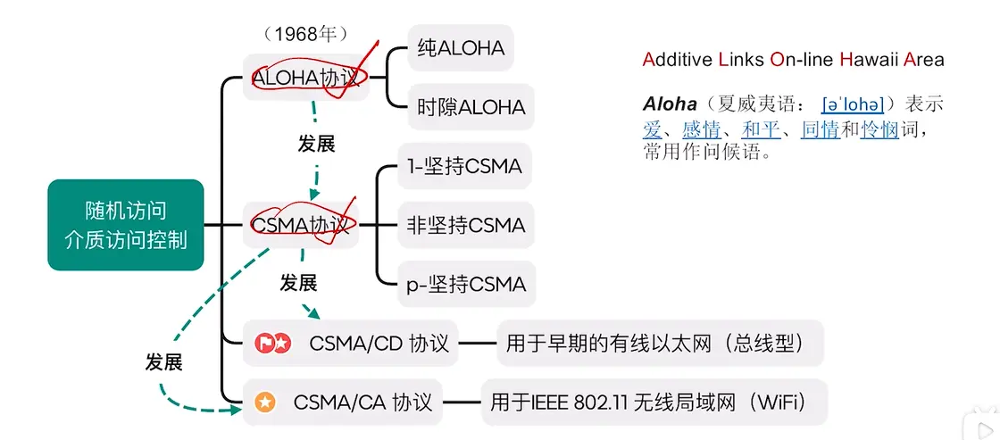  

# 纯 ALOHA 和时隙 ALOHA  
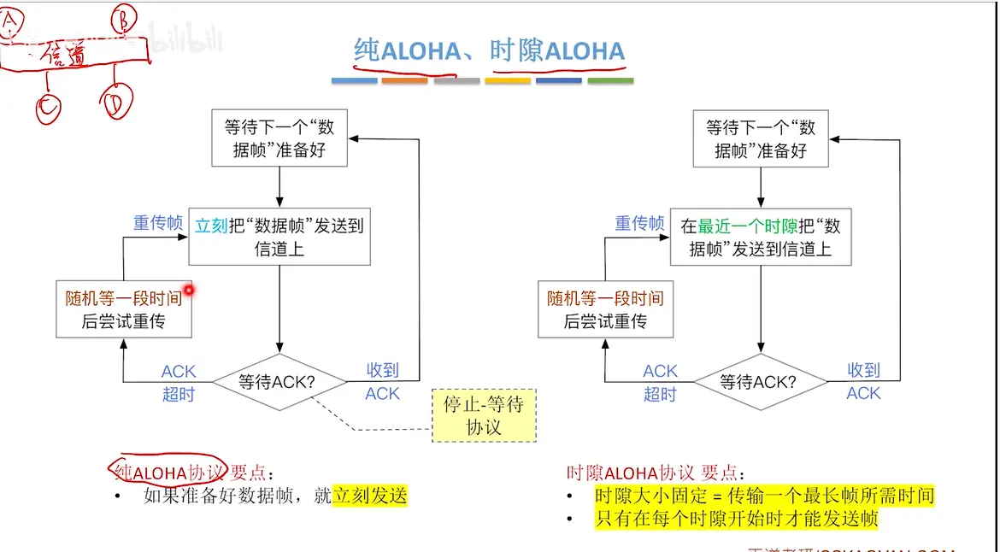
这里发生了冲突导致 帧错误    导致不返回 ack  

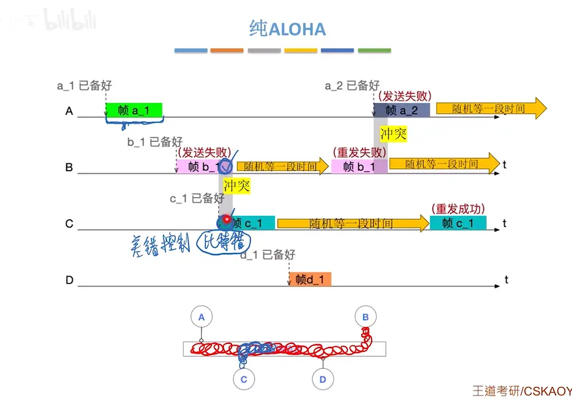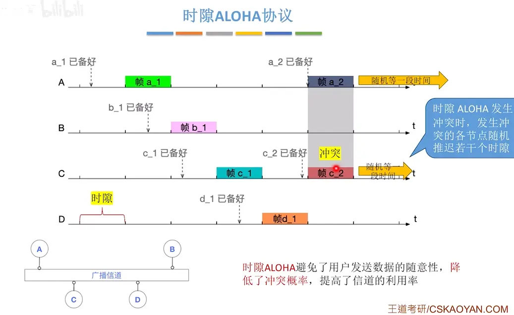  

# CSMA 协议  载波监听

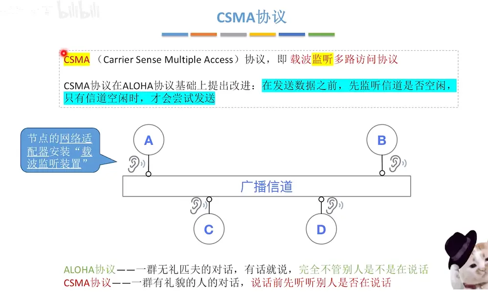  

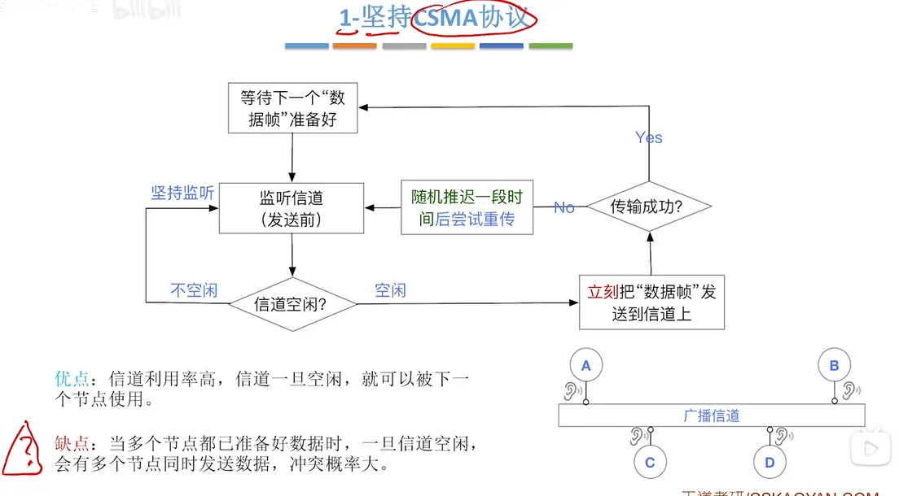  

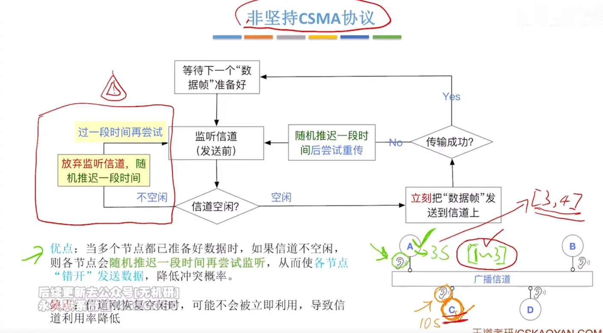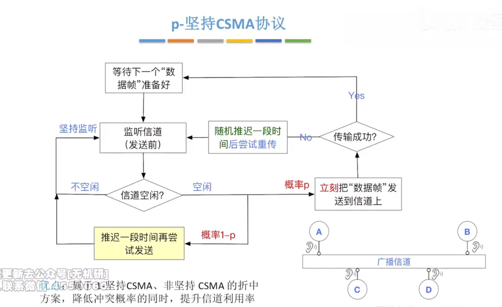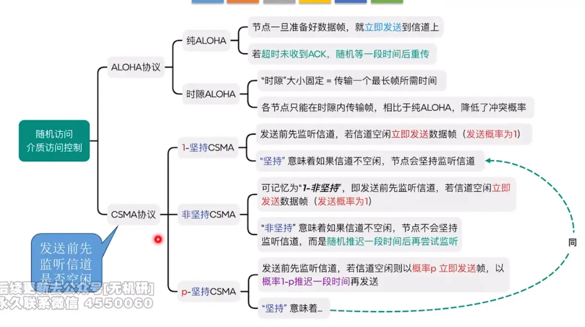  

# csma cd 协议    载波监听+冲突检测  

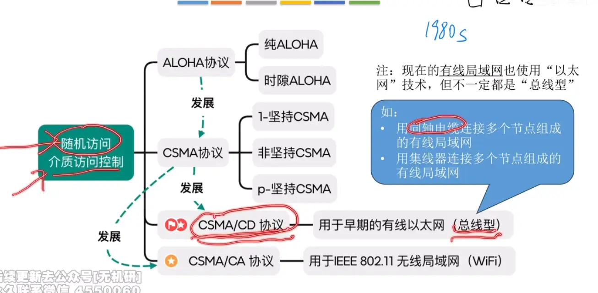  

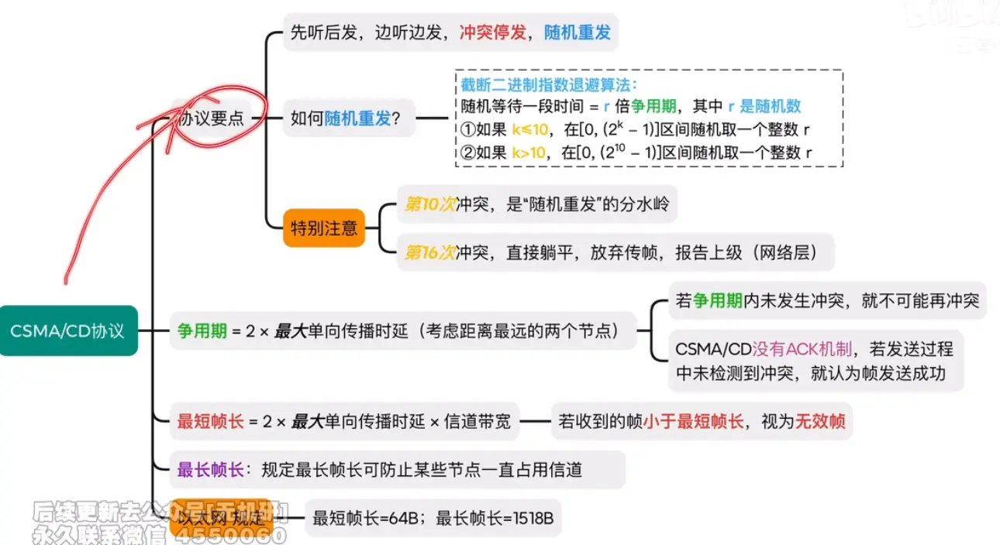  
# 检测冲突
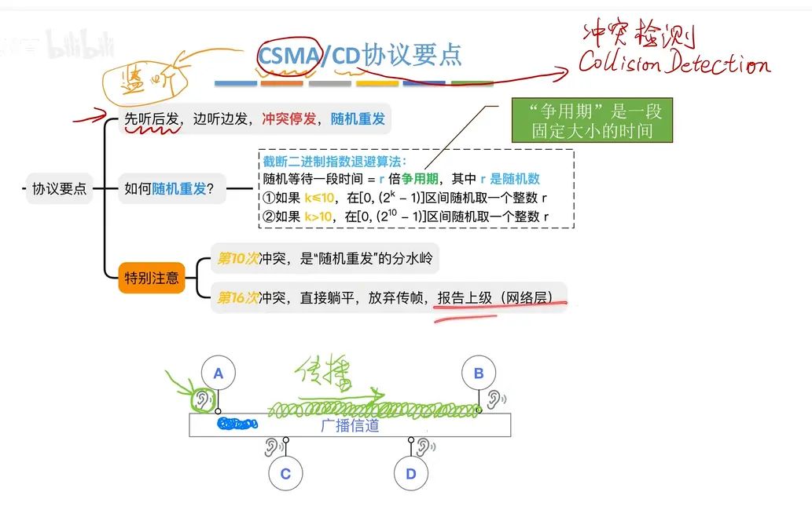

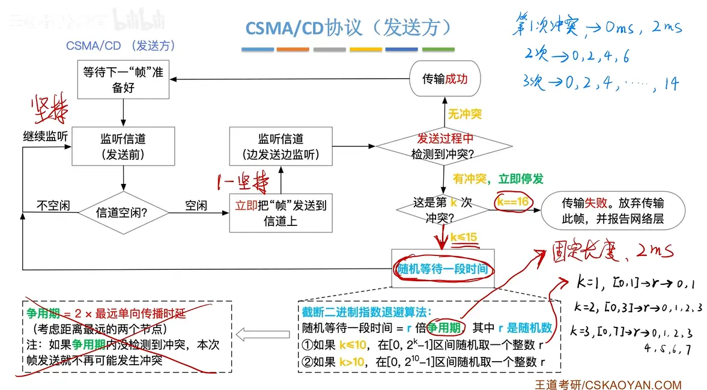

发生的冲突越多，说明网络非常忙，r 边大  ，延长等待时间，来避免冲突

都是边听边发 为什么这里还是会发生冲突呢  
因为信号传播是需要时间的  a 发送了信号  还没传到 b  导致中间会有冲突  

# 争用期  （发生冲突还需要继续传到目的地传递冲突信号）  

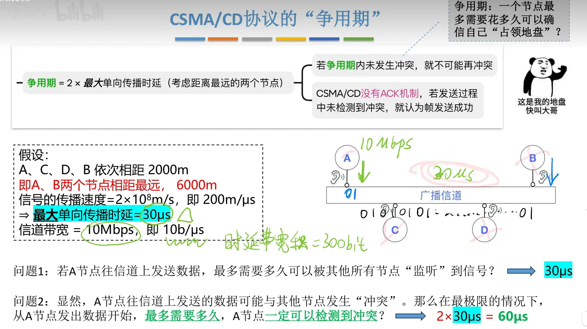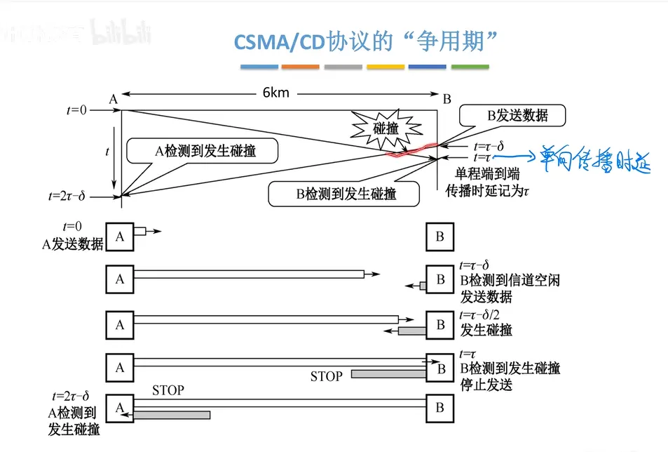  

# 最短帧长  

