“透明网桥” 这个名字，是为了和另一种网桥方案**源路由网桥**做区分。后者是典型的 “不透明” 方案：

- 源路由网桥的核心逻辑：由发送数据的主机自己决定数据帧的传输路径，主机必须知道整个网络的网桥分布和拓扑结构；
- 发送方会在数据帧头部写入完整的路径信息，网桥只按照帧里的路径转发，不自主学习和决策；
- 这种模式下，主机明确感知到网桥的存在，还要负责计算路由，因此是 “不透明” 的。

透明网桥是 IEEE 802.1 D 标准定义的以太网标准网桥，而源路由网桥主要用于早期的令牌环网，现在已经基本被淘汰。  

# 透明网桥的自学习和转发帧的流程  （形成转发表）

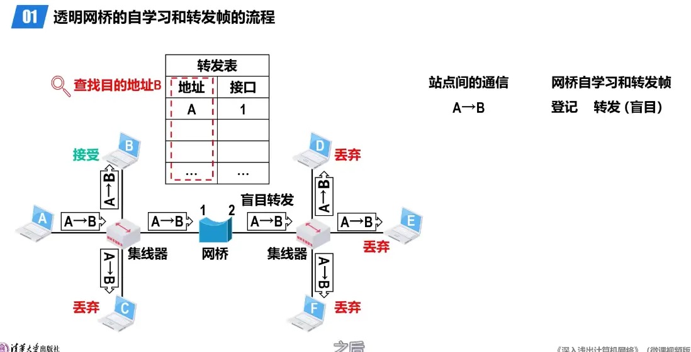

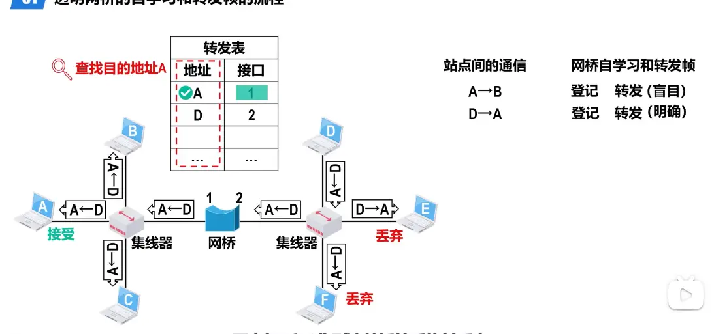

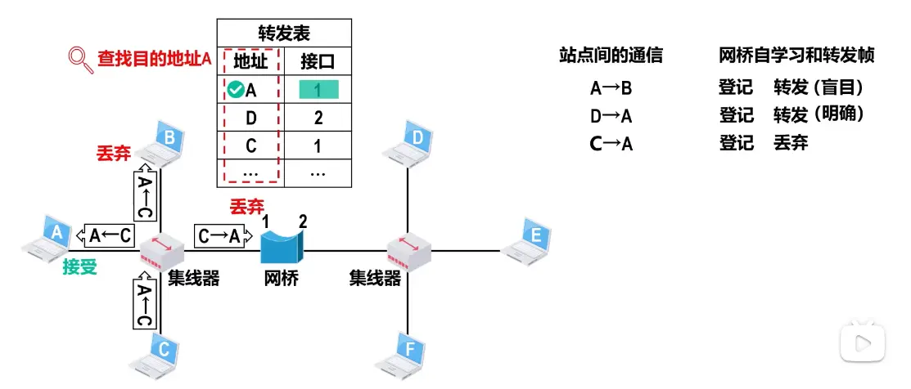

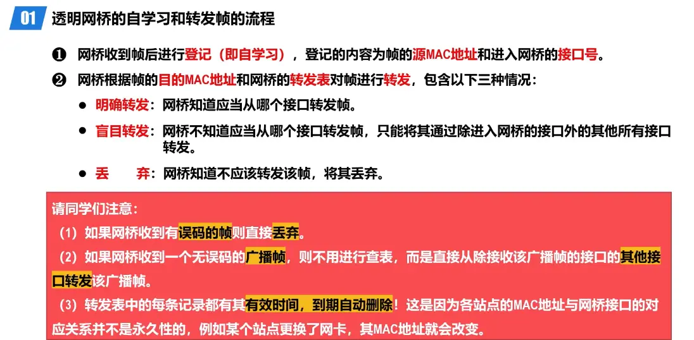

# 透明网桥的生成树协议 stp  

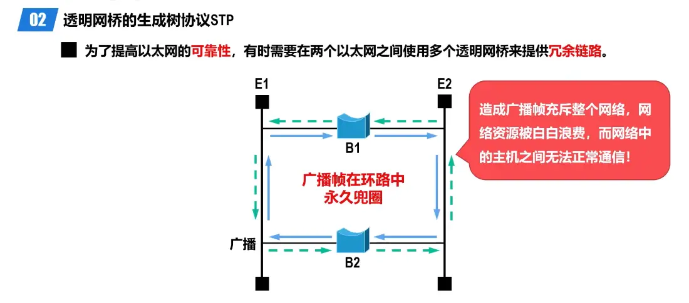  

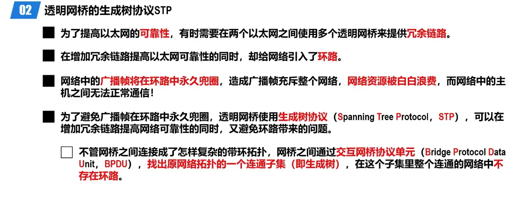  

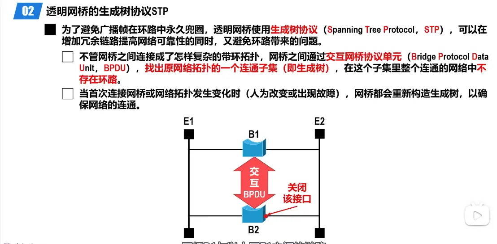  
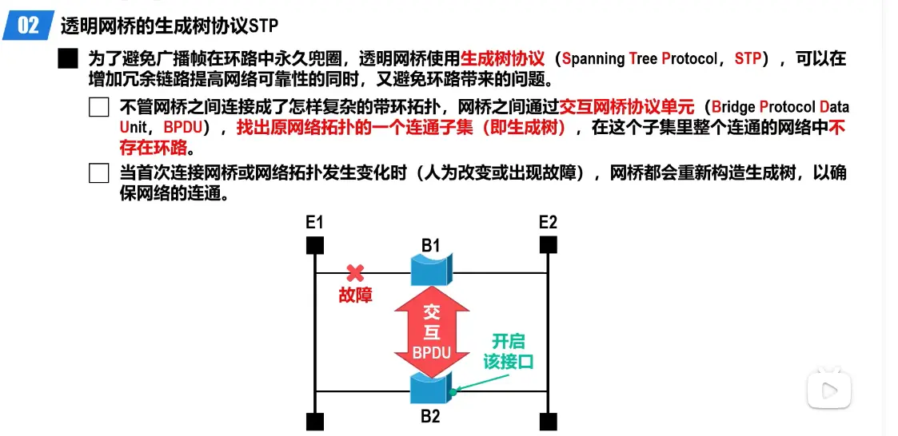  

# 交换机（网桥的的升级版）

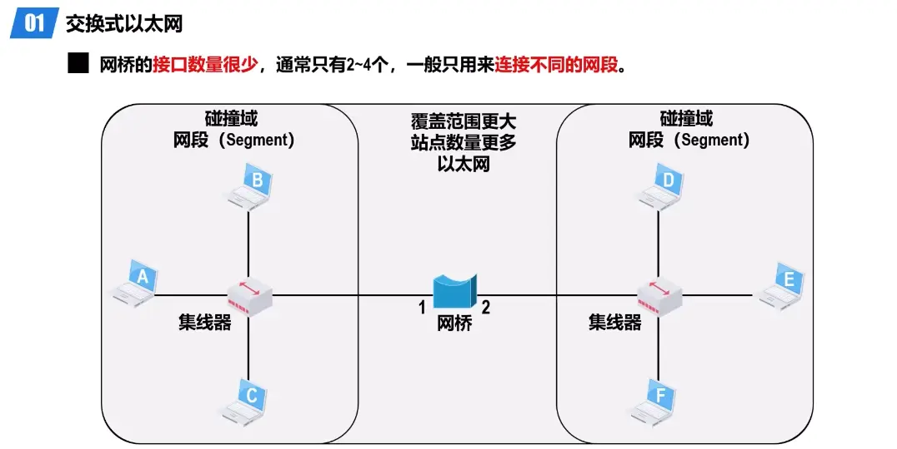  

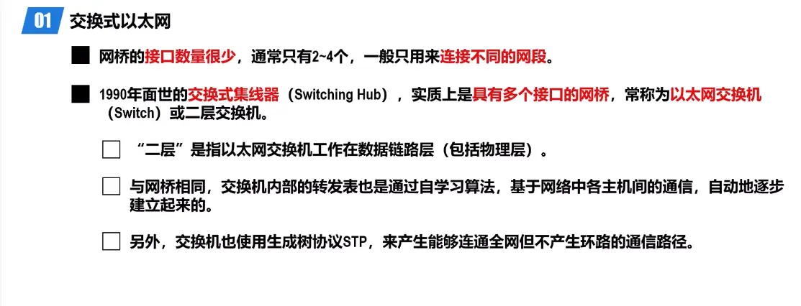  

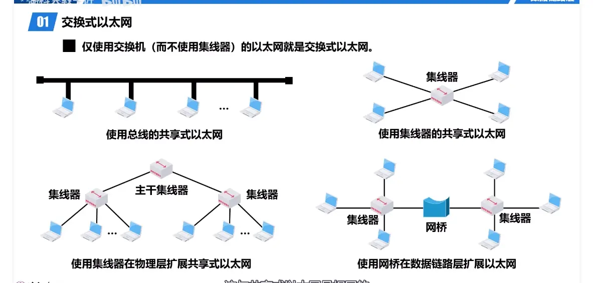

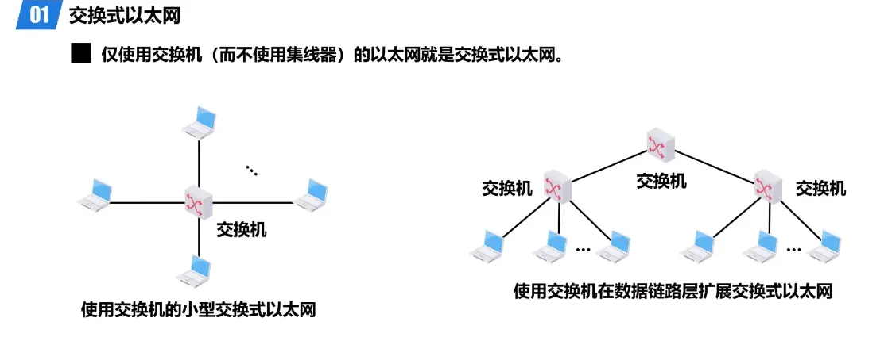