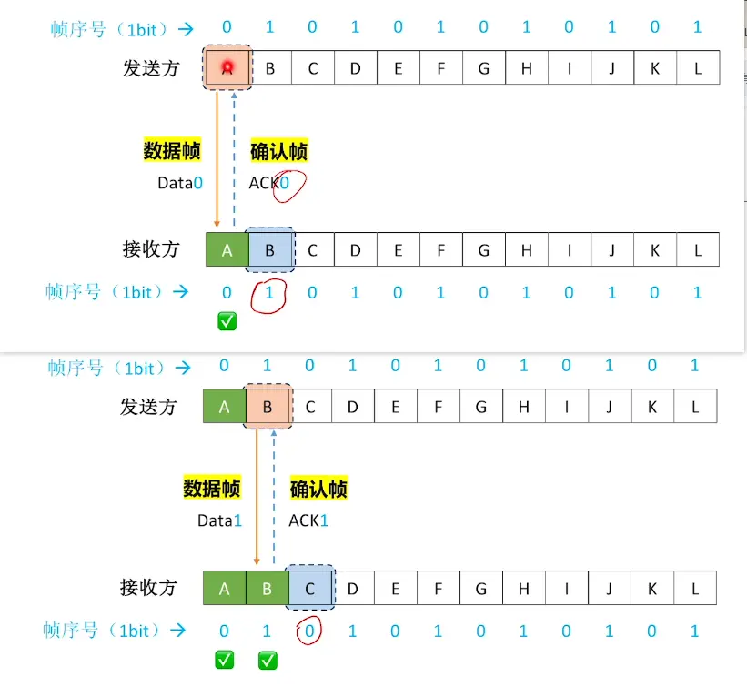
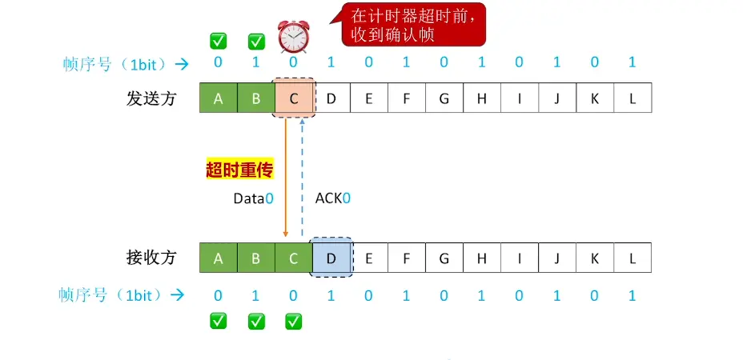
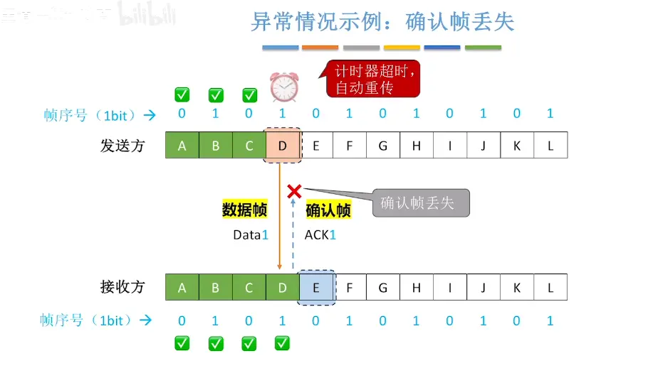
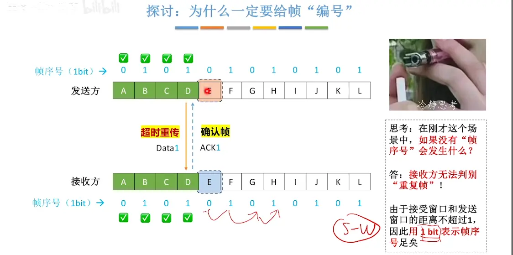
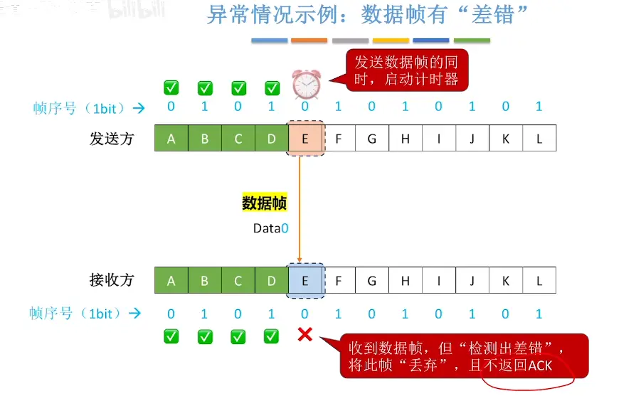
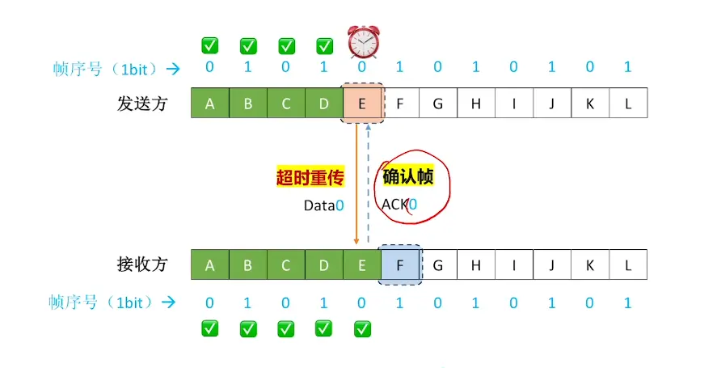
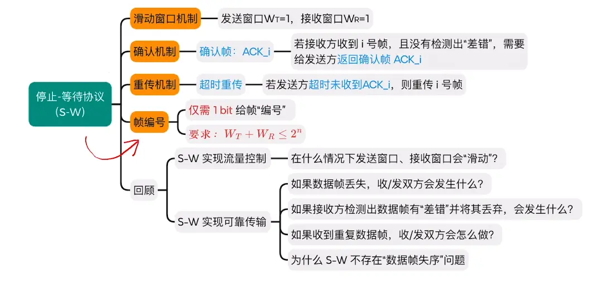

  

# 帧的编号
对于帧的编号  三种协议均满足最后一个要求即可  
在停止等待协议中只需要一个比特进行编号即可  

  

# 数据帧  确认帧 帧序号的概念  

  

# 传输帧的过程（接受到数据帧之后接收端就往后移一个窗口可以接受下一个了，再返回确认帧，发送端收到确认帧，才能一起跟着往后移已给窗口（实现流量控制），开始发送下一个，循环，直到全部发送完）

## 正常情况  
（接收方往后一移表示可以传输了）发送方再发送下一个对应的
  

## 数据帧丢失（超时重传）   

  
  

重新发送后  会重置计时器  重新计时  直到收到确认帧
  
收到之后窗口往后移   继续传送  

##  确认帧丢失  （超时重传）

  

  

## 数据帧有差错  （超时重传）  

  

# 总结  

