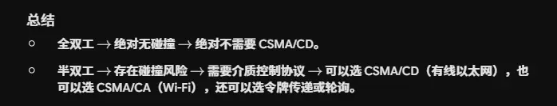
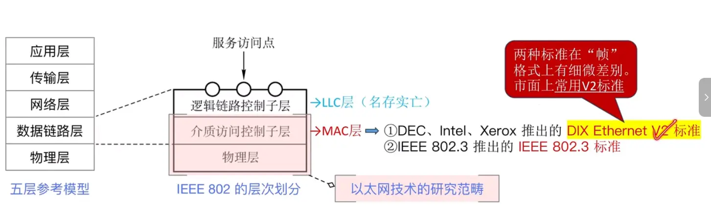
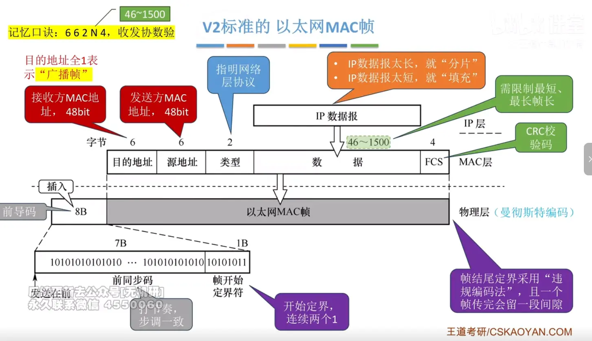
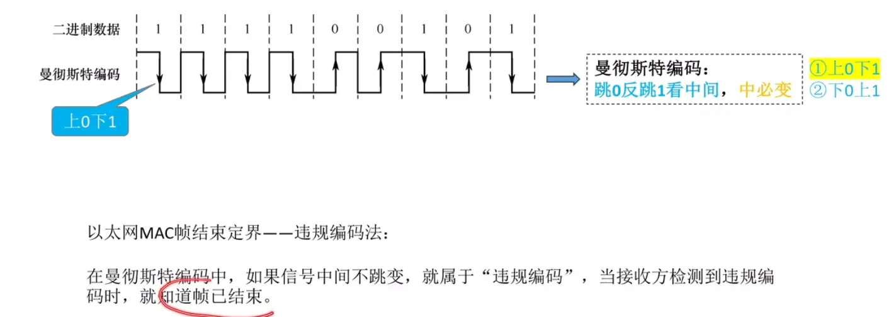
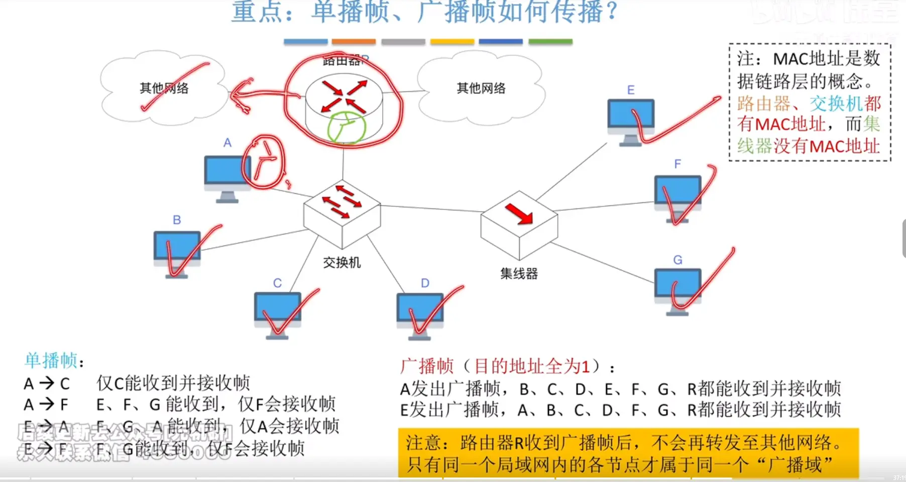
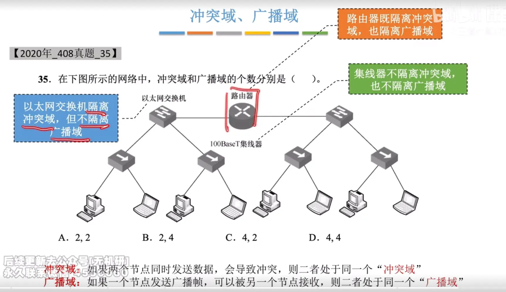

  

# 以太网物理层 802.3 标准
## 物理层标准
  

## 同轴电缆以太网  
  

# 双绞线以太网  
  

# 以太网 mac 层  v 2 标准

  
现在的 v 2 标准是主流  

  

  
在 ieee 中推出的标准中类型变成了数据大小是因为它有个 llc 层，但是现在以及名存实亡了  
并且现在都是用 v 2 标准 ，数据链路层其实就可以等价于 mac 层了
# 单播帧 广播帧 的传播  （重点）

  

  

# 总结  
