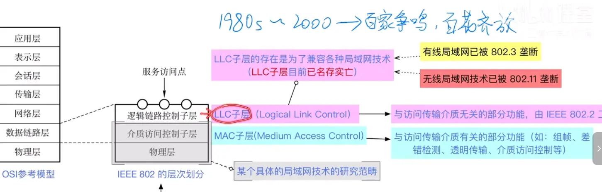

以下是基于您提供的文本提取的关于局域网与 IEEE 802 委员会的核心知识点总结：

### 1. IEEE 802 委员会概述

- **组织背景**：隶属于 IEEE（电气电子工程师协会）的国际组织分支机构。
    
- **主要职责**：负责推进局域网（LAN）、城域网（MAN）以及个域网（PAN）等网络技术的全球标准化工作，以促进技术的统一和普及。
    
- **运作方式**：下设多个工作组（如 802.3、802.11 等），每个工作组专门负责某一项特定局域网技术的标准化。
    

### 2. 核心局域网标准与工作组对应关系

- **IEEE 802.3（以太网）**：
    
    - **起源**：由 DEC、英特尔和施乐公司于上世纪 80 年代共同推出。
        
    - **现状**：占据了几乎所有的有线局域网市场，在考试和实际应用中，**802.3 几乎等同于以太网**。
        
- **IEEE 802.11（无线局域网/Wi-Fi）**：
    
    - **职责**：负责无线局域网技术的标准化。
        
    - **现状**：**802.11 几乎等同于 Wi-Fi 技术**。
        
    - **代际标准**：标准后缀代表不同的 Wi-Fi 代际（如路由器支持的具体模式）。
        
        - `802.11b`：民间俗称的 Wi-Fi 1（第一代）。
            
        - `802.11ac`：民间俗称的 Wi-Fi 5（第五代，2013 年推出）。
            
        - `802.11ax`：民间俗称的 Wi-Fi 6（第六代，目前主流）。
            
        - Wi-Fi 7：第七代技术，预计 2024 年起逐步推广。
            
- **IEEE 802.1 Q（虚拟局域网/VLAN）**：负责 VLAN 的基本概念、原理及技术标准。
    

### 3. IEEE 802 对数据链路层的划分

为了推进标准化工作，IEEE 802 委员会将 OSI 参考模型中的**数据链路层**拆分成了两个独立的子层（对应 OSI 的物理层和数据链路层）：  

- **MAC 子层（介质访问控制子层，Media Access Control）**：
    
    - **功能**：处理与传输介质相关的底层功能，包括组帧、差错控制、透明传输以及介质访问控制。
        
    - **现状**：现代有线网卡或无线网卡中均包含 MAC 子层和物理层的相应功能，主流只有 802.3（有线）和 802.11（无线）两种类型的 MAC 子层。
        
- **LLC 子层（逻辑链路控制子层，Logical Link Control）**：
    
    - **设计初衷**：在局域网技术“百家争鸣”的时代，为了兼容底层各种不同的局域网技术（如令牌环网、FDDI、以太网等），向上层（网络层）暴露统一的服务访问点和调用接口。
        
    - **负责部门**：原由 IEEE 802.2 工作组负责。
        
    - **现状（已淘汰）**：由于以太网和 Wi-Fi 彻底垄断了有线和无线局域网市场，兼容多项技术的需求不复存在。LLC 子层已名存实亡，802.2 工作组已解散，现代网卡通常不再包含 LLC 子层的功能。
        

### 4. 历史上被淘汰的局域网技术

- **令牌环网（Token Ring）**：由 IBM 公司推出，曾受市场认可。交由 **802.5 工作组**进行标准化，后因不敌以太网而被淘汰，工作组解散。
    
- **FDDI（光纤分布数字接口）**：上世纪 90 年代流行的局域网技术。交由 **802.8 工作组**进行标准化，同样因被以太网击败而被淘汰，工作组解散。