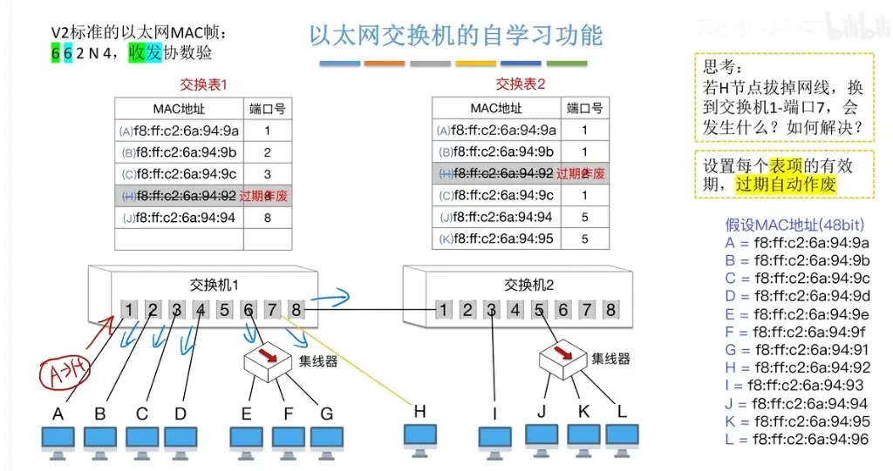

结合您提供的文稿和 image_720 be 9.jpg，以太网交换机的自学习与数据帧转发工作流程可以系统地总结为以下两大核心机制：

### 一、 交换机的核心处理流程（“先学习，后决策”）

当交换机接收到任何一个数据帧时，都会严格执行以下动作：

**第一步：自学习（登记源 MAC 与端口号）**

- 交换机每收到一个帧，首先会检查该帧的发送方（源）MAC 地址。
    
- 交换机会将这个发送方的 MAC 地址与该帧进入交换机的端口号进行绑定，并登记到交换表中。
    
- 如果该发送方的 MAC 地址及其对应的端口号信息已经在交换表中登记过了，则不需要再进行重复登记。
    

**第二步：转发决策（根据目的 MAC 查表转发）**

交换机在登记完发送方信息后，会检查帧的接收方（目的）MAC 地址，并根据交换表的情况做出以下四种处理动作之一：

- **动作 1：盲发（未知单播帧处理）。** 若交换机在表中**找不到**接收方的 MAC 地址（即不知道该节点连在哪个端口），它会把这个帧从除了入口之外的其他所有端口转发出去，相当于把它当作广播帧处理。
    
- **动作 2：精准转发（已知单播帧，跨端口处理）。** 若交换机在表中**能够找到**接收方的 MAC 地址，且对应的端口号与该帧进来的端口号不同，交换机会非常精准地只从目标端口将帧转发出去。
    
- **动作 3：丢弃（已知单播帧，同端口处理）。** 若接收方的 MAC 地址在表中对应的端口，与该帧进来的端口是**同一个端口**（例如两个节点连接在同一个端口下的集线器上），交换机认为目标节点已经收到了该帧，不需要再多此一举重新转发出去，因此不再进行转发操作。
    
- **动作 4：广播转发（广播帧处理）。** 若帧的接收方地址是全 1，明确表示这是一个广播帧，交换机会无脑地将该帧转发到除了入口之外的其他所有端口。
    

### 二、 节点移动与表项老化机制

在实际应用中，网络拓扑可能是动态的（节点物理位置发生改变）。为此，交换机具备表项淘汰与更新的机制：

- **问题场景（节点移动）：** 如图 image_720 be 9.jpg 中的思考题所示，若节点 H 拔掉网线，离开原来的位置并换到了交换机 1 的端口 7，这会导致两台交换机中原本记录 H 节点位置的表项变成错误信息。如果按照旧表项转发，帧会被错误地发向没有设备的空端口，导致接收失败。
    
- **解决机制（过期自动作废）：** 交换机会为每一个表项设置一个有效期。一旦时间到期，该表项就会自动作废，如 image_720 be 9.jpg 的交换表 1 和交换表 2 中，节点 H 旧的 MAC 地址表项都被标记了“过期作废”。
    
- **重新学习（恢复通信）：** 表项作废后，当其他节点再给 H 发送帧时，由于找不到有效记录，交换机会采取泛洪转发（从所有其他端口发出），从而确保移动后的 H 节点依然能收到数据帧。而只要 H 节点自身发出了任何一个新的帧，交换机就能立刻捕捉到，并把 H 节点的新位置信息重新登记到交换表中，完成自学习的闭环。