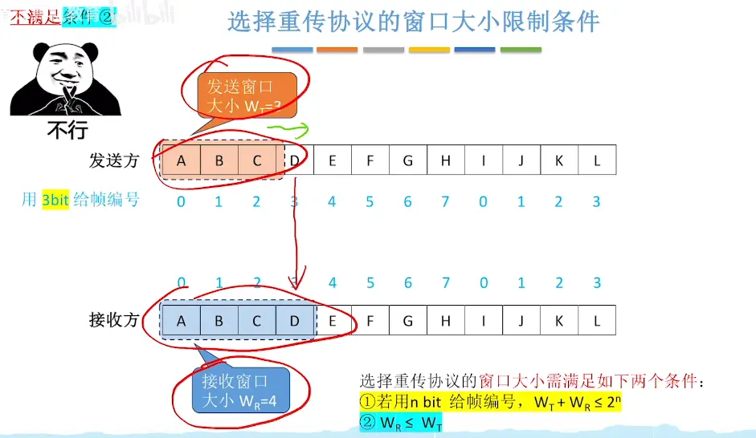
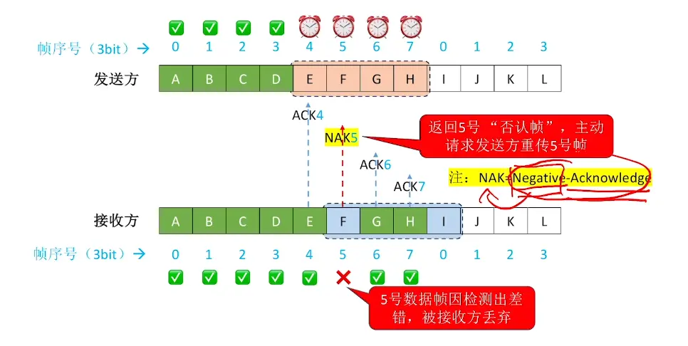
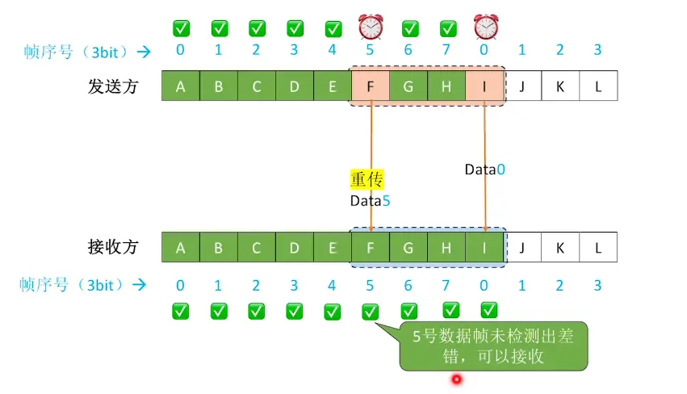
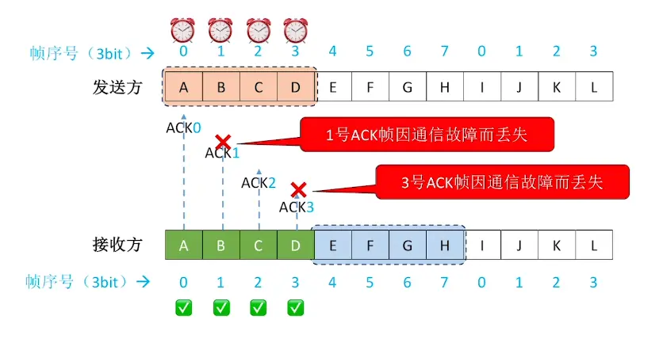
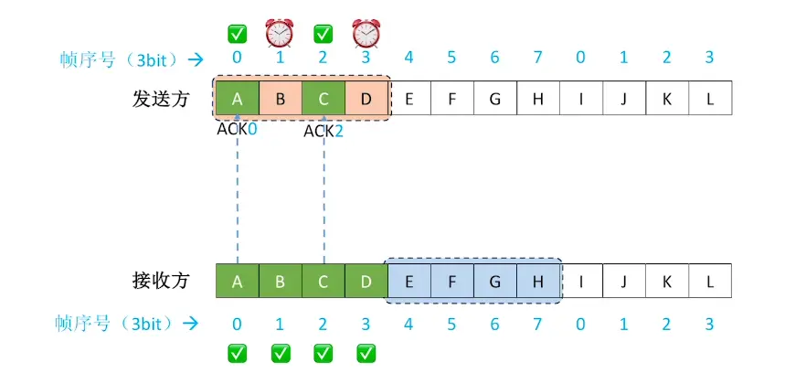
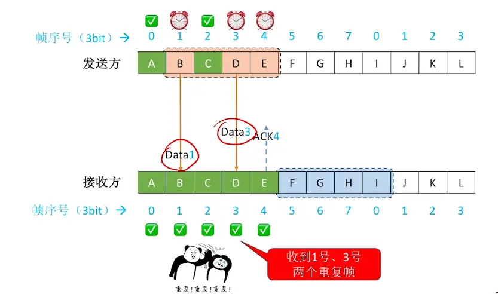
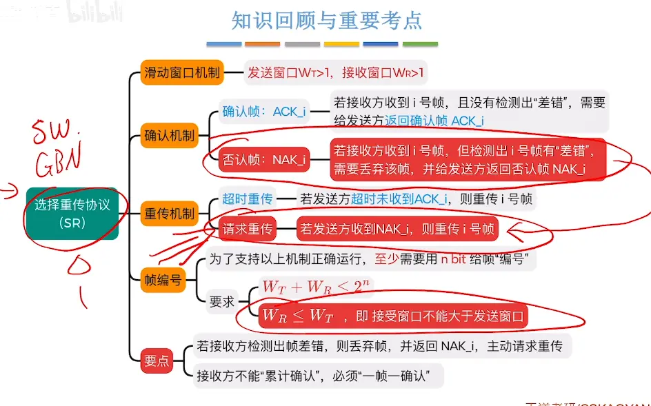

  

# 选择重传协议的窗口大小限制条件  

  
接受窗口小于等于发送窗口 ，因为如果大于的话，会有多余的接受窗口格子出于空闲，占用

  

# 一个例子说明工作过程  

## 正常情况  

 
  

## 数据帧丢失  

## 数据帧因差错而被丢弃  （有否认帧的机制）

##  确认帧丢失  

  
 
#  如果窗口大小不符合比特位
  
  

# 总结  

