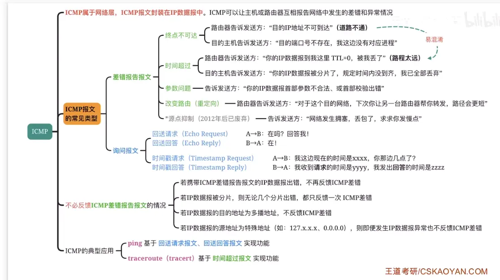  

  

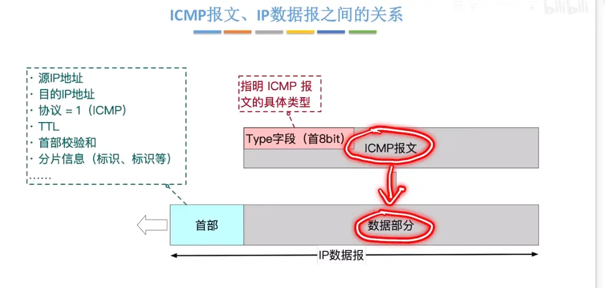  
这里的 type 字段就是 icmp 返回报文的信息  

# 差错报告报文
## 终点不可达  

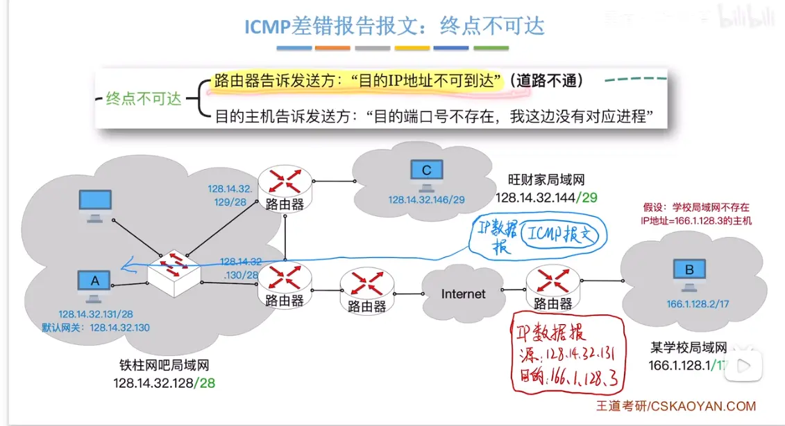  

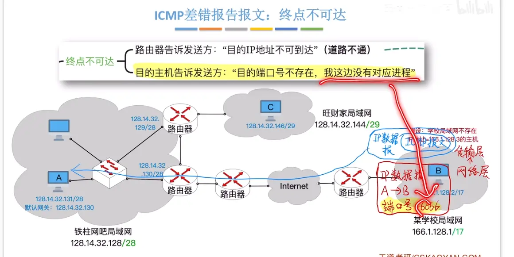  

## 时间超过  

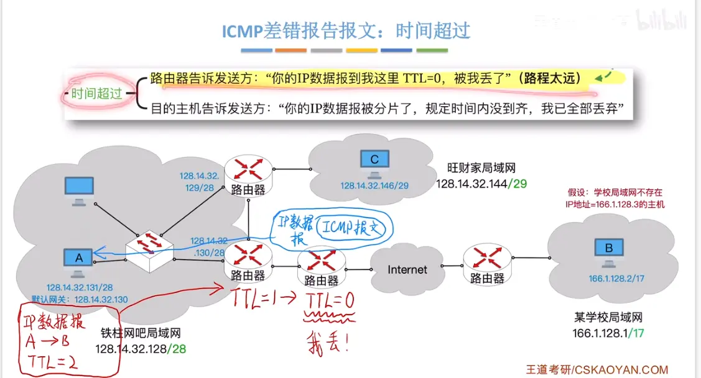

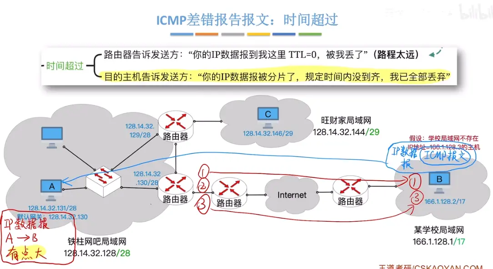  

## 参数错误  

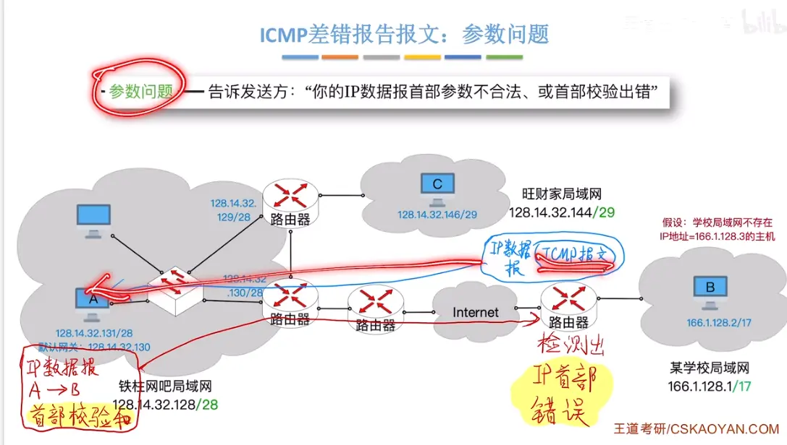  

## 改变路由 （重定向）  

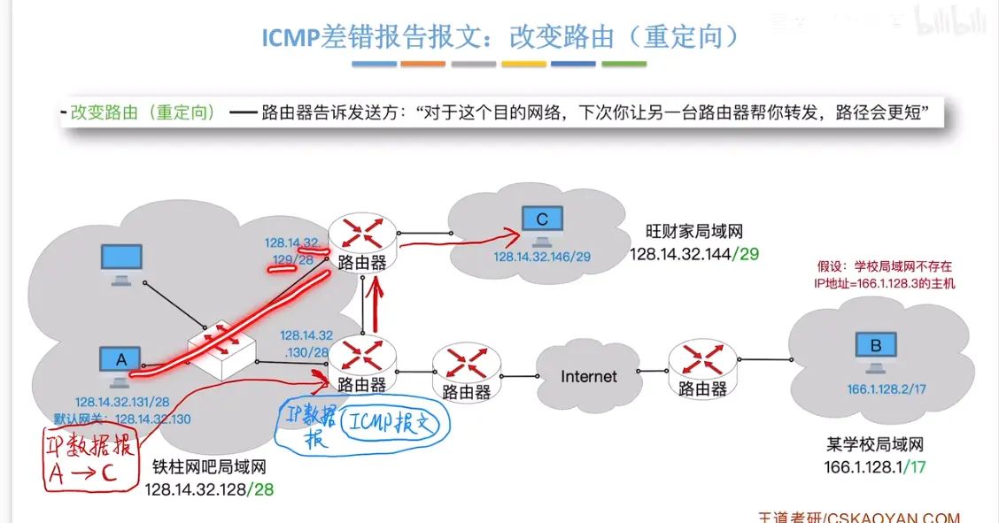  
这里路由器的 发现更近的  和后面的路由选择协议  

## 源点抑制（删除了 了解即可）  

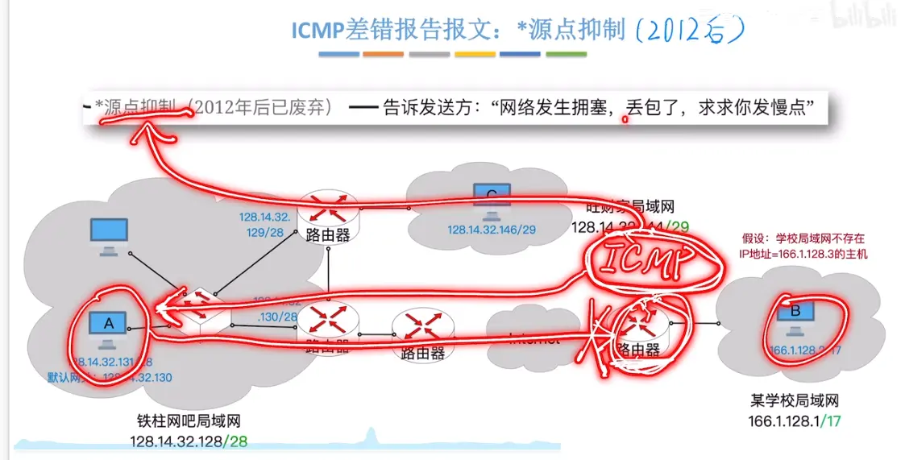  
现在都是  交给 tcp 来控制拥塞问题   而不是这个  所以删了  

#  询问报文  

## 回送请求 回送回答（检测 路线是否连通）  

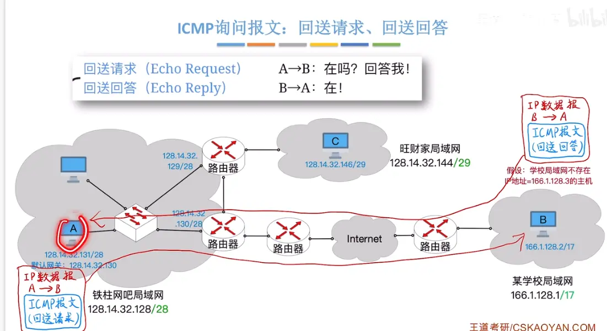  

经典应用 ping  

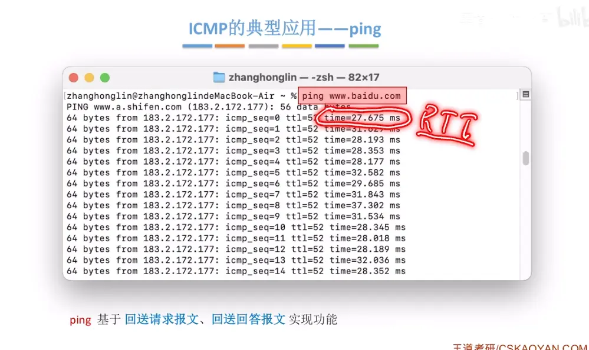  

## 时间戳请求和时间戳回答 （ 和回送请求  流程一样  校对时间）  

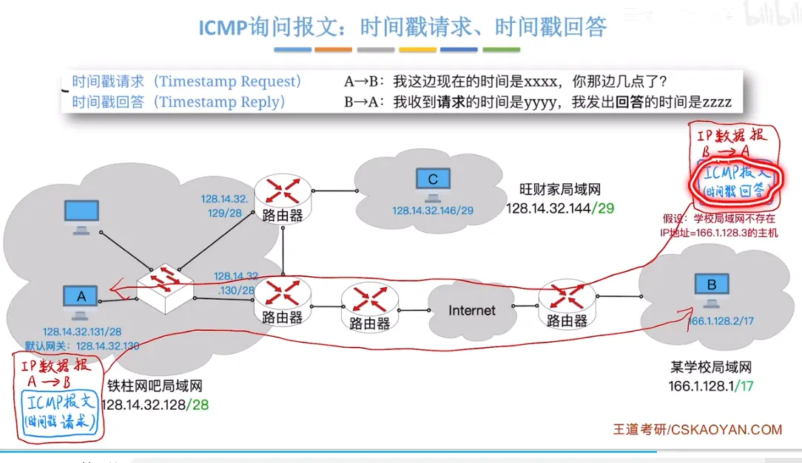  

电脑校对时间  （经典应用）  

#  不必返回 icmp 差错报文的情况  

