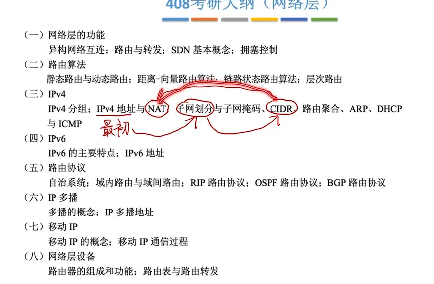
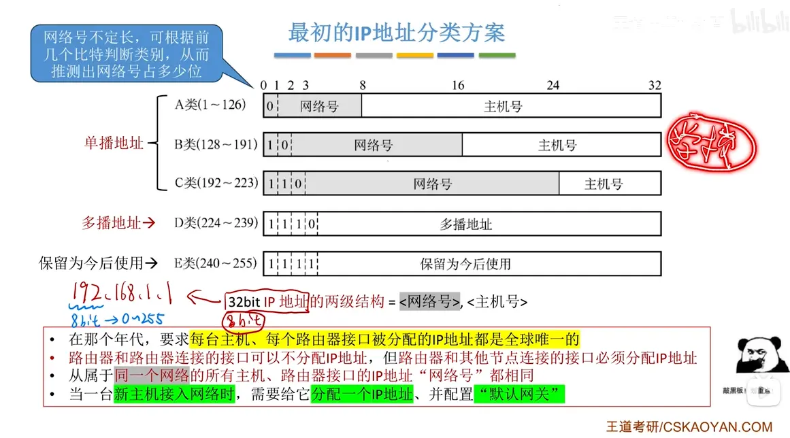
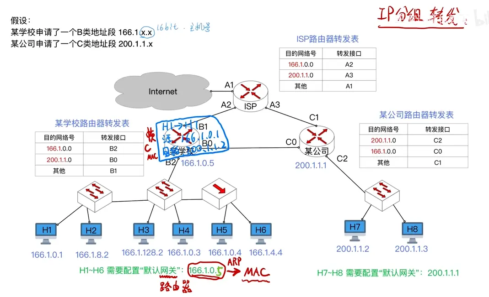
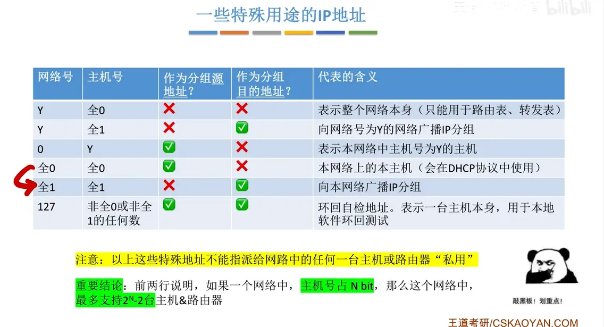
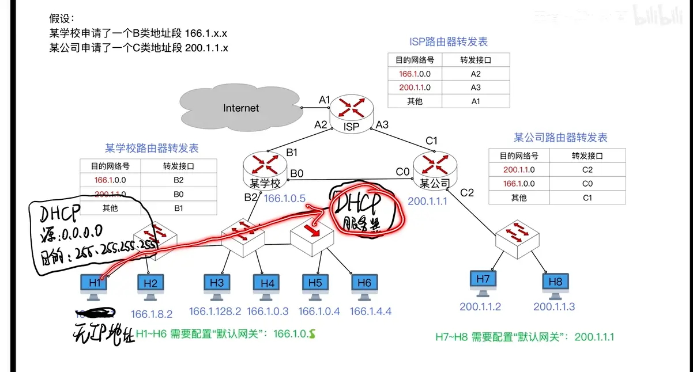

# 发展历程
  

# 最初的 ip 地址划分   

  第二条是因为   只有主机才会发送数据报来发送请求  此时就需要一个端口来接收  
端口要留一个 ip 地址给主机来保存识别作为端口  所以需要配置一个 ip 地址  

# ip 分组转发  

ip 目的地址没变  对应的 mac 地址变了    arp 协议  
他需要不断地通过 arp 协议来修改 mac 帧 
# 特殊用途的 ip 地址  

  

