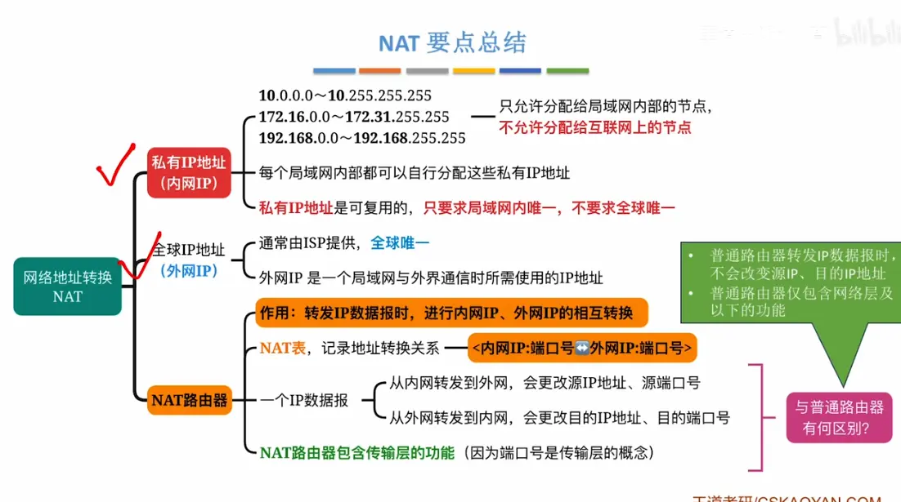  

# 传输层端口号  

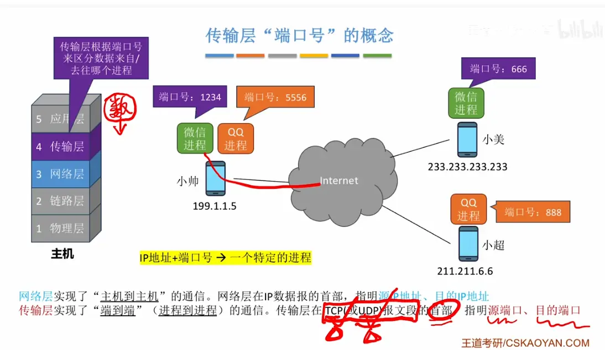  

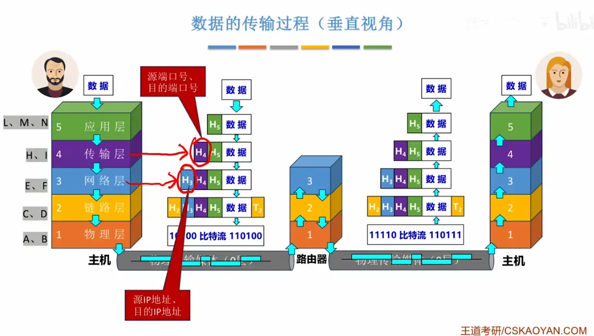  

# 缓解 ipv 4 不够用问题  

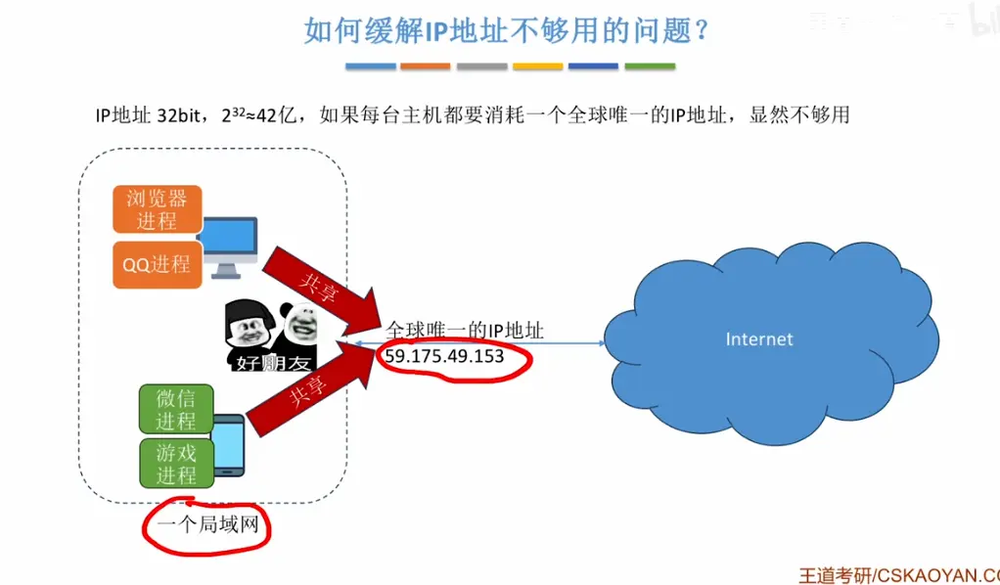  

# 外网（公网）和内网  

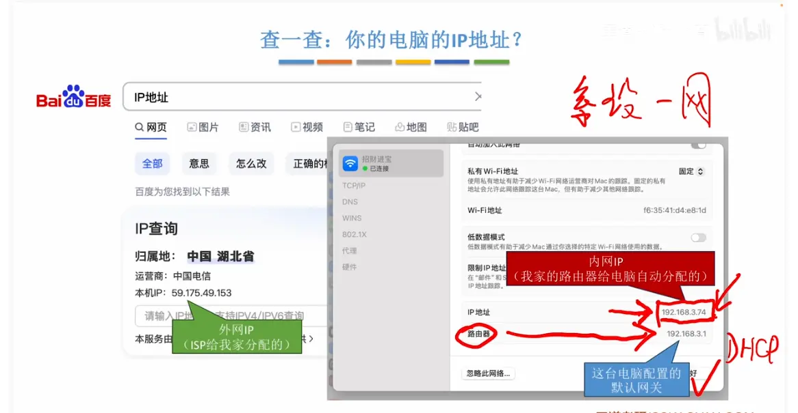  

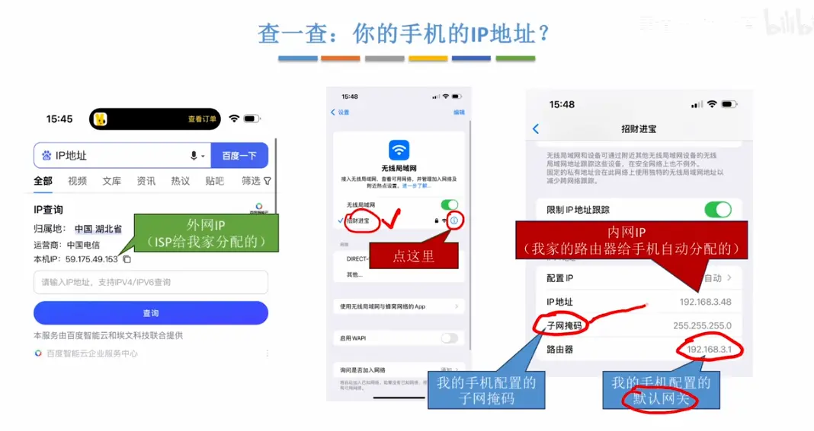  

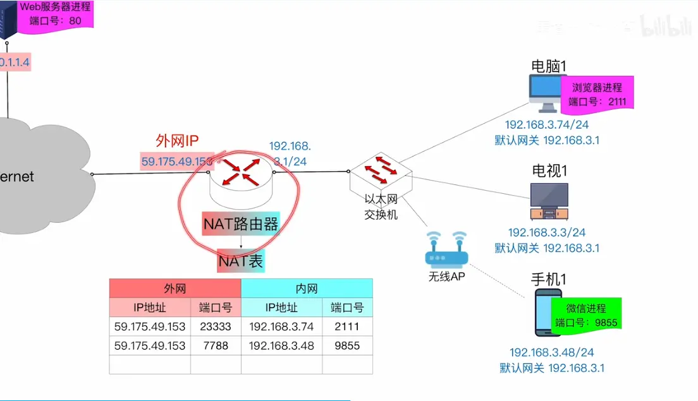  

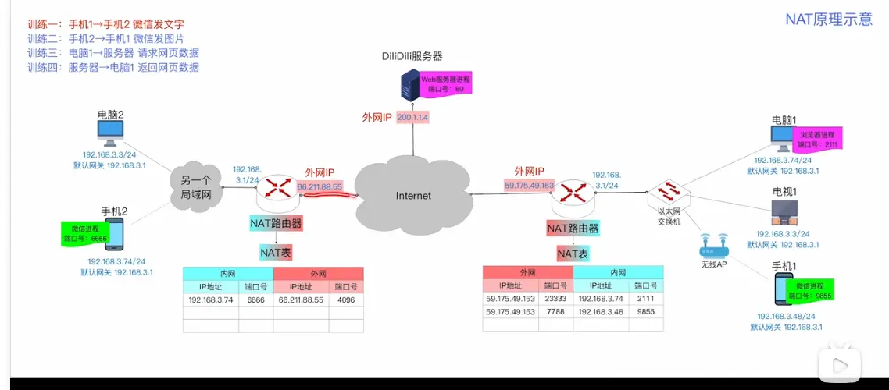  

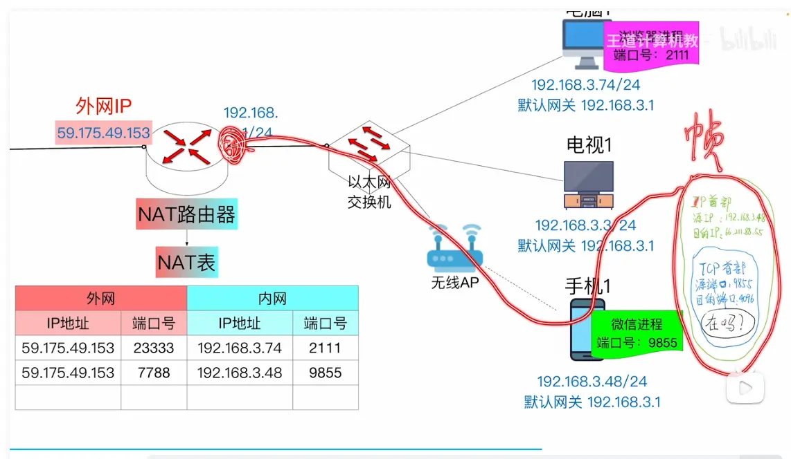  
目的都是写 外网 ip  和外网端口  
这里有一个端口映射

我们结合图中的拓扑和 NAT 表，把**手机 1→手机 2 发微信文字**的完整 NAT 转换流程拆分为「出方向 SNAT（源地址转换）」和「入方向 DNAT（目的地址转换）」两大阶段，逐包讲解地址/端口的变化。

### 一、先明确所有节点的地址信息

|设备/角色|内网 IP|进程端口|所属 NAT 网关|网关公网 IP|NAT 映射关系|
|---|---|---|---|---|---|
|手机 1（发送方）|192.168.3.48/24|微信：9855|右侧 NAT 路由器|59.175.49.153|公网 `59.175.49.153:7788` ↔ 内网 `192.168.3.48:9855` |
|手机 2（接收方）|192.168.3.74/24|微信：6666|左侧 NAT 路由器|66.211.88.55|公网 `66.211.88.55:4096` ↔ 内网 `192.168.3.74:6666` |

> 注：图中是 NAT 原理简化示意，真实微信消息会通过公网服务器中转，本质是两次「客户端-服务器」的 NAT 通信，逻辑和下方流程一致。

---

### 二、阶段 1：手机 1 → 公网（右侧 NAT 执行 SNAT 源地址转换）

#### 步骤 1：手机 1 生成原始数据包

手机 1 的微信进程（端口 9855）封装文字消息为 IP 数据包，此时包头信息：

- 源 IP：`192.168.3.48`（手机 1 的内网 IP）
- 源端口：`9855`（手机 1 微信进程的端口）
- 目的 IP：`66.211.88.55`（手机 2 所在网络的公网 IP，即左侧 NAT 的外网口）
- 目的端口：`4096`（左侧 NAT 映射给手机 2 微信的公网端口）

#### 步骤 2：数据包送达右侧 NAT 路由器

手机 1 判断目的 IP 不在本网段，将数据包发送给自己的默认网关 `192.168.3.1`，也就是右侧 NAT 路由器的内网接口。

#### 步骤 3：右侧 NAT 查表并执行源地址替换

右侧 NAT 路由器收到内网数据包后，查询本地 NAT 映射表，匹配到条目： `内网 192.168.3.48:9855 ↔ 外网 59.175.49.153:7788`

随后对数据包做**SNAT（源地址转换）**，替换源 IP 和源端口，替换后包头：

- 源 IP：`59.175.49.153`（右侧 NAT 的公网 IP）
- 源端口：`7788`（NAT 分配的公网端口）
- 目的 IP：`66.211.88.55`（保持不变）
- 目的端口：`4096`（保持不变）

#### 步骤 4：数据包进入公网

转换完成后，数据包从右侧 NAT 的外网接口发出，进入 Internet，公网根据目的 IP `66.211.88.55`，将数据包路由到左侧 NAT 路由器。

---

### 三、阶段 2：公网 → 手机 2（左侧 NAT 执行 DNAT 目的地址转换）

#### 步骤 5：左侧 NAT 查表并执行目的地址替换

左侧 NAT 路由器的外网接口收到公网数据包，查询本地 NAT 映射表，匹配到条目： `外网 66.211.88.55:4096 ↔ 内网 192.168.3.74:6666`

随后对数据包做**DNAT（目的地址转换）**，替换目的 IP 和目的端口，替换后包头：

- 源 IP：`59.175.49.153`（保持不变，仍是右侧 NAT 的公网 IP）
- 源端口：`7788`（保持不变）
- 目的 IP：`192.168.3.74`（手机 2 的内网 IP）
- 目的端口：`6666`（手机 2 微信进程的端口）

#### 步骤 6：数据包送达手机 2

转换完成后，数据包从左侧 NAT 的内网接口转发到局域网，最终送达手机 2。 手机 2 的网卡收到数据包后，向上交给端口 `6666` 对应的微信进程，解析出文字内容，一次完整的消息传输完成。

---

### 补充：真实微信通信的逻辑

图中是简化的端到端 NAT 演示，**实际微信文字消息是通过腾讯公网服务器中转**的：

1. 手机 1 先把消息发给微信服务器（走右侧 NAT 的 SNAT）；
2. 服务器根据账号找到手机 2 对应的公网地址；
3. 服务器再把消息转发给手机 2（走左侧 NAT 的 DNAT）。

本质是两次“客户端-服务器”的 NAT 交互，和图中「电脑 1 请求网页、服务器返回数据」的逻辑完全一致，只是服务器类型从 Web 服务器换成了即时通讯服务器。

另外图中用到的是**PAT（端口多路复用 NAT）**，也是目前家庭/企业网络最常用的 NAT 类型——多个内网设备共用 1 个公网 IP，通过不同端口号区分不同设备和进程。  

# 总结  
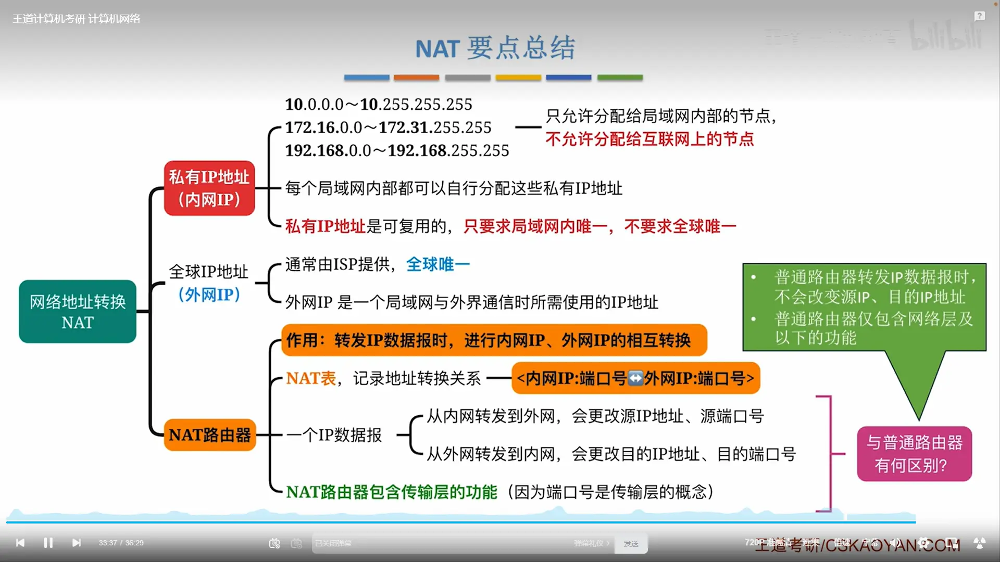  

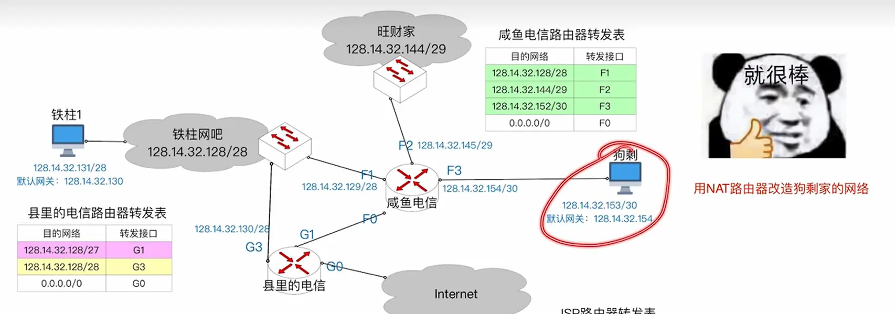