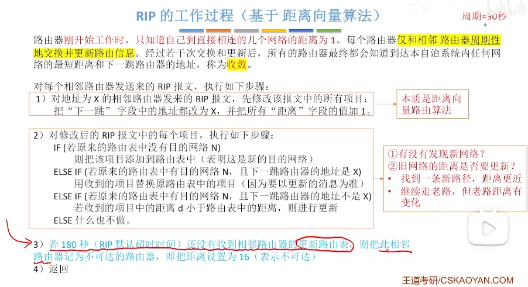
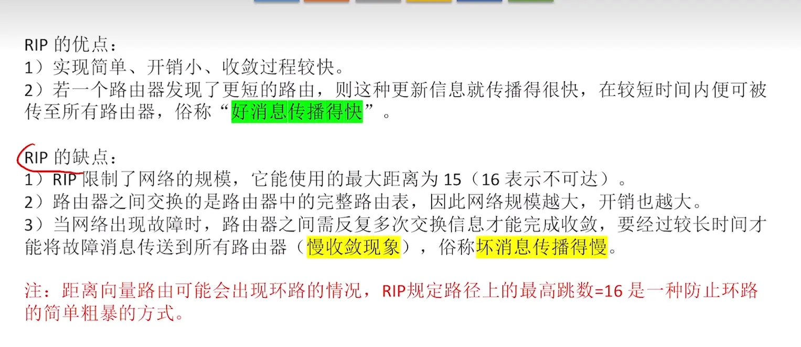
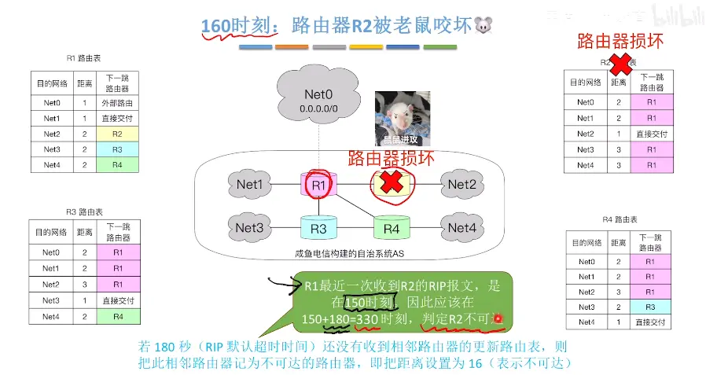
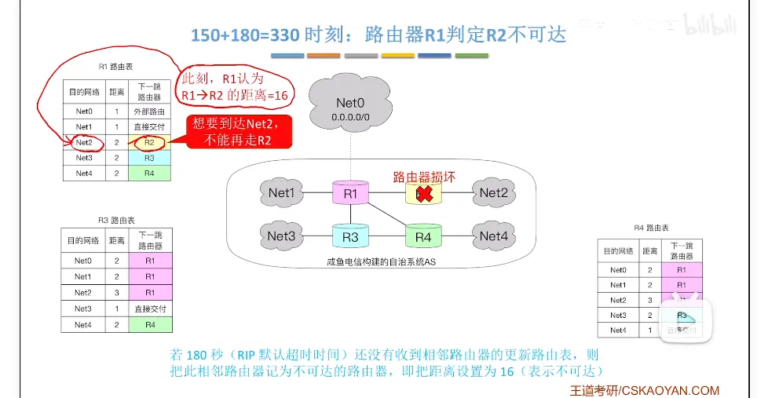
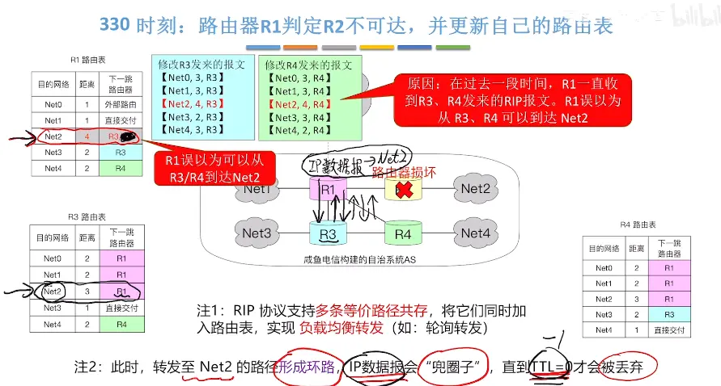
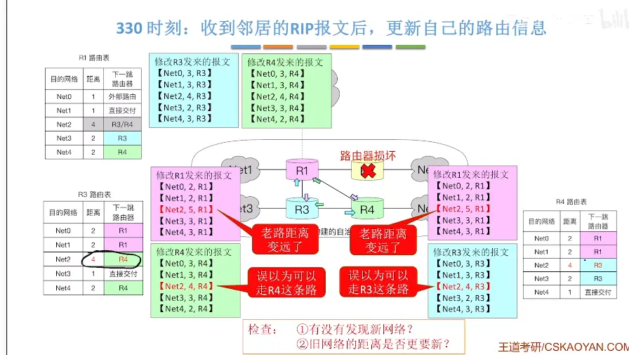
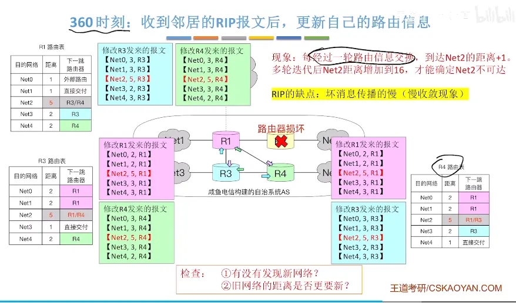
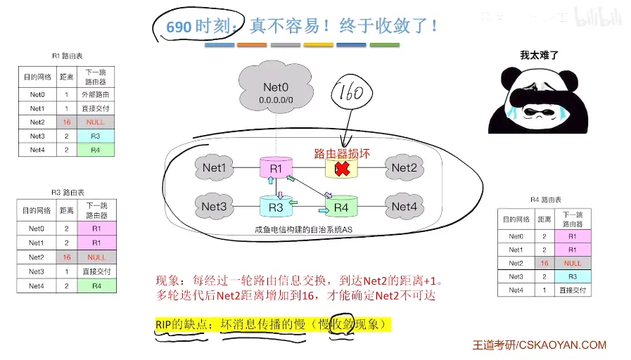

  

  

  

  1. **RIP 协议层面**：路由器之间继续交换 RIP 更新报文，不断把这条坏路由的跳数 + 1，慢慢往 16 涨；
2. **业务数据包层面**：去往故障网段的 IP 分组，会被路由器沿着环路来回转发，**靠 IP 头部 TTL 不断减 1，直到 TTL=0 丢弃**。

  

  

  
路由器损坏这个坏消息   需要经过反复多次交换信息  才能得到故障这个信息 到达 16  

# 总结  

