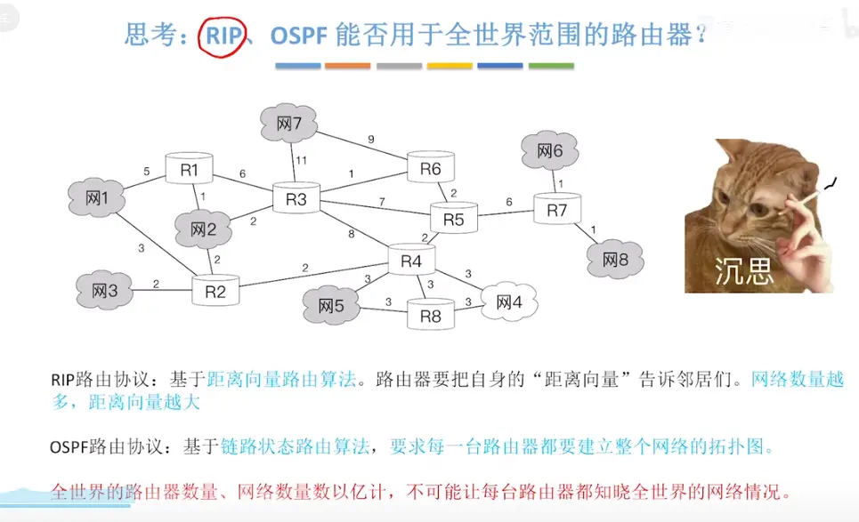
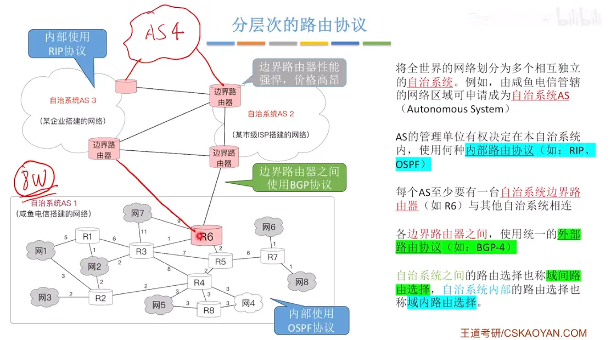
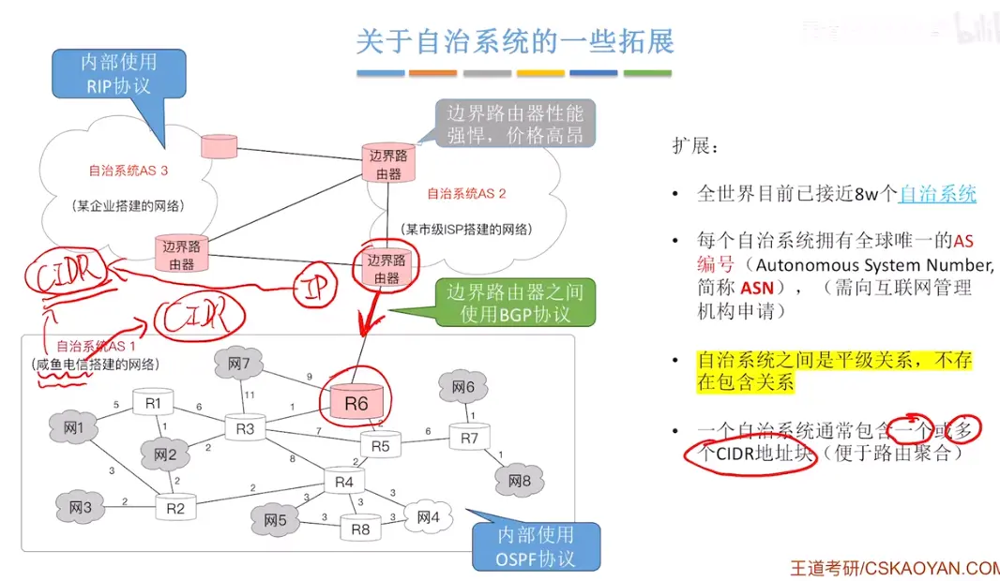
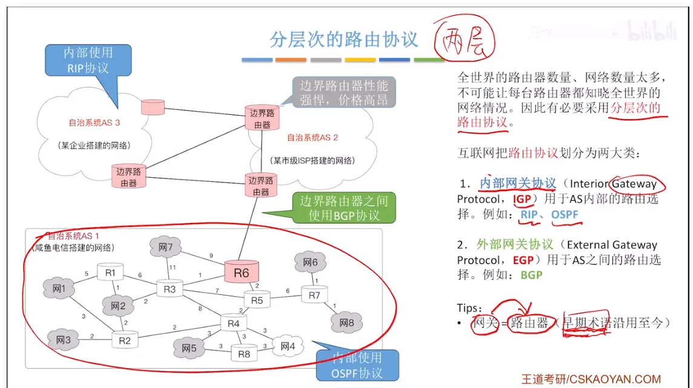
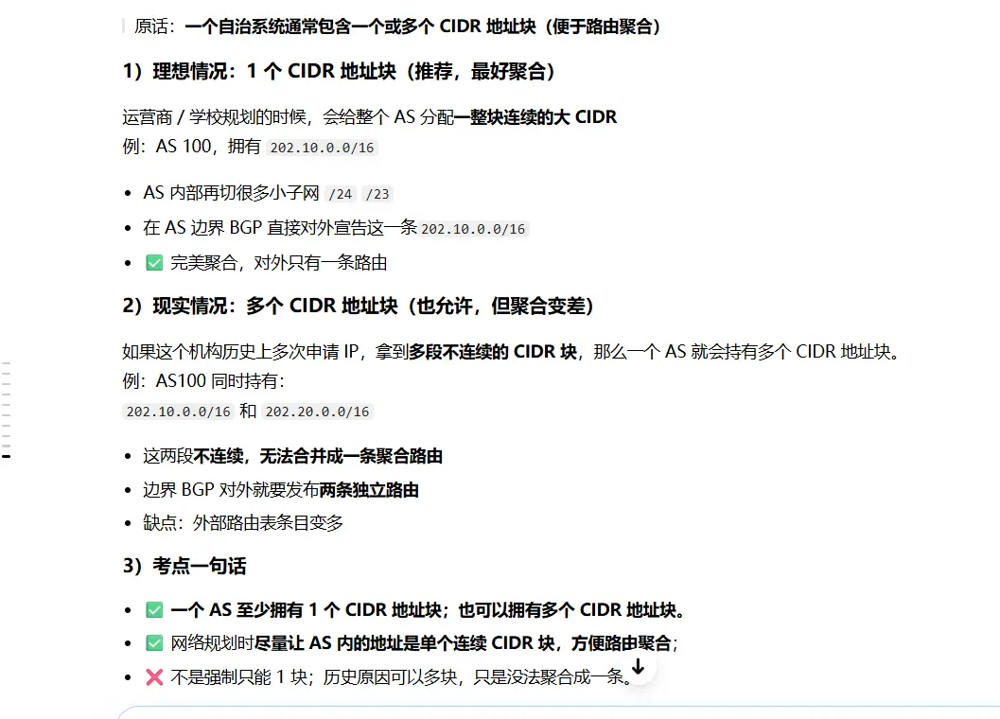

  

  

#   自治系统扩展  

> **一个自治系统通常包含一个或多个 CIDR 地址块（便于路由聚合）**

## 拆词

1. **自治系统 AS**：同一个组织管理、统一路由策略的一组路由器（层次路由里的 AS）
2. **CIDR 地址块**：`x.x.x.x/n` 这种无分类网段，例如 `202.1.0.0/16`
3. **路由聚合（超网）**：把 AS 内部很多小的子网，汇总成**一条大的 CIDR 路由**发给外部其他 AS

## 核心含义

一个 AS（比如某高校、某运营商）内部会划分很多子网，但**对外发布路由时，把内部多个子网聚合为少数几条 CIDR 大地址块**，发给其他 AS。

### 举例子

某高校 AS 内部划了： `202.1.0.0/24`、`202.1.1.0/24`、`202.1.2.0/24`、`202.1.3.0/24` 内部用 OSPF（IGP）互通； 对外（和其他 AS 用 BGP）**不单独发布 4 条路由**，而是聚合为一条：`202.1.0.0/22`。

✅ 好处：

- 外部 AS 的路由器路由表条目变少（不用记你学校里每一个小 VLAN 网段）
- 这就是层次路由思想 + CIDR 路由聚合配合使用

## 考试考点

1. AS**内部**：可以划很多子网（VLSM）
2. AS**出口边界路由器**：执行 CIDR 路由聚合，向外只宣告汇总后的 CIDR 地址块
3. 这句话的目的：**减少域间路由表条目，解决路由表膨胀**

## 一句话背诵版

自治系统 AS 内部有多个子网，将它们组织成一个或多个连续 CIDR 地址块；在 AS 边界做路由聚合，对外只发布汇总后的 CIDR 路由，减少全网路由表的条目数量。

## 关联知识点（串联你前面学的）

层次路由（AS 分层） ←依赖→ CIDR 路由聚合

- AS 内部：IGP（RIP/OSPF），管内部子网
- AS 之间：BGP，传递聚合后的 CIDR 块，**不需要暴露 AS 内部全部子网细节**

> 选择题坑：AS 不是只能拥有**一个**CIDR 块，可以多个，但尽量连续，方便聚合。如果地址块不连续，就没法聚合成一条，只能对外发布多条路由。

要不要我顺便对比：**路由聚合和子网划分**的区别，这个很容易混淆？

