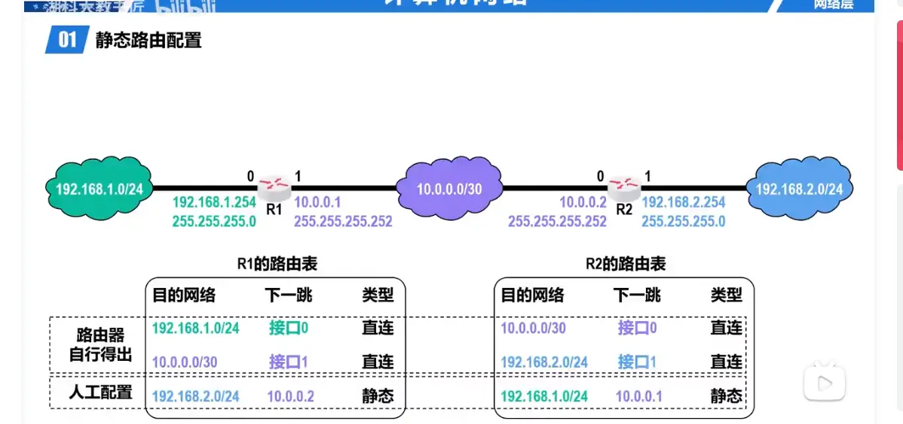
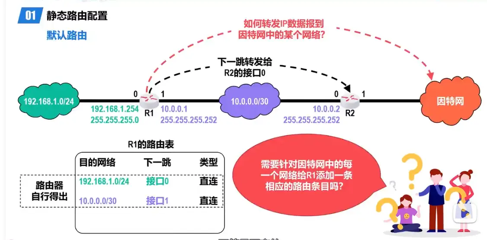
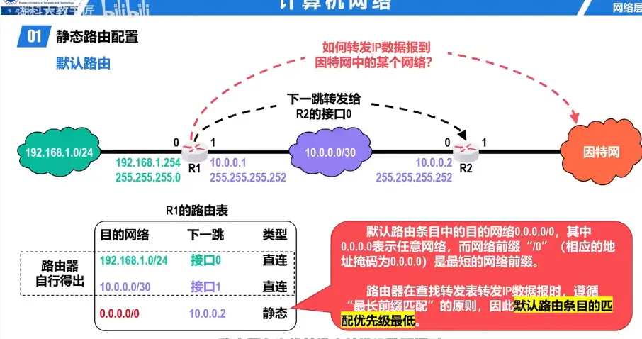
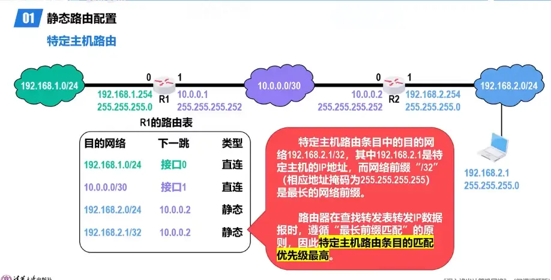
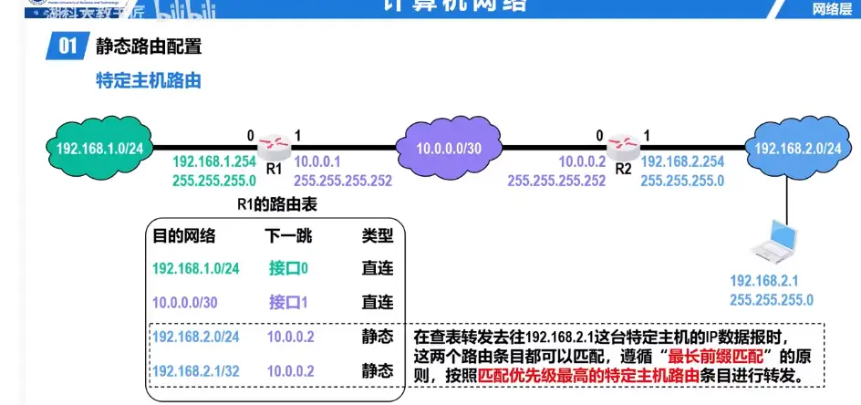
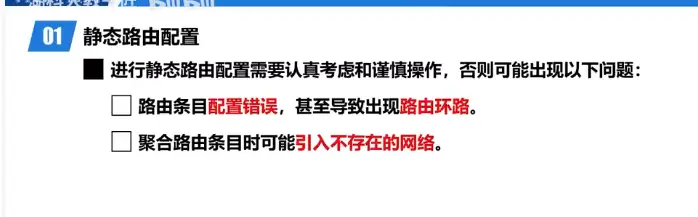

  

# 特定主机路由  
针对单个 IP 做流量管控，不影响整个网段：

- **流量牵引**：想对某台主机的流量做抓包、防火墙审计、内容过滤，给它配主机路由，下一跳指向安全审计设备，单独把它的流量引过去，其他主机正常转发，避免拖累全网性能。
- **精准封禁**：想禁用某台主机的外网访问，给它配一条主机路由，下一跳指向 `null0`（空接口，直接丢弃报文），同网段其他设备完全不受影响。

  

# 核心原因：**直连路由 vs 静态路由**

## 1. 前两条：路由器**自行得出（直连路由）**

> 直连网络：就是**直接接在路由器接口上**的网段。

- R 1 的接口 0 配置了 `192.168.1.254/24`，所以这个 `192.168.1.0/24` 网络**直接连在 R 1 接口 0**；
- R 1 的接口 1 配置了 `10.0.0.1/30`，所以 `10.0.0.0/30` 网络**直接连在 R 1 接口 1**。

路由器开机后，只要接口**启用并且配置好 IP 地址+子网掩码**，路由器会**自动计算**出这个接口对应的网段，自动加入路由表，**不需要人工输入**。 👉 这就是“路由器自行得出”，类型叫**直连路由**。

## 2. 最后一条：需要**人工配置（静态路由）**

> 非直连网络：目标网段**不直接接在当前路由器上**，要经过别的路由器才能到达。

- 对于 R 1 来说：`192.168.2.0/24` 在 R 2 的另一边，**不是直接连在 R 1 上**。
- R 1 本身不知道怎么去这个网段，必须管理员手动告诉 R 1：
    
    > 想去 `192.168.2.0/24`，下一跳地址是 `10.0.0.2`（R 2 靠近 R 1 的接口 IP）。
    

这条手动添加的条目，类型就是**静态路由**。 同理：R 2 也需要手动配置一条静态路由，告诉它去往 `192.168.1.0/24` 的下一跳是 `10.0.0.1`。

---

# 一句话总结

- ✅ **直连网段**：网线直接插在路由器接口，配好 IP，路由器自动识别，自动进路由表；
- ✅ **远端网段**：隔着另一台路由器，路由器自己不知道怎么走，**必须管理员手动写静态路由条目**。

# 访问过程  
# 拓扑回顾

- 左侧主机网段：`192.168.1.0/24`，网关 **R 1 接口 0：192.168.1.254**
- R 1-R 2 之间互联网段：`10.0.0.0/30`
    - R 1 接口 1：`10.0.0.1`
    - R 2 接口 0：`10.0.0.2`
- 右侧主机网段：`192.168.2.0/24`，网关 **R 2 接口 1：192.168.2.254**

> 场景：`192.168.1.0/24` 里一台主机（举例：`192.168.1.10`）访问右侧主机 `192.168.2.10`

---

# 完整通信过程（重点区分：**IP 地址全程不变，MAC 地址逐跳改写**）

## 第 1 步：源主机判断目标是否在同一网段

源：`192.168.1.10`，目标：`192.168.2.10` 用自己子网掩码 `255.255.255.0` 做与运算：

- 源网段：`192.168.1.0`
- 目标网段：`192.168.2.0` 不在同一个网段 → **发给网关 R 1（192.168.1.254）**

主机 ARP 查询：`192.168.1.254` 对应的 MAC 地址，得到 R 1 接口 0 的 MAC。 封装帧：

- 源 IP：`192.168.1.10`，目的 IP：`192.168.2.10`（IP 从头到尾不变！）
- 源 MAC：主机 MAC，目的 MAC：**R 1 接口 0 MAC**

帧发送到 R 1。

## 第 2 步：R 1 收到帧，查表转发

1. R 1 剥掉二层帧头，取出 IP 包，看目的 IP：`192.168.2.10`
2. 查询 R 1 路由表：
    - `192.168.2.0/24`，下一跳 `10.0.0.2`（R 2 的接口 0）
3. R 1 在自己接口 1（`10.0.0.1`）ARP 查询 `10.0.0.2` 的 MAC 地址
4. 重新封装二层帧：
    - 源 IP：`192.168.1.10`，目的 IP：`192.168.2.10`（**IP 不变**）
    - 源 MAC：R 1 接口 1 MAC，目的 MAC：**R 2 接口 0 MAC**
5. 把帧从 R 1 接口 1 发往 R 2。

## 第 3 步：R 2 收到帧，查表转发

1. R 2 剥掉二层帧头，取出 IP 包，目的 IP `192.168.2.10`
2. 查询 R 2 路由表：`192.168.2.0/24` 是直连网段（接口 1）
3. R 2 在接口 1 ARP 查询 `192.168.2.10` 的 MAC 地址
4. 再次封装二层帧：
    - 源 IP：`192.168.1.10`，目的 IP：`192.168.2.10`（**IP 依旧不变**）
    - 源 MAC：R 2 接口 1 MAC，目的 MAC：**右侧主机 MAC**
5. 帧发给目标主机 `192.168.2.10`

## 第 4 步：回程（目标主机回复数据包）

反向流程完全同理： `192.168.2.10` 判断目标 `192.168.1.10` 不在本网段 → 发给网关 R 2； R 2 路由表有静态路由 `192.168.1.0/24` 下一跳 `10.0.0.1` → 转发给 R 1； R 1 发现 `192.168.1.0/24` 是直连网段 → 转发给源主机。

---

# 408 核心考点总结

1. **IP 地址：端到端**，整个传输过程源 IP、目的 IP 始终不变；
2. **MAC 地址：链路到链路（逐跳改变）**，每经过一台路由器，二层帧的源 MAC、目的 MAC 都会被路由器重新改写；
3. 路由器转发的核心动作：**查路由表 → 找到下一跳 → 重新封装二层帧**；
4. 直连路由：路由器接口配 IP 后自动生成；跨网段路由，必须手动配静态路由（或者动态路由协议），否则路由器不知道怎么转发远端网段报文。

> 坑点：很多人误以为 IP 地址也会变，一定要区分网络层（IP）和数据链路层（MAC）的作用范围。

要不要我画一个表格，把**去程每一段链路**的源 IP/目的 IP、源 MAC/目的 MAC 全部列出来，一眼看清变化规律？

# 核心一句话

** `/32（掩码255.255.255.255）` 是路由表里面的【目标条目】，不是主机网卡上配置的 IP！**

> 主机网卡上的 IP 依然有主机位；`/32` 只是路由器路由表的一条路由记录，表示：**只匹配这一个单独 IP 地址**。

---

## 1. 先区分两个东西（绝大多数人卡在这里）

1. **主机 PC 网卡配置：`192.168.2.1/24` **
    - 掩码：`255.255.255.0`
    - 网络位 24 位，主机位 8 位。
    - ✅ 有主机号，这个 IP 是正常主机 IP，可以分配给电脑。
    - 这是**网卡接口的 IP 配置**。
2. **R 1 路由表条目：`192.168.2.1/32` **
    - 掩码：`255.255.255.255`（全部 32 位都是网络位）
    - 👉 **这不是给主机用的 IP！这是路由表的匹配规则！**
    - 含义：当数据包目的 IP**完全等于 192.168.2.1**，这条路由才算匹配。
    - 路由条目 `/32` 只是用来精确匹配**一个单独的目的 IP**，它不是分配给主机的网卡地址。

## 2. 路由表匹配过程拆解

路由查表逻辑：`目的IP` 和 `路由条目的掩码` 做**按位与运算**，结果等于路由条目的目的网络，则匹配成功。

- 路由条目：`192.168.2.1/32`，掩码 `255.255.255.255`
- 目的 IP：`192.168.2.1`
- 按位与：`192.168.2.1 & 255.255.255.255 = 192.168.2.1`，匹配✅

> 掩码全 1，代表：**必须每一位都一模一样才能匹配**，没有任何主机位可以变化。 它不是说主机本身没有主机位；只是路由器匹配的时候，要求目的 IP 必须完全相等。

## 3. 对比普通网段路由

`192.168.2.0/24`，掩码 `255.255.255.0` 按位与时，只看前 24 位；后面 8 位主机位随便是什么，只要前 24 位一致就匹配。 也就是：`192.168.2.x` 全部命中。

而 `/32`：**32 位全部检查，必须完全一模一样才命中**。

## 4. 容易踩坑的考点辨析

1. ❌ 错误理解：`192.168.2.1/32` 是电脑网卡上的 IP，主机号为 0 不能用。
2. ✅ 正确理解：**路由表写 `/32` 是匹配规则；电脑网卡还是 `/24`，正常有主机位。**

> 补充：其实现在有些设备也支持给网卡配置 `/32`（环回口常用），环回口的 `/32` 本身就是特殊用法，环回口不需要主机位，因为它就是设备本身，不需要网段内其他主机通信。但我们这个拓扑里 PC 不是环回口！PC 网卡仍然是 `/24`。

## 5. 类比理解

- `/24` 路由：匹配所有住在“2 号楼”的人（后面房间号随便）
- `/32` 路由：只匹配住在“2 号楼 001 房间”**这一个特定的人**。 “2 号楼 001 房间”这个人本身是真实存在的（主机 IP 合法）；路由规则只是要求必须精确到完整地址才能匹配，不是说这个人没有房间号。

---

# 408 真题小提醒

选择题经常挖坑：

> 问：`192.168.2.1/32` 能不能作为主机 IP 分配给普通 PC 网卡？ 答：普通以太网 PC 网卡一般**不配置/32**（因为同网段没有其他主机，无法二层通信）；但是**路由表里面完全可以存在/32 的特定主机路由条目**，用来匹配单个 IP。

要不要我再讲一下环回接口 lo 配置/32，和这个特定主机路由的区别？