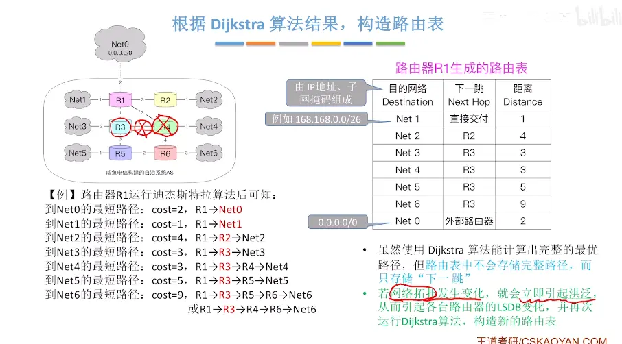
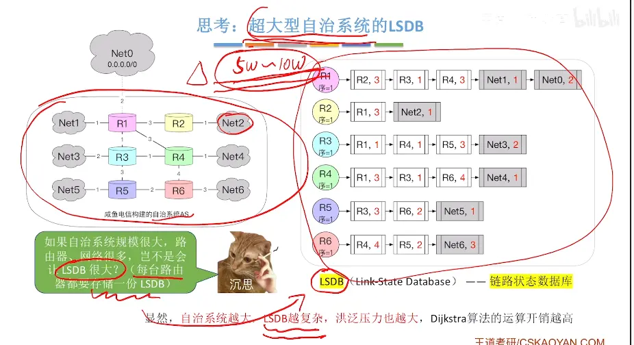
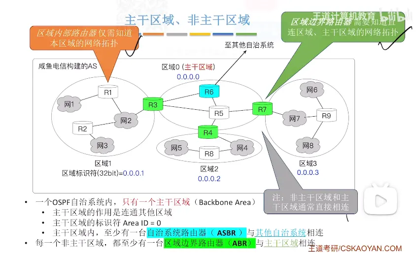
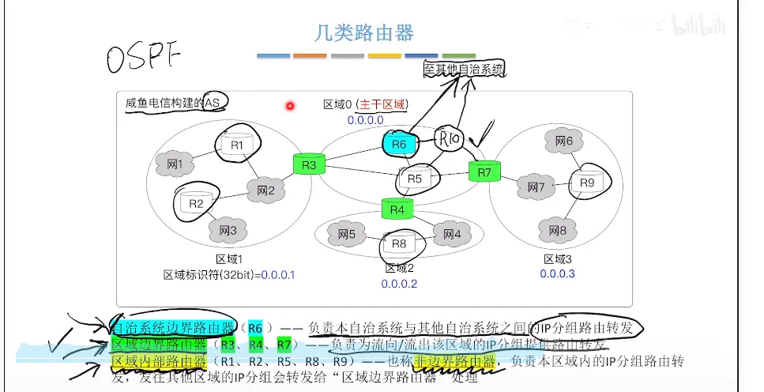
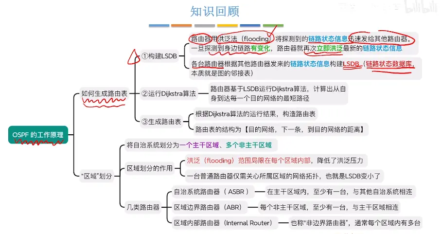
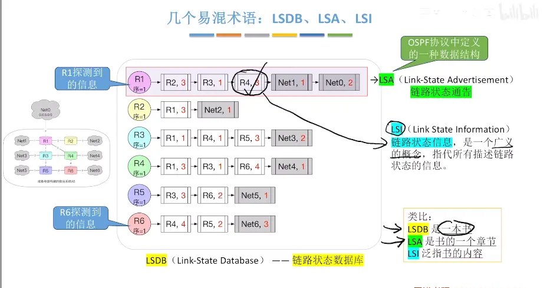
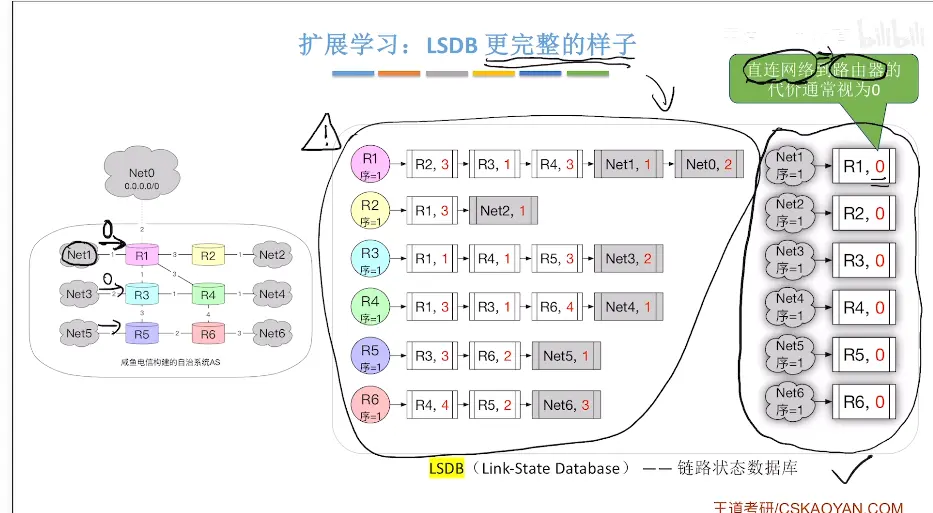

  

在计算机网路中的叫法不同（这里不叫邻接表）  
每个路由器都可以构建自己的链路状态数据库  

  

  

  
改进版的迪杰斯特拉算法  支持探测到多个最短路径 

# ospf 协议的区域划分  （扩展）

  

  

# 路由器分类
# ASBR 和 ABR（OSPF 核心考点，408 常考）

一句话区分： **ABR：区域边界路由器，在同一个自治系统 AS 内部，连接不同 OSPF 区域；** **ASBR：自治系统边界路由器，连接 OSPF 自治系统和外部其他路由协议（不同 AS）。**

> 前提：只针对 **OSPF**，这两个是 OSPF 路由器角色。

## 对比总表

|对比项|ABR（Area Border Router，区域边界路由器）|ASBR（Autonomous System Boundary Router，自治系统边界路由器）|
|---|---|---|
|**边界位置**|**AS 内部，OSPF 区域之间**   连接骨干区域 Area 0 + 非骨干区域|**OSPF AS 和外部网络之间**   OSPF 域 ↔ 其他协议（RIP、静态路由、其他 AS）|
|**接口所属区域**|至少**两个接口**，分别属于不同 OSPF 区域，**其中一个必须在 Area 0 骨干区**|接口可以全部在同一个 OSPF 区域（不一定在 Area 0）；一个接口跑 OSPF，另一个跑外部路由协议|
|**LSA 处理**|产生 **Type 3/4 LSA**（网络汇总、ASBR 汇总）   把一个区域的路由汇总，传递到另一个区域|产生 **Type 5 LSA**（外部路由）   引入外部路由，注入 OSPF 域|
|**路由类型**|处理**域内路由、域间路由（IA）**|引入**外部路由（E 1/E 2）**|
|**身份限制**|一台路由器**可以同时是 ABR+ASBR**|一台路由器**可以同时是 ABR+ASBR**|
|**典型例子**|路由器一端 Area 0，一端 Area 1|路由器一端 OSPF Area 1，另一端跑静态路由或者 BGP/RIP|

## 详细原理拆解

### 1. ABR 区域边界路由器

OSPF 把大 AS 划分为多个区域，用来减少 LSA 泛洪范围，降低路由器负载。

- ABR**同时属于多个区域**，并且必须有一个接口在骨干 Area 0。
- 作用：
    1. 在区域之间转发路由信息；
    2. 对区域内路由做汇总；
    3. 生成 Type 3 LSA（区域间路由），Type 4 LSA（告诉域内 ASBR 在哪）
        
        > 重点：**ABR 的所有操作都还在同一个 AS 里面，没有引入外部路由**
        

### 2. ASBR 自治系统边界路由器

AS 是一套统一管理、使用同一种内部网关协议（OSPF）的网络。 ASBR 负责把**外部路由**（不属于 OSPF 这个 AS 的路由）重分布引入 OSPF。

- 外部路由来源：静态路由、RIP、EIGRP、BGP 等其他协议；
- ASBR 生成 Type 5 LSA，描述外部网段，泛洪到整个 OSPF AS；
    
    > 重点：ASBR**不一定在 Area 0**，可以位于任意 OSPF 区域。 若 ASBR 在非骨干区域，ABR 会生成 Type 4 LSA，告诉其他区域：这个 ASBR 路由器的位置。
    

## 408 高频易错点

1. ✅ 一台路由器**可以既是 ABR 又是 ASBR** 例：路由器接口 1：Area 0；接口 2：Area 1；接口 3：静态路由。 接口 1+2 满足 ABR；接口 3 引入外部路由，成为 ASBR。
2. ❌ 误区：ASBR 必须在骨干区域 Area 0
    
    > ASBR 可以在任何区域。非骨干区的 ASBR，依靠 ABR 产生 Type 4 LSA 通告 ASBR 位置。
    
1. ❌ 误区：ABR 连接两个不同 AS
    
    > ABR 只在**同一个 AS 内部**，连接 OSPF 不同区域。跨 AS 边界是 ASBR/BGP 干的活。
    
2. LSA 快速记忆

- Type 1/2：区域内路由（本区域）
- Type 3：ABR 产生，**区域间路由 IA**
- Type 4：ABR 产生，**ASBR 位置**
- Type 5：ASBR 产生，**外部路由 E 1/E 2**

## 极简口诀

- **ABR：跨区域，同 AS，生成 3、4 类 LSA**
- **ASBR：跨自治系统，引外部路由，生成 5 类 LSA**

要不要我顺带区分一下 OSPF 的域内路由、域间路由、外部路由三者优先级？这个经常和 ABR/ASBR 一起出选择题。
# 总结  

  

  

