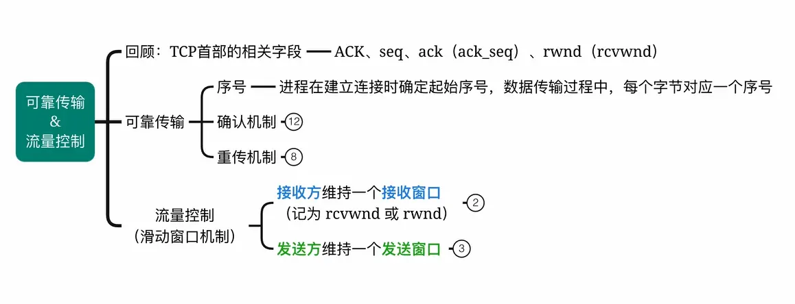  
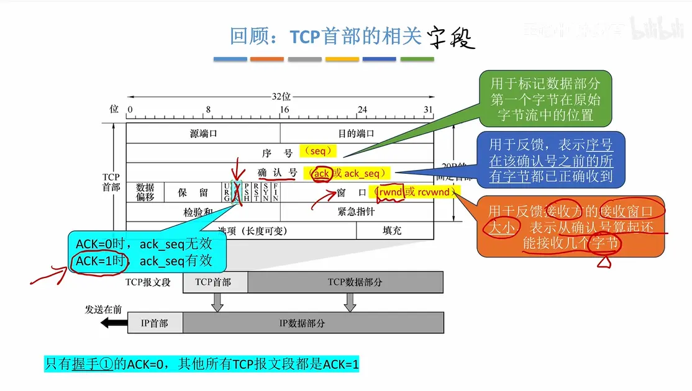  

# 例子  

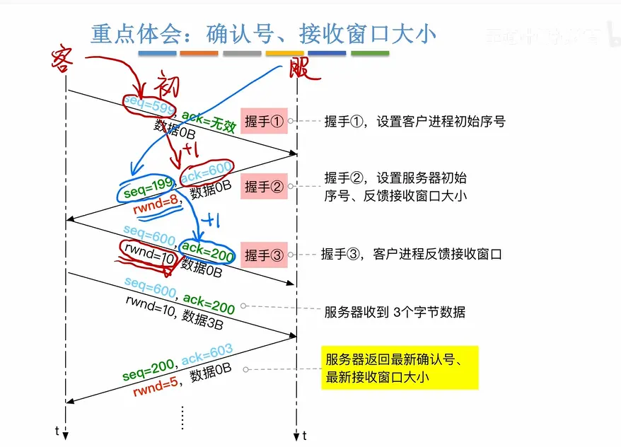  

# 握手阶段的初始化  
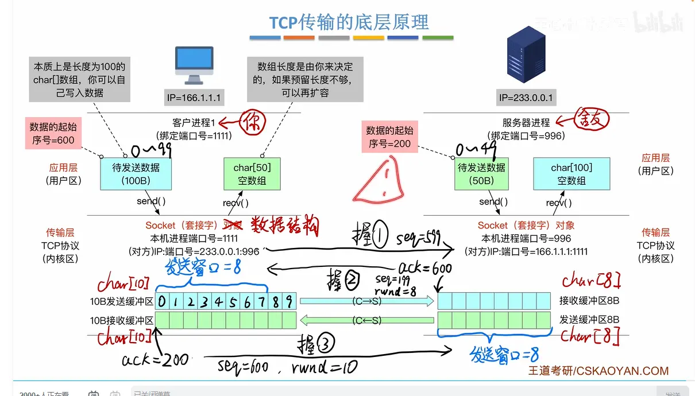  

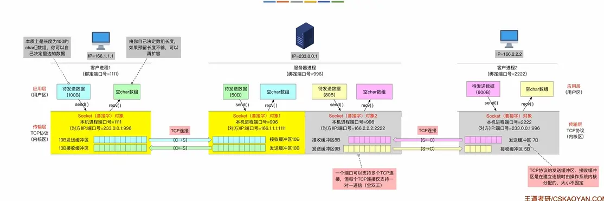  

# 数据开始传输了  
## 只有用户端传输
客户端的发送窗口要跟随服务端的变  
并且可以累计确认  

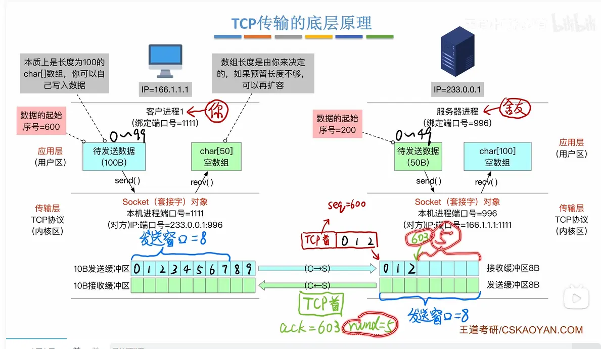 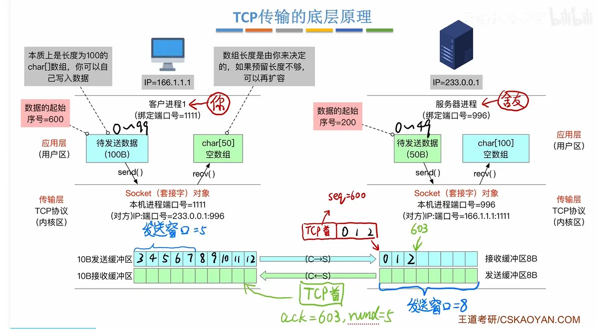  
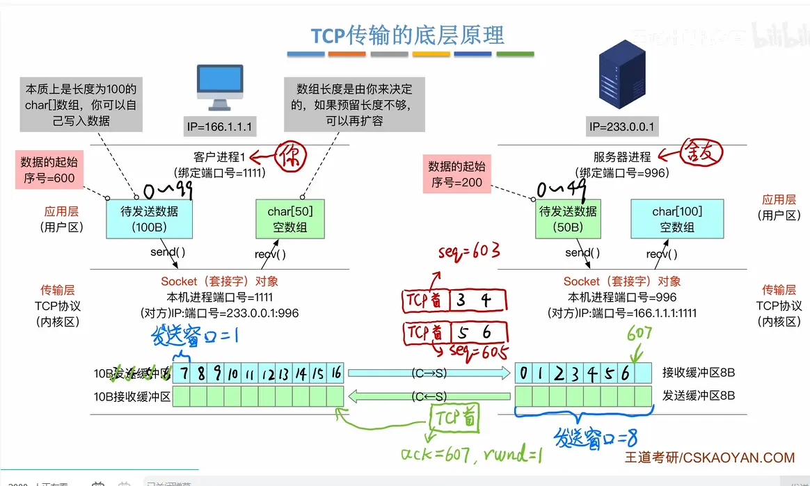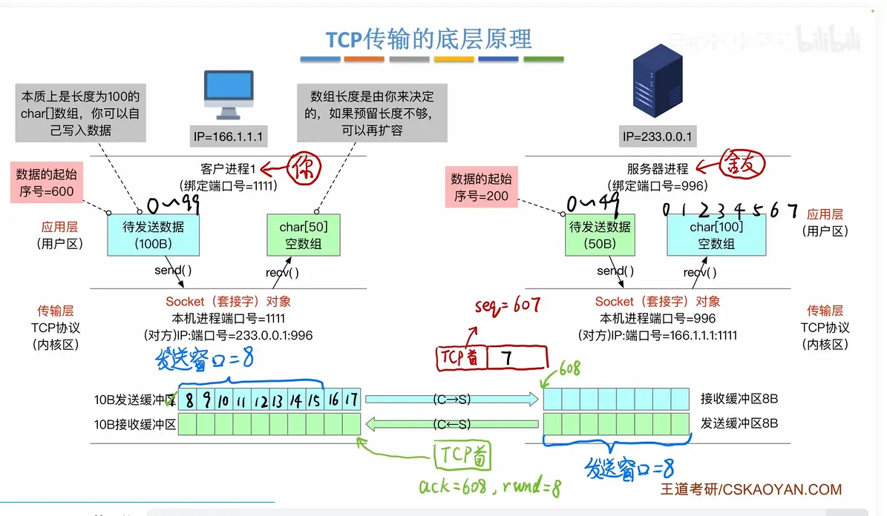  

## 服务端页传输（捎带确认）
  
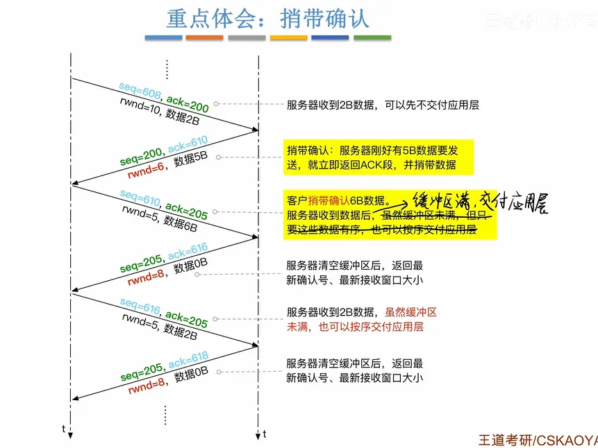

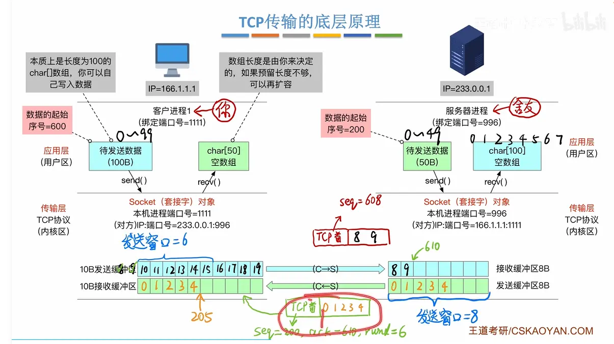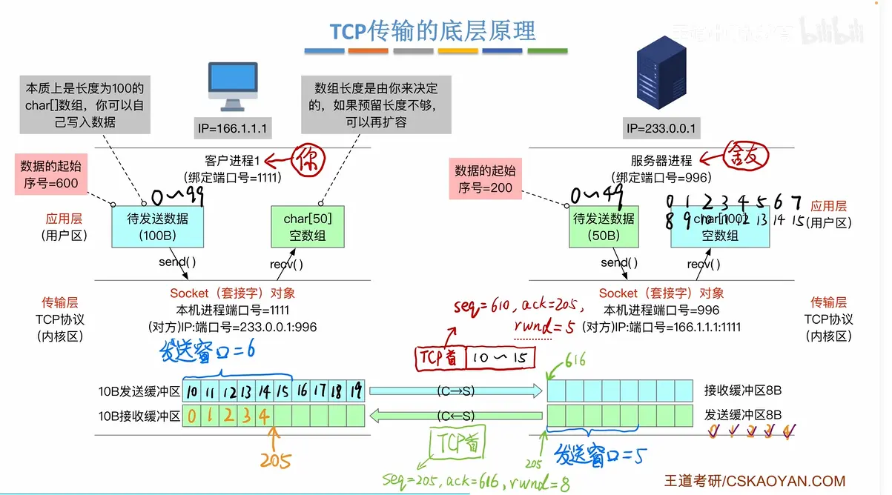 接受窗口交给用户进程必须数据有序  

## 超时重传机制  

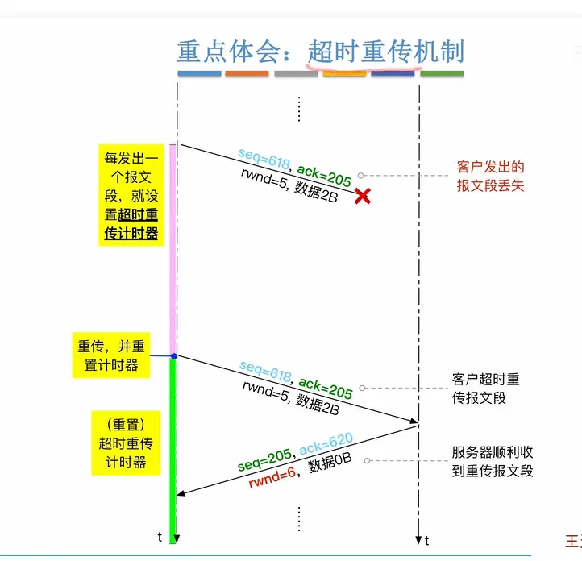  

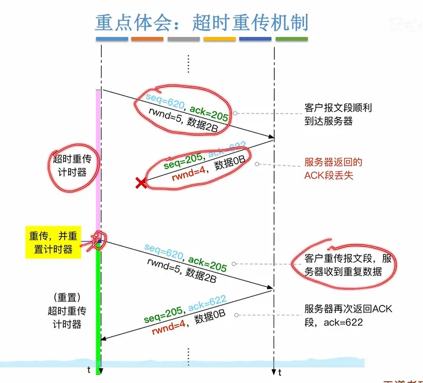  
服务器会判断重复的  不会接受  

## 快重传  

 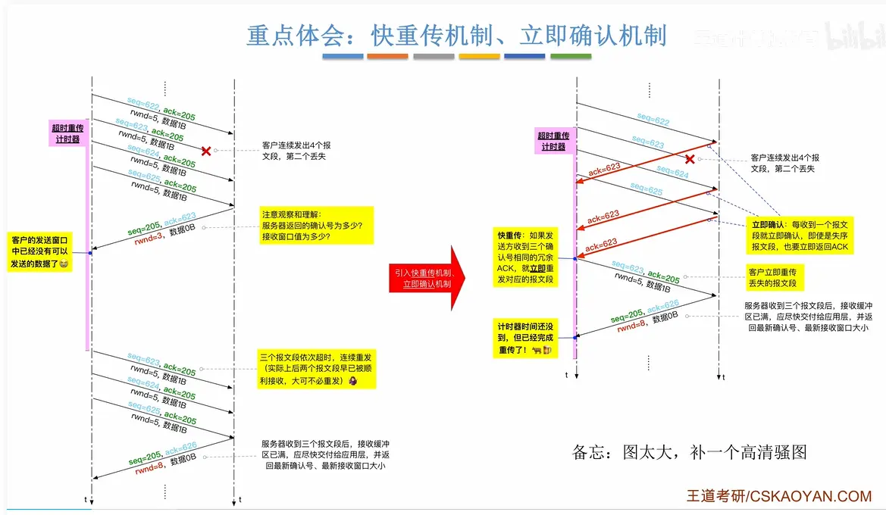
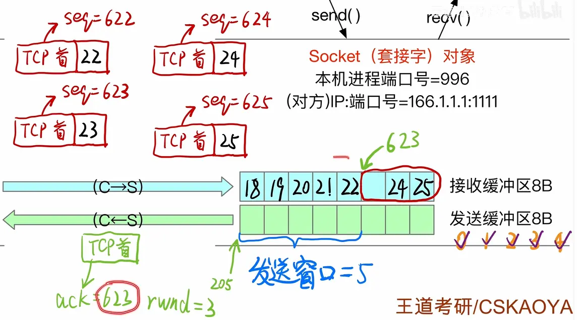  

# 总结  
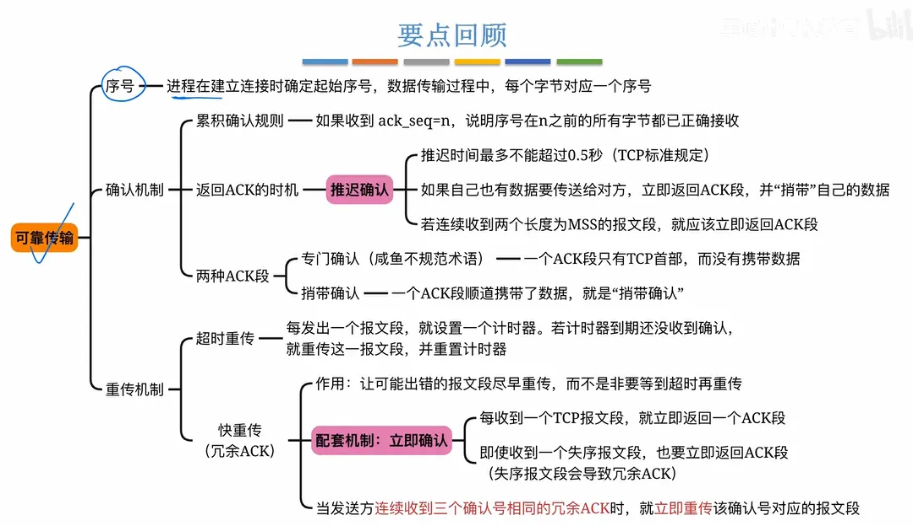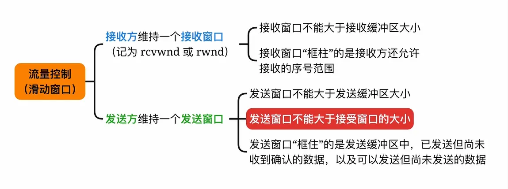