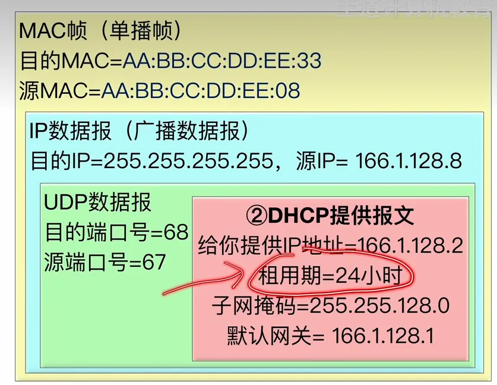
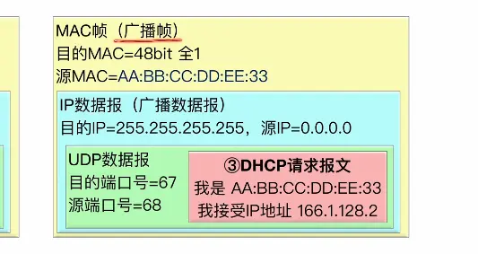

  

  

  

  
## discover
  67 这个端口号只能给 dhcp 使用  计算机网络规范中 这个端口号是不能给其他的进程来使用的
所以这个 mac 帧只能被 dhcp 服务器接收
## offer  
  
超期了  重新打招呼  
这里的虽然是广播 ip  
但是是单播帧  因为第一步的时候发给 dhcp 服务器了  

## request  

  
同一个网络中会有多个 dhcp 服务器  
dhcp 接收到主机发过来的分配 ip 的请求时     每个 dhcp 都会去给主机分配 ip 地址  
此时  主机选取其中的一个  并不能用它  而是返回一个报文  告诉自己会使用哪个报文