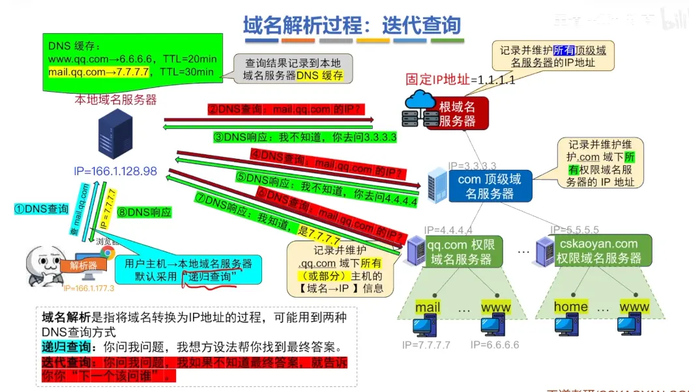
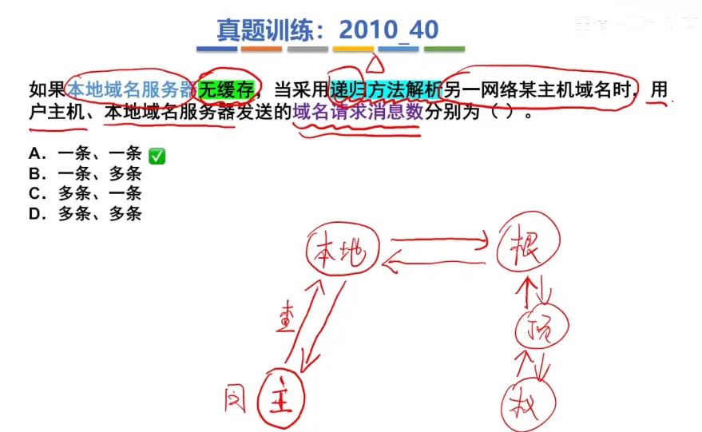
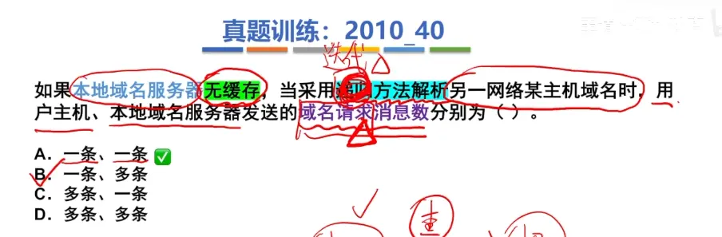
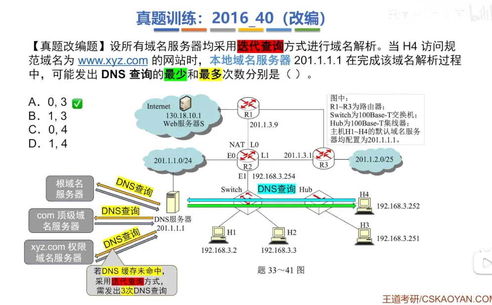

  

  

# 分层查询
  

# 解决访问量巨量的问题  
  

# 递归查询  

  

# 迭代查询  
  

# 例题  
  

这道题的核心在于理解**域名层级结构**和**迭代查询**的运作机制。

最多需要发出 3 次查询，是因为这是一个“最坏情况”（即本地域名服务器的缓存完全为空），它必须从 DNS 树状结构的“最顶端”开始，一层一层地往下问，而 `[www.xyz.com](https://www.xyz.com)` 这个域名刚好对应了 **3 个管理层级**。

结合你在 `image_35dd28.jpg` 中看到的左下角图示，我们可以把这 3 次查询的具体过程拆解如下：

### 域名解析的 3 个层级与 3 次查询

当本地域名服务器（201.1.1.1）手里完全没有关于 `[www.xyz.com](https://www.xyz.com)` 的线索时，它必须亲自出马，按顺序拜访以下三个服务器：

- **第 1 次查询：找“根域名服务器” (Root)**
    
    - **动作：** 本地域名服务器向全球**根域名服务器**询问：“你知道 `[www.xyz.com](https://www.xyz.com)` 的 IP 吗？”
        
    - **结果：** 根服务器并不知道具体的底层网站 IP，但它负责管理所有的顶级后缀。它会回答：“我不知道，但这个域名是以 `.com` 结尾的，你去问 ** `com` 顶级域名服务器**吧，它的地址是 X.X.X.X。”
        
- **第 2 次查询：找“顶级域名服务器” (TLD)**
    
    - **动作：** 本地域名服务器拿到地址后，转而向 ** `com` 顶级域名服务器**询问：“你知道 `[www.xyz.com](https://www.xyz.com)` 的 IP 吗？”
        
    - **结果：** `com` 顶级服务器依然不知道具体的网站 IP，但它管理着所有在 `.com` 下注册的二级域名。它查了一下档案说：“我不知道，但 `xyz.com` 这个域名是在我这里注册的，你去问 ** `xyz.com` 权限域名服务器**吧，它的地址是 Y.Y.Y.Y。”
        
- **第 3 次查询：找“权限域名服务器” (Authoritative)**
    
    - **动作：** 本地域名服务器最后向 ** `xyz.com` 权限域名服务器**询问：“你知道 `[www.xyz.com](https://www.xyz.com)` 的 IP 吗？”
        
    - **结果：** 权限域名服务器是这个网站的“最终管理者”，它拥有该域名下所有主机的具体记录（A 记录）。它一查数据库说：“我知道，主机 `www` 对应的 IP 是 Z.Z.Z.Z。”
        

拿到最终的 Z.Z.Z.Z 后，本地域名服务器就把这个答案返回给主机 H 4，整个迭代查询过程结束。因为层级只有三层（根 -> com -> xyz.com），所以最多只需要跑腿 **3 次**。

**补充理解：为什么最少是 0 次？**

如果本地域名服务器的**本地缓存**中已经存有了 `[www.xyz.com](https://www.xyz.com)` 的 IP 地址（比如 H 4 刚才访问过，或者同局域网的其他主机 H 1 刚访问过），它就会直接把缓存里的 IP 告诉 H 4。

在这种“缓存完全命中”的情况下，本地域名服务器**不需要向外网的任何服务器发出查询**，因此向外发出的 DNS 查询次数就是 **0**。