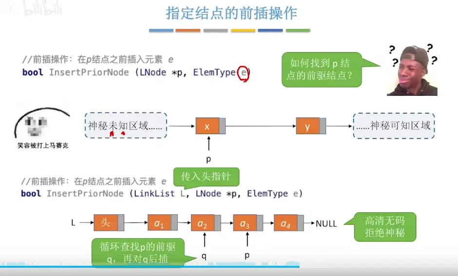
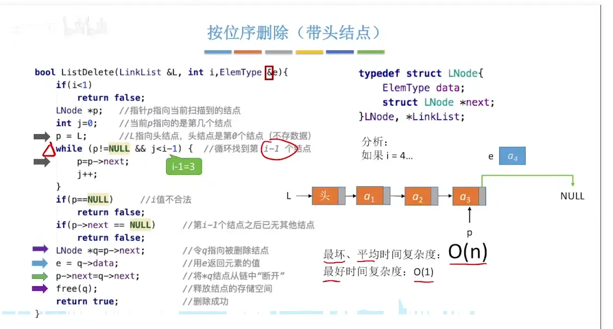

# 单链表的定义  
  
  

# 单链表的初始化（带头不带头）  
<font color="#ff0000">头结点不存放数据  视为下标 0</font>
  
  
  

# 在位序 i 处插入  

# 后插操作    


# 前插操作  
  
# 按位序删除  
C++

```
bool ListDelete(LinkList &L, int i, ElemType &e) {
    if (i < 1) 
        return false; // i 值不合法

    // 特殊情况：如果删除的是第 1 个结点
    if (i == 1) {
        if (L == NULL) 
            return false; // 空表，无法删除
        
        LNode *q = L;     // 令 q 指向被删除的第 1 个结点
        e = q->data;      // 用 e 返回被删除元素的值
        L = q->next;      // 将头指针指向下一个结点（核心区别！）
        free(q);          // 释放存储空间
        return true;
    }

    // 常规情况：删除第 2 个及以后的结点
    LNode *p = L;         // 指针 p 指向当前扫描到的结点
    int j = 1;            // 当前 p 指向的是第 1 个结点 (注意这里 j=1，带头结点时 j=0)

    // 循环找到第 i-1 个结点
    while (p != NULL && j < i - 1) { 
        p = p->next;
        j++;
    }

    // p 为 NULL 说明 i 值超出了链表长度；p->next 为 NULL 说明第 i-1 个结点后已无其他结点
    if (p == NULL || p->next == NULL) 
        return false; 

    LNode *q = p->next;   // 令 q 指向被删除结点 (第 i 个结点)
    e = q->data;          // 用 e 返回元素的值
    p->next = q->next;    // 将 *q 结点从链中“断开”
    free(q);              // 释放结点的存储空间
    return true;          // 删除成功
}
```

