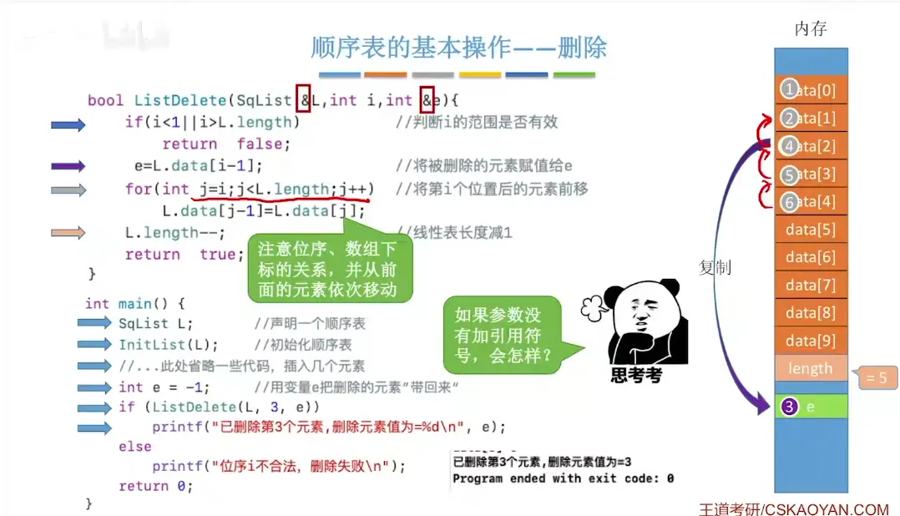
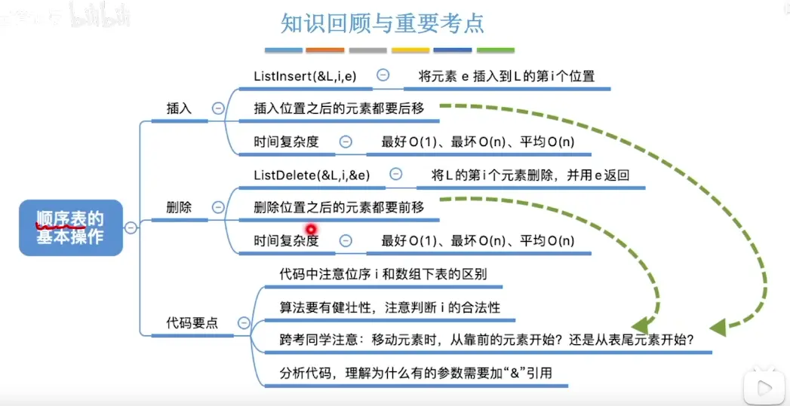

  
  

# 静态分配
  

# 动态分配  
  

# 特点  
  
这里的位置计算使用的是下标
# 在 i 位序插入一个数  
在 i-1 下标插入一个数   
i-1 下标开始需要往后移  
第一次 length-1=length -2
最后一次 i=i-1

# 在 i 位序删除  
第一次 i-1=i  
最后一次 len -2=len-1
  

# 查找 i 位序值  

# 
# 时间复杂度  
