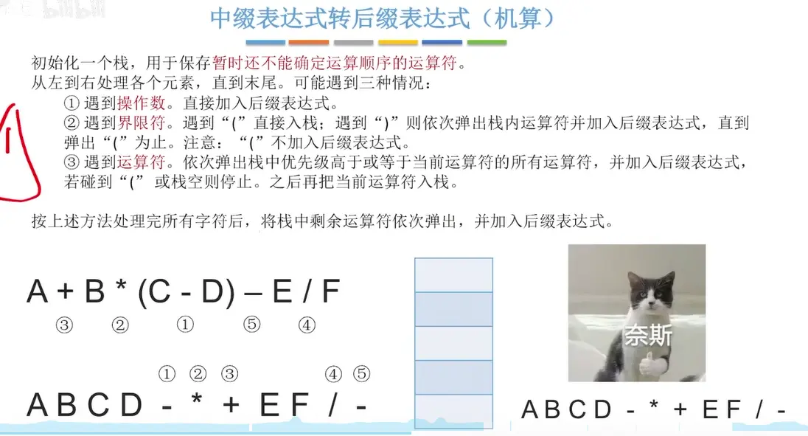
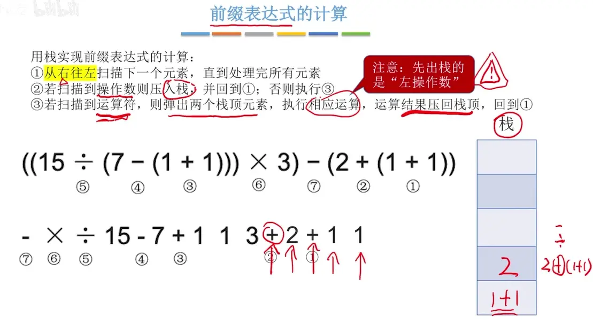
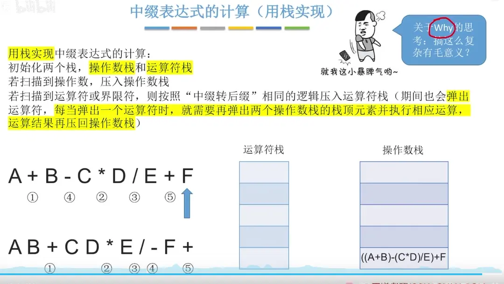
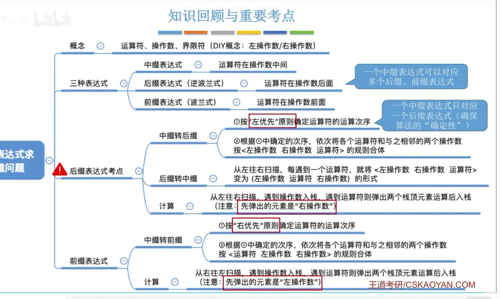

# 中缀 后缀 前缀表达式  
  

# 中缀转后缀（左优先原则）  
运算符从左到右先生效

  

# 后缀表达式的运算   

  

后缀表达式运算 （代码实现）  
  

# 中缀转前缀  （右优先原则）
运算符从右到左依次生效
  

# 前缀表达式运算  

  

# 中缀表达式的计算（用栈实现）  
  

用这个算法可以把一个很复杂的运算拆解成 一个个的基本运算，这些运算作为基本指令交个 cpu 进行处理，使用 cpu 可以逐条执行  

# 总结  
