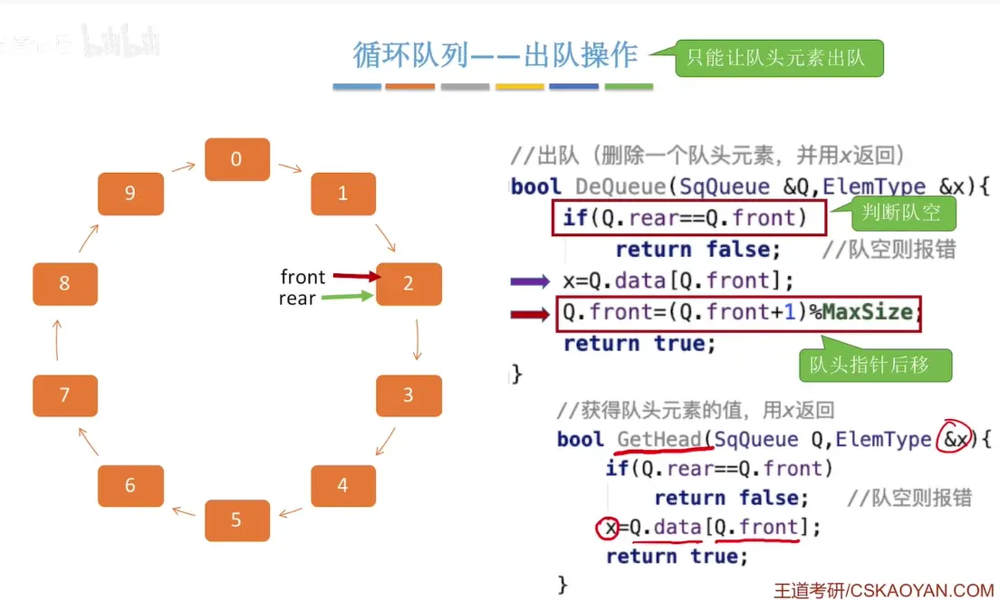
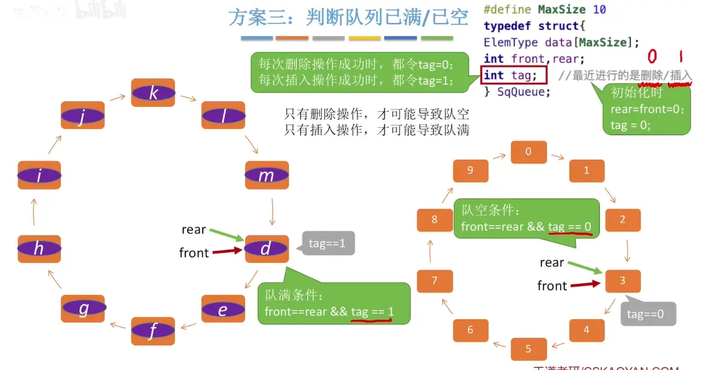
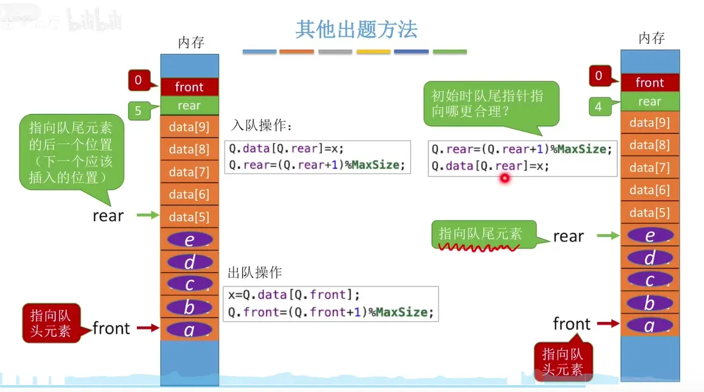
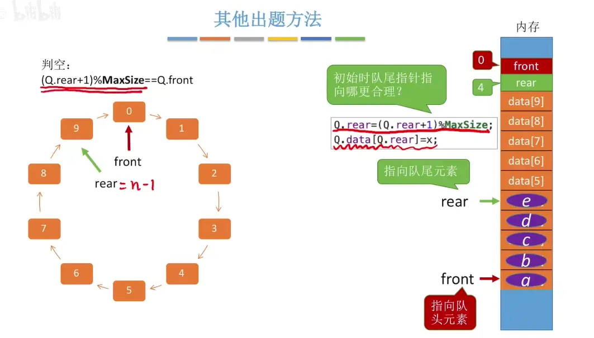
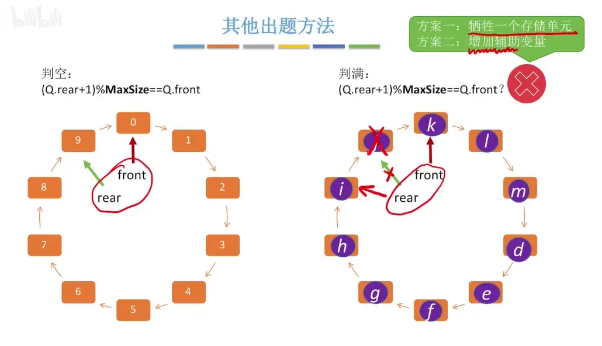

# 队列的初始化 判空  
  

# 入队操作  (循环队列)
  
  
  

# 出队操作  获取队头元素  (循环队里)

# 判断队列 已满/已空操作  
## 牺牲一个存储空间  
  
## 定义一个 size  
  

## 设置标志位 tag  
  

# 队尾指针指向队尾元素（先加后填）

  
牺牲 一个存储单元   填充了 i 之后  rear 会自动的指向 k 前面的那个节点  
但是节点