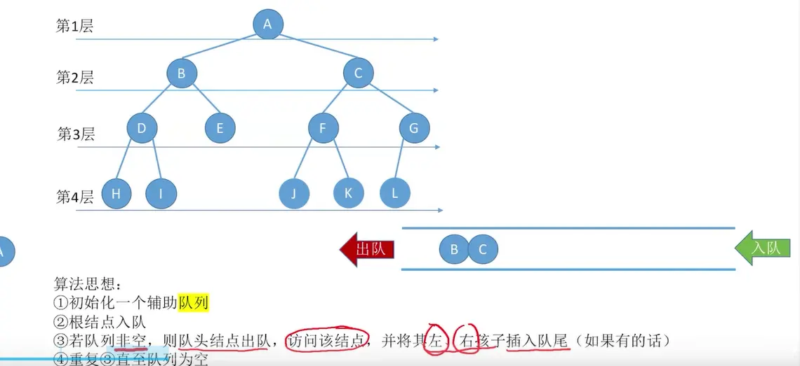

# 二叉树的层次遍历  

  
# 代码实现（链队列）  
  


```c++
#include <stdio.h>
#include <stdlib.h>
#include <stdbool.h>

// ==================== 数据结构定义 ====================

// 1. 二叉树的结点 (链式存储)
typedef struct BiTNode{
    char data;
    struct BiTNode *lchild, *rchild;
} BiTNode, *BiTree;

// 2. 链式队列结点 (注意：存的是指向二叉树结点的指针)
typedef struct LinkNode{
    BiTNode * data;           // 存指针而不是结点
    struct LinkNode *next;
} LinkNode;

// 3. 链式队列
typedef struct{
    LinkNode *front, *rear;   // 队头、队尾指针
} LinkQueue;


// ==================== 队列基本操作 ====================
// (图片中省略了这部分实现，这里予以补全，带头结点的链队)

// 初始化辅助队列
void InitQueue(LinkQueue &Q) {
    Q.front = Q.rear = (LinkNode*)malloc(sizeof(LinkNode)); // 分配头结点
    Q.front->next = NULL;
}

// 判断队列是否为空
bool IsEmpty(LinkQueue Q) {
    return Q.front == Q.rear;
}

// 将元素入队 (尾插法)
void EnQueue(LinkQueue &Q, BiTree x) {
    LinkNode *s = (LinkNode*)malloc(sizeof(LinkNode));
    s->data = x;
    s->next = NULL;
    Q.rear->next = s; // 新结点插入到队尾
    Q.rear = s;       // 修改表尾指针
}

// 将元素出队 (头删法)
bool DeQueue(LinkQueue &Q, BiTree &x) {
    if(Q.front == Q.rear) return false; // 空队
    LinkNode *p = Q.front->next;        // p 指向出队结点
    x = p->data;                        // 用 x 返回队头元素
    Q.front->next = p->next;            // 断开 p 结点
    if(Q.rear == p) {                   // 如果原队列中只有一个结点，出队后变为空队
        Q.rear = Q.front;
    }
    free(p);
    return true;
}


// ==================== 二叉树操作 ====================

// 访问结点函数
void visit(BiTree p) {
    printf("%c ", p->data);
}

// 层序遍历 (完全按照图片中的逻辑)
void LevelOrder(BiTree T){
    LinkQueue Q;
    InitQueue(Q);               // 初始化辅助队列
    BiTree p;
    EnQueue(Q, T);              // 将根结点入队
    while(!IsEmpty(Q)){         // 队列不空则循环
        DeQueue(Q, p);          // 队头结点出队
        visit(p);               // 访问出队结点
        if(p->lchild != NULL)
            EnQueue(Q, p->lchild); // 左孩子入队
        if(p->rchild != NULL)
            EnQueue(Q, p->rchild); // 右孩子入队
    }
}


// ==================== 测试代码 ====================

int main() {
    /* * 手动构造一棵测试用的二叉树:
     * A
     * / \
     * B   C
     * / \   \
     * D   E   F
     */
    BiTNode *n1 = (BiTNode*)malloc(sizeof(BiTNode));
    BiTNode *n2 = (BiTNode*)malloc(sizeof(BiTNode));
    BiTNode *n3 = (BiTNode*)malloc(sizeof(BiTNode));
    BiTNode *n4 = (BiTNode*)malloc(sizeof(BiTNode));
    BiTNode *n5 = (BiTNode*)malloc(sizeof(BiTNode));
    BiTNode *n6 = (BiTNode*)malloc(sizeof(BiTNode));

    n1->data = 'A'; n2->data = 'B'; n3->data = 'C';
    n4->data = 'D'; n5->data = 'E'; n6->data = 'F';

    n1->lchild = n2;   n1->rchild = n3;
    n2->lchild = n4;   n2->rchild = n5;
    n3->lchild = NULL; n3->rchild = n6;
    n4->lchild = NULL; n4->rchild = NULL;
    n5->lchild = NULL; n5->rchild = NULL;
    n6->lchild = NULL; n6->rchild = NULL;

    printf("二叉树层序遍历结果: ");
    LevelOrder(n1);
    printf("\n");

    return 0;
}
```