# 拼凑法
  
# 常见二进制记忆
  补码的强制规定  
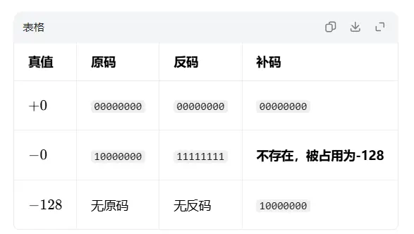
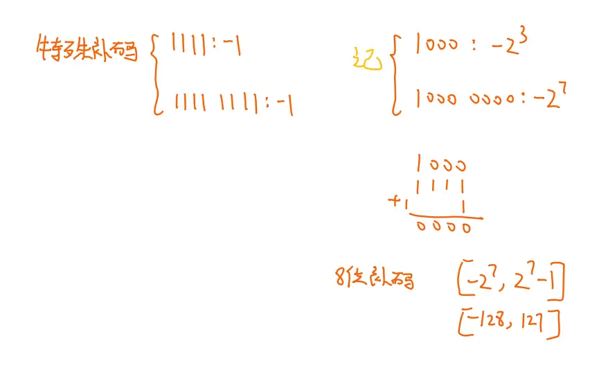
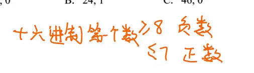

# 补码和源码的快速转换
  

# 源码补码表示范围  

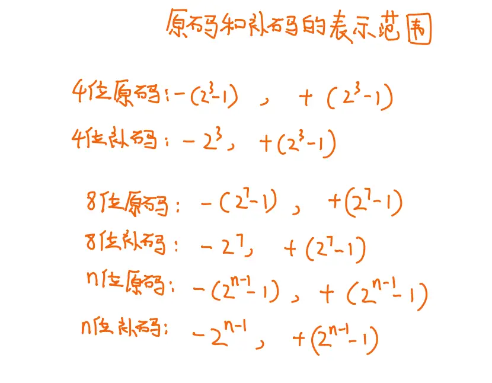  

# 补码求真值  （负数算法  正数按权展开）

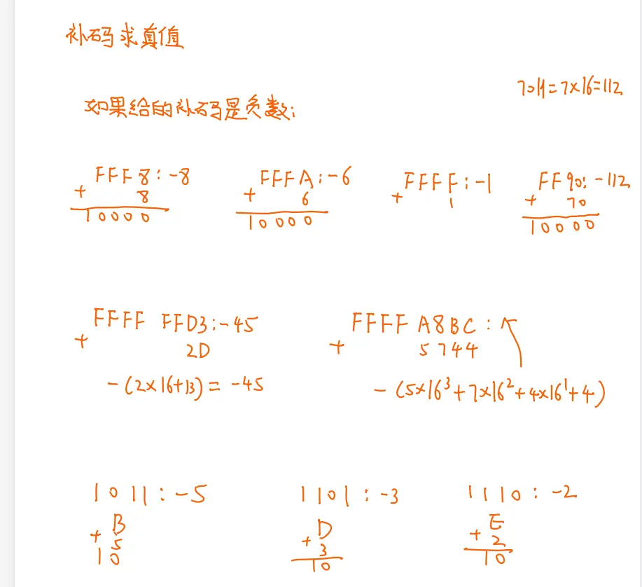  
## 总结（第 3 种）
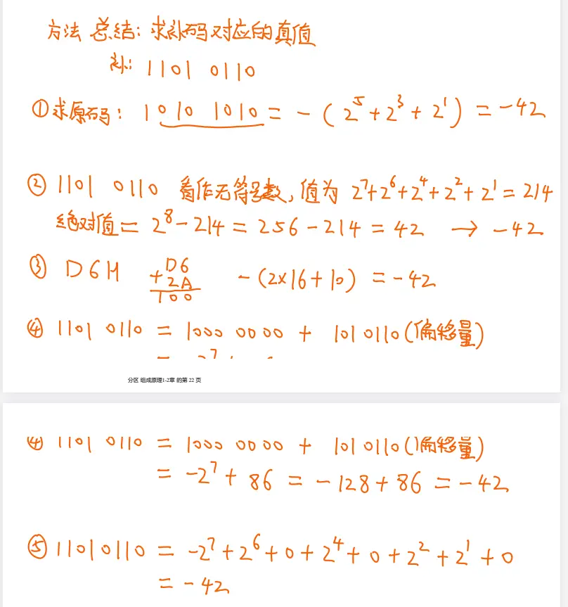
# 真值求补码  

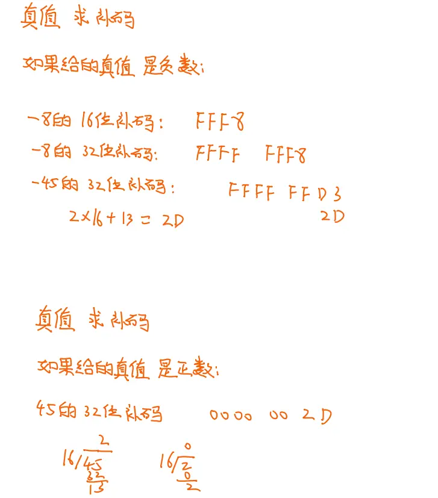

# 移码和真值的互相转换  

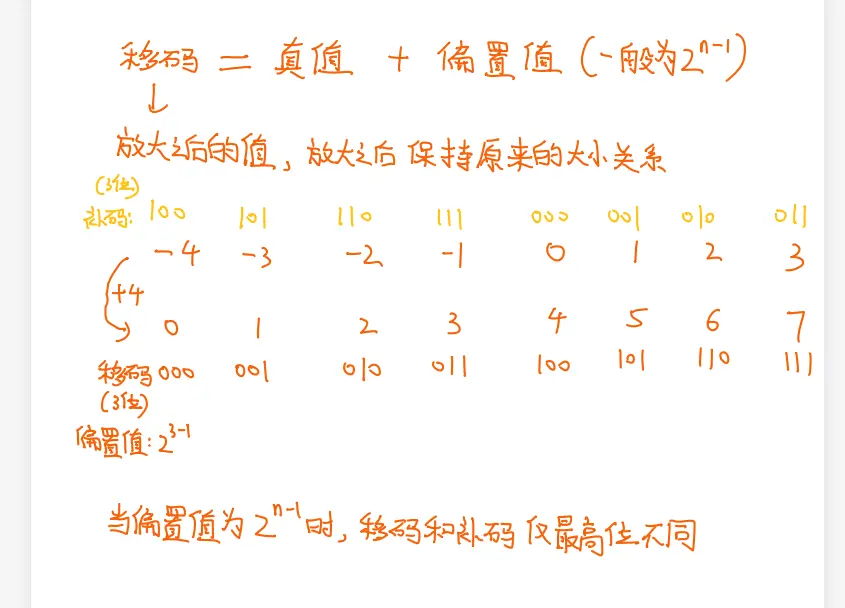  
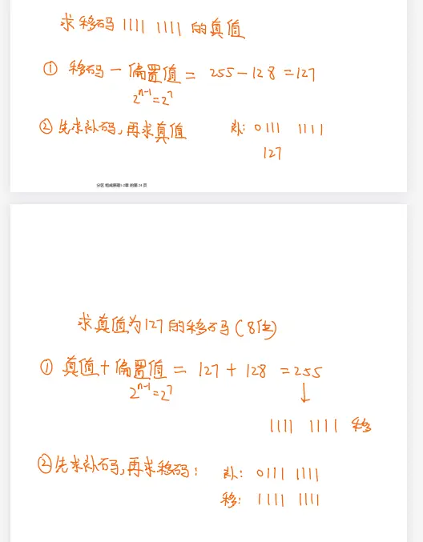  
把移码当成无符号数来计算的话 这里可以直接判断出真值的大小  正负都可以  

# 补码比大小  
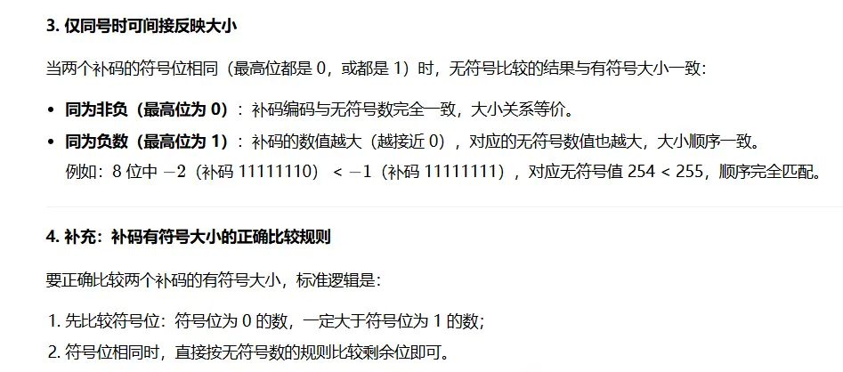  

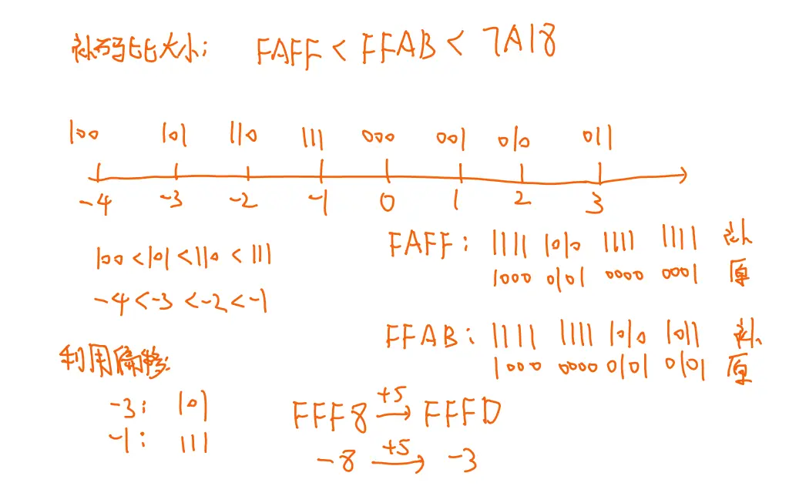