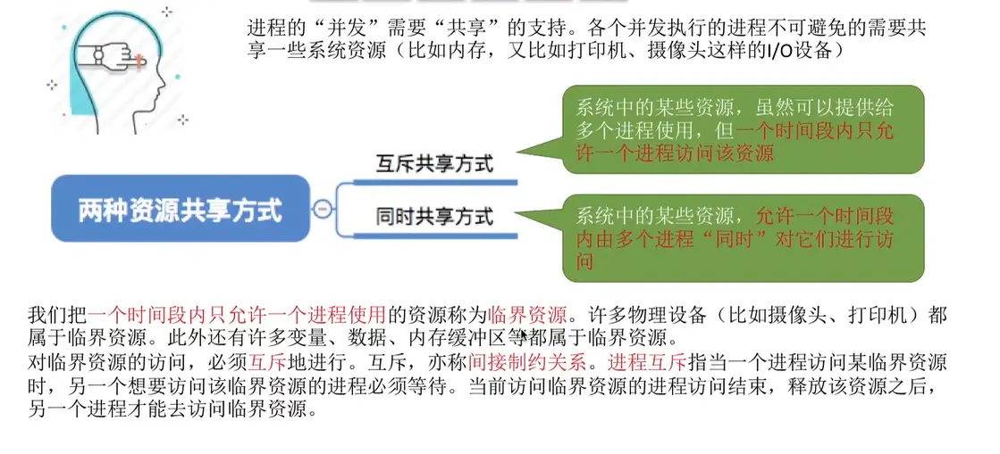

在操作系统中，互斥（Mutual Exclusion）**和**同步（Synchronization）是解决并发进程之间关系的两种核心机制。简单来说，**互斥是为了防止冲突，而同步是为了协调步骤。**

## 1. 互斥（Mutual Exclusion）

互斥解决的是资源**竞争**问题（也称为间接制约关系）。

- **定义：** 当多个进程（或线程）需要访问同一个临界资源（Critical Resource，如打印机、共享变量、物理内存段）时，在同一时刻只允许一个进程访问。其他试图访问该资源的进程必须等待，直到当前进程释放资源。

    
- **现实比喻：** 两个人想用同一个单间洗手间。一个人进去后锁上门，另一个人只能在外面等，直到里面的人出来。
    
- **核心特征：** 进程之间互相并不知道对方的运行逻辑，它们只是在抢夺同一个资源。谁先抢到谁先用，执行的先后顺序是不确定的。
    

## 2. 同步（Synchronization）

同步解决的是进程间的**协作**问题（也称为直接制约关系）。

- **定义：** 多个进程为了完成某个共同任务，必须按照特定的**先后顺序**执行。一个进程的执行依赖于另一个进程完成特定操作或发送信号。
    
- **现实比喻：** 厨师做菜与服务员上菜（经典的生产者-消费者问题）。厨师没有把菜做好放在出餐台上，服务员就只能等待；服务员没有把餐台上的菜端走，厨师就没有空盘子继续放新菜。
    
- **核心特征：** 进程之间是合作关系，互相知道对方的存在，并且需要互相等待或发送信号来推进整体任务的进度。
    

## 3. 核心区别对比

|**维度**|**互斥 (Mutual Exclusion)**|**同步 (Synchronization)**|
|---|---|---|
|**核心目的**|保护临界资源，防止数据不一致或冲突|控制执行顺序，确保任务按逻辑先后完成|
|**关系类型**|竞争关系（间接制约）|协作关系（直接制约）|
|**执行顺序**|谁先抢到资源谁先执行，**顺序不确定**|必须按照特定逻辑执行，**顺序严格确定**|
|**依赖性**|进程间相互独立，只因争夺资源才发生联系|进程间存在功能依赖，互相等待对方的信号|

## 4. 在信号量（Semaphore）实现上的区别

在操作系统中，这两种机制通常都可以通过信号量机制（P/V 操作）来实现，但代码结构和初始值截然不同：

- **互斥：PV 操作在同一个进程中成对出现。**
    
    - 互斥信号量（Mutex Semaphore）的初值通常设为 `1`。
        
    - 执行逻辑：`P(mutex)`（加锁） $\rightarrow$ 访问临界区 $\rightarrow$ `V(mutex)`（解锁）。这两个操作都在同一个进程的代码块内。
        
- **同步：PV 操作交叉出现在不同的进程中。**
    
    - 同步信号量（Sync Semaphore）的初值通常设为 `0` 或可用资源的数量。
        
    - 执行逻辑：前置进程在完成任务后执行 `V(sync)`（唤醒/发送信号）；后置进程在开始任务前执行 `P(sync)`（等待/接收信号）。这两个操作分别在两个不同进程的代码中。