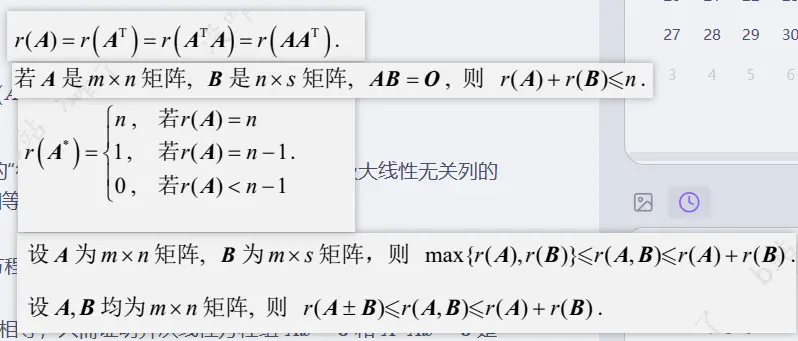

这五组关于**矩阵的秩（Rank）**的公式，是线性代数（尤其是考研线代）中最核心的“大杀器”。理解它们不需要死记硬背，我们可以通过**几何直观**、**方程组**以及**极大线性无关组**的视角来逐一拆解。

### 1. 伴随转置同秩定理

$$r(A) = r(A^{\top}) = r(A^{\top}A) = r(AA^{\top})$$

- ** $r(A) = r(A^{\top})$ 的本质**：一个矩阵的“行秩”等于“列秩”。也就是说，矩阵的极大线性无关列的个数，和极大线性无关行的个数总是相等的。
    
- ** $r(A^{\top}A) = r(A)$ 的证明突破口（解方程组视角）**：
    
    这是考研的高频考点。要证明它们秩相等，只需证明齐次线性方程组 $Ax = \mathbf{0}$ 和 $A^{\top}Ax = \mathbf{0}$ 是**同解方程组**。
    
    - 如果 $Ax = \mathbf{0}$，两边左乘 $A^{\top}$ 显然有 $A^{\top}Ax = \mathbf{0}$。
        
    - 如果 $A^{\top}Ax = \mathbf{0}$，两边左乘 $x^{\top}$ 得到 $x^{\top}A^{\top}Ax = \mathbf{0}$，即 $(Ax)^{\top}(Ax) = 0$。在实数域下，向量的内积为 0 意味着向量本身必须为 0，所以 $Ax = \mathbf{0}$。
        
    - 既然解集完全一样，它们的未知数个数 $n$ 也一样，根据基础解系的维数公式 $n - r$，它们的秩必然相等。
        

> 💡 **核心记忆：** 矩阵乘上自己的转置，不管左乘还是右乘，**完全不改变原矩阵的秩**。

### 2. 乘积为零矩阵定理

> 若 $A$ 是 $m \times n$ 矩阵，$B$ 是 $n \times s$ 矩阵，且 $AB = O$，则：
> 
> $$r(A) + r(B) \le n$$

- **解方程组视角（最直观）**：
    
    把矩阵 $B$ 按列展开成 $B = (\boldsymbol{\beta}_1, \boldsymbol{\beta}_2, \cdots, \boldsymbol{\beta}_s)$。
    
    因为 $AB = O$，所以 $A(\boldsymbol{\beta}_1, \boldsymbol{\beta}_2, \cdots, \boldsymbol{\beta}_s) = (\mathbf{0}, \mathbf{0}, \cdots, \mathbf{0})$。
    
    这意味着 ** $B$ 的每一个列向量 $\boldsymbol{\beta}_i$ 都是齐次方程组 $Ax = \mathbf{0}$ 的解**！
    
- **秩的推导**：
    
    既然 $B$ 的所有列向量都是 $Ax = \mathbf{0}$ 的解，那么由这些列向量构成的向量组的秩 $r(B)$，绝对不可能超过整个解空间（基础解系）的维数。
    
    而 $Ax = \mathbf{0}$ 的解空间维数是 $n - r(A)$。
    
    因此得到：$r(B) \le n - r(A)$，移项即得 $r(A) + r(B) \le n$。
    

> 💡 **核心记忆：** 两矩阵相乘为 $O$，说明后矩阵的列全部落在了前矩阵的解空间里，**解空间的容量（$n - r(A)$）限制了后矩阵的秩**。

### 3. 伴随矩阵的秩（分水岭定理）

$$r(A^*) = \begin{cases} n, & \text{若 } r(A) = n \\ 1, & \text{若 } r(A) = n - 1 \\ 0, & \text{若 } r(A) < n - 1 \end{cases}$$

这个公式的背后是行列式展开和公式 $AA^* = |A|E$ 的完美体现：

- **情况一：$r(A) = n$（满秩）**
    
    此时 $|A| \ne 0$，由于 $AA^* = |A|E$，两边取行列式可得 $|A| \cdot |A^*| = |A|^n \Rightarrow |A^*| = |A|^{n-1} \ne 0$。既然 $A^*$ 的行列式不为 0，它也是满秩的，所以 $r(A^*) = n$。
    
- **情况二：$r(A) = n - 1$（降 1 阶）**
    
    此时 $|A| = 0$，所以 $AA^* = O$。根据上面第 2 条定理，有 $r(A) + r(A^*) \le n \Rightarrow (n-1) + r(A^*) \le n \Rightarrow r(A^*) \le 1$。
    
    同时，因为 $r(A) = n-1$，说明 $A$ 至少存在一个 $n-1$ 阶子式不为 0。而 $A^*$ 的元素恰好就是这些 $n-1$ 阶代数余子式，说明 $A^*$ 中至少有一个元素不为 0，即 $r(A^*) \ge 1$。结合起来，只能是 $r(A^*) = 1$。
    
- **情况三：$r(A) < n - 1$（塌陷）**
    
    此时 $A$ 的所有 $n-1$ 阶子式全部为 0。这意味着 $A^*$ 里的每一个元素全都是 0（全是零矩阵），所以秩直接塌陷为 0。
    

### 4. 矩阵拼块的秩（并列组合）

> 设 $A$ 为 $m \times n$ 矩阵，$B$ 为 $m \times s$ 矩阵，则：
> 
> $$\max\{r(A), r(B)\} \le r(A, B) \le r(A) + r(B)$$

把 $A$ 和 $B$ 横向拼成一个大矩阵 $(A, B)$：

- **左边的不等式 $\max\{r(A), r(B)\} \le r(A, B)$ **：
    
    把 $B$ 拼进来，只可能在大矩阵里增加新的线性无关向量，绝对不可能让原来 $A$ 里本来就无关的向量变相关。所以大矩阵的秩至少不会比 $A$ 或 $B$ 单独的秩小。
    
- **右边的不等式 $r(A, B) \le r(A) + r(B)$ **：
    
    大矩阵 $(A, B)$ 的最大线性无关组，最多也就是从 $A$ 的极大无关组（$r(A)$ 个）和 $B$ 的极大无关组（$r(B)$ 个）里挑选拼凑出来的。即使两边完全没有交集，总数最多也就是 $r(A) + r(B)$。
    

### 5. 矩阵和/差的秩（空间叠加）

> 设 $A, B$ 均为 $m \times n$ 矩阵，则：
> 
> $$r(A \pm B) \le r(A, B) \le r(A) + r(B)$$

- **为什么要引入中间的 $r(A, B)$？**
    
    因为 $A+B$ 的每一列，都是 $A$ 的对应列与 $B$ 的对应列相加得到的。
    
    根据向量空间的性质，由 $A+B$ 的列向量组合出来的空间，**完全被包含在**由 $A$ 和 $B$ 的所有列向量共同组合出来的空间（即拼块矩阵 $(A, B)$ 的列空间）里。
    
    因为空间被包含，所以秩一定更小：$r(A \pm B) \le r(A, B)$。
    
- **最终结论**：
    
    结合第 4 条定理的右半部分，直接搭桥得到了最常用的考研不等式：
    
    $$r(A \pm B) \le r(A) + r(B)$$
    

> 💡 **宏观几何直观：** 秩代表的是“维度”或“占领的空间”。两个矩阵做加减法，他们叠加后的总维度，绝对不可能超过他们各自独立维度之和。这就是线代里的“三角不等式”。  

