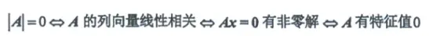
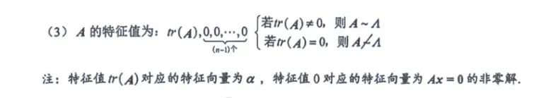

# 转化为非 0 解的问题
图片 "image_75 bd 1 e.png" 展示的是线性代数中最核心的“等价命题链”之一（前提是 $A$ 为 $n$ 阶方阵）。这四个命题用不同的数学语言，描述了方阵 $A$ 的同一种“残缺”状态——**不可逆（奇异）**。

我们可以把它们拆解开，从本质上理解为什么它们完全等价：

### 1. 核心纽带：$A$ 的列向量线性相关 $\iff A\boldsymbol{x}=\boldsymbol{0}$ 有非零解

这是最关键的一步，本质是对**矩阵乘法**的理解。

- 把矩阵 $A$ 按列分块，记作 $A = (\boldsymbol{\alpha}_1, \boldsymbol{\alpha}_2, \cdots, \boldsymbol{\alpha}_n)$，未知数向量 $\boldsymbol{x} = (x_1, x_2, \cdots, x_n)^{\text{T}}$。
    
- 根据矩阵乘法的规则，$A\boldsymbol{x}$ 其实就是对 $A$ 的列向量做线性组合：
    
    $$A\boldsymbol{x} = x_1\boldsymbol{\alpha}_1 + x_2\boldsymbol{\alpha}_2 + \cdots + x_n\boldsymbol{\alpha}_n = \boldsymbol{0}$$
    
- 如果 $A\boldsymbol{x}=\boldsymbol{0}$ 有**非零解**，意味着 $x_1, x_2, \cdots, x_n$ 不全为 $0$。也就是说，存在一组不全为 $0$ 的系数使得列向量的线性组合等于零向量。
    
- 这恰好就是**线性相关**的严格代数定义。
    

### 2. 行列式的意义：$|A|=0 \iff A$ 的列向量线性相关

- **代数角度**：$n$ 个 $n$ 维向量线性相关，意味着它们构成的矩阵的秩 $r(A) < n$（不满秩）。对于方阵而言，满秩等价于 $|A| \neq 0$，不满秩自然就等价于 $|A| = 0$。
    
- **几何角度（直观理解）**：行列式 $|A|$ 的绝对值代表了这 $n$ 个列向量在 $n$ 维空间中张成的“超平行六面体”的体积。如果列向量线性相关，说明至少有一个向量可以被其他向量表示（它们共面或共线了），导致整个立体图形被“压扁”了，体积自然变成了 $0$。
    

### 3. 特征值的定义转化：$A\boldsymbol{x}=\boldsymbol{0}$ 有非零解 $\iff A$ 有特征值 $0$

- 特征值和特征向量的定义是：如果存在常数 $\lambda$ 和**非零向量** $\boldsymbol{x}$，使得 $A\boldsymbol{x} = \lambda\boldsymbol{x}$，那么 $\lambda$ 就是 $A$ 的特征值。
    
- 当我们令 $\lambda = 0$ 时，这个定义式就变成了：
    
    $$A\boldsymbol{x} = 0 \cdot \boldsymbol{x} \implies A\boldsymbol{x} = \boldsymbol{0}$$
    
- 因为特征向量 $\boldsymbol{x}$ 按定义必须是**非零向量**，所以说“$A$ 有特征值 $0$”，等价于说“存在一个非零向量 $\boldsymbol{x}$ 满足 $A\boldsymbol{x}=\boldsymbol{0}$”，即方程组有非零解。
    

**总结**

这四个命题是完全绑定的。在考研复习或做题时，看到这四个条件中的**任何一个**，都要立刻条件反射地联想到另外三个，它们是可以互相无缝替换的已知条件。

例如：题目告诉你“某矩阵的特征值全不为 0”，你就可以反向推导：它没有特征值 0 $\implies A\boldsymbol{x}=\boldsymbol{0}$ 只有零解 $\implies$ 列向量线性无关 $\implies |A| \neq 0$（矩阵可逆）。  

# 秩为 1 的特征向量  

  
图片 "image_75 c 469.png" 中总结的是 $n$ 阶**秩为 1 的矩阵**在特征值和对角化方面的核心性质。

要透彻理解这些性质，我们需要抓住一个最根本的切入点：**任何一个秩为 1 的 $n$ 阶方阵 $A$，都可以分解为一个非零列向量 $\boldsymbol{\alpha}$ 与一个非零行向量 $\boldsymbol{\beta}^{\text{T}}$ 的乘积**，即：

$$A = \boldsymbol{\alpha}\boldsymbol{\beta}^{\text{T}}$$

基于这个基本形式，我们可以逐一解释图片中的三条结论：

### 1. 为什么特征值是 $tr(A), 0, 0, \cdots, 0$？

- **为什么有 $n-1$ 个 $0$？**
    
    已知矩阵 $A$ 的秩 $r(A) = 1$。根据齐次线性方程组的解系理论，方程组 $A\boldsymbol{x} = \boldsymbol{0}$ 的基础解系中包含的线性无关的解向量个数为 $n - r(A) = n - 1$。
    
    而 $A\boldsymbol{x} = \boldsymbol{0}$ 实际上就是 $A\boldsymbol{x} = 0\boldsymbol{x}$，这说明**数字 $0$ 是矩阵 $A$ 的特征值**，并且属于特征值 $0$ 的线性无关的特征向量刚好有 $n-1$ 个。这就证明了特征值中至少有 $n-1$ 个 $0$。
    
- **最后一个特征值为什么是 $tr(A)$？**
    
    矩阵的所有特征值之和等于矩阵的迹（即主对角线元素之和，$tr(A)$）。
    
    设最后一个特征值为 $\lambda_1$，那么有：$\lambda_1 + 0 + 0 + \cdots + 0 = tr(A)$。
    
    显然，得出 $\lambda_1 = tr(A)$。
    

### 2. 为什么说“特征值 $tr(A)$ 对应的特征向量为 $\boldsymbol{\alpha}$”？（图片最下方的注）

我们利用 $A = \boldsymbol{\alpha}\boldsymbol{\beta}^{\text{T}}$ 这个形式，将矩阵 $A$ 乘以向量 $\boldsymbol{\alpha}$：

$$A\boldsymbol{\alpha} = (\boldsymbol{\alpha}\boldsymbol{\beta}^{\text{T}})\boldsymbol{\alpha} = \boldsymbol{\alpha}(\boldsymbol{\beta}^{\text{T}}\boldsymbol{\alpha})$$

注意，这里 $\boldsymbol{\beta}^{\text{T}}$ 是一个 $1 \times n$ 的行向量，$\boldsymbol{\alpha}$ 是一个 $n \times 1$ 的列向量，它们相乘 $\boldsymbol{\beta}^{\text{T}}\boldsymbol{\alpha}$ 得到的是一个**实数（标量）**。

根据矩阵迹的性质，这个实数刚好等于矩阵 $A$ 的迹，即 $\boldsymbol{\beta}^{\text{T}}\boldsymbol{\alpha} = tr(\boldsymbol{\alpha}\boldsymbol{\beta}^{\text{T}}) = tr(A)$。

所以上面的式子变成了：

$$A\boldsymbol{\alpha} = tr(A)\boldsymbol{\alpha}$$

根据特征值的定义（$A\boldsymbol{x} = \lambda\boldsymbol{x}$），这完美地说明了：** $tr(A)$ 是矩阵 $A$ 的特征值，而构成矩阵 $A$ 的那个列向量 $\boldsymbol{\alpha}$，正是它对应的特征向量！**

### 3. 为什么通过 $tr(A)$ 是否为 0 可以判断能否对角化？

矩阵能对角化的充要条件是：**每个特征值的代数重数（出现的次数）等于其几何重数（对应的线性无关特征向量的个数）**。

- **情形一：若 $tr(A) \neq 0$ **
    
    此时 $n$ 个特征值为：一个非零数 $tr(A)$，以及 $n-1$ 个 $0$。
    
    对于特征值 $0$，它出现了 $n-1$ 次，且我们刚才算过，它对应的无关特征向量正好也有 $n-1$ 个，相等。
    
    对于特征值 $tr(A)$，它出现了 $1$ 次（单根），单根对应的特征向量自然是 $1$ 个，相等。
    
    由于所有特征值的代数重数等于几何重数，因此 ** $A$ 可以相似对角化（$A \sim \Lambda$）**。
    
- **情形二：若 $tr(A) = 0$ **
    
    此时 $n$ 个特征值全是 $0$。也就是说，特征值 $0$ 的代数重数是 $n$。
    
    但是，属于特征值 $0$ 的线性无关的特征向量只有 $n-1$ 个（因为 $r(A)=1$ 决定的解空间维数）。
    
    代数重数 ($n$) $\neq$ 几何重数 ($n-1$)，因此 ** $A$ 不能相似对角化（$A \not\sim \Lambda$）**。
    
    _(从另一个直观角度想：如果 $A$ 能对角化，那么 $A \sim \begin{pmatrix} 0 & & \\ & \ddots & \\ & & 0 \end{pmatrix} = O$。若 $A$ 相似于零矩阵，由于相似矩阵秩相同，那么 $A$ 必须是零矩阵。但已知 $A$ 是秩为 1 的矩阵，$A \neq O$，这就产生了矛盾，所以绝不可能对角化。)_