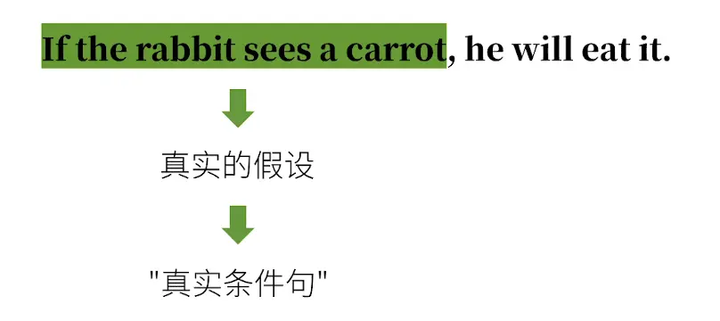
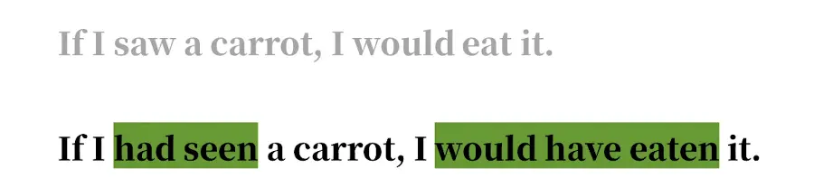
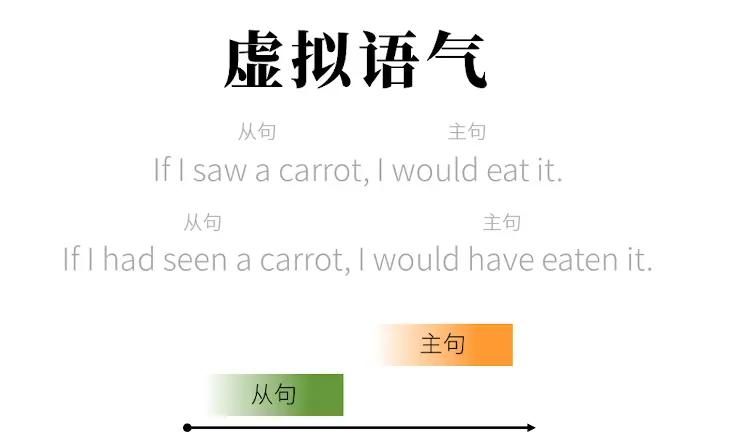
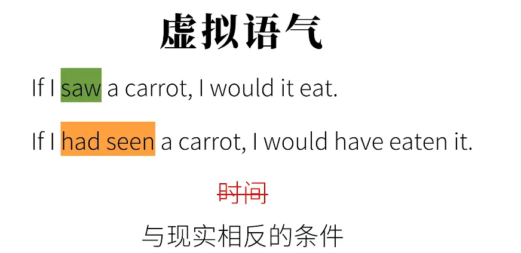
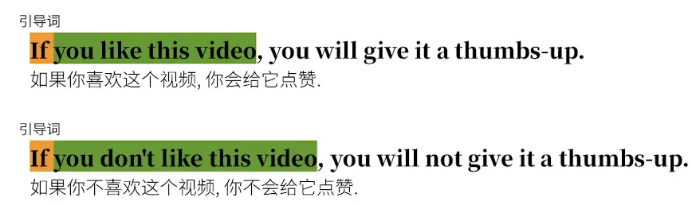
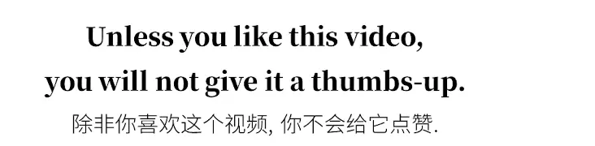

  单纯的假设   属于真实条件句    表示客观事实

  

> ### ① If I saw a carrot, I would eat it.
> 
> **翻译：如果我看到一根胡萝卜，我就会吃掉它。** ✅ 类型：**与现在事实相反的虚拟语气**
> 
> > 暗含现实：我现在并没有看到胡萝卜，所以我不会去吃。 从句：`saw`（一般过去式，虚拟）；主句：`would eat`（would + 动词原形）
> 
> ### ② If I had seen a carrot, I would have eaten it.
> 
> **翻译：如果当时我看到了那根胡萝卜，我本来就会把它吃掉。** ✅ 类型：**与过去事实相反的虚拟语气**
> 
> > 暗含现实：我**当时并没有看到胡萝卜**，所以当初也就没有吃掉它。 从句：`had seen`（过去完成时）；主句：`would have eaten`（would + have done）
> 
> ---
> 
> ### 一句话区分两句核心差别
> 
> 1. 第一句：**现在/假想当下**，我现在没看见胡萝卜，所以不吃。
> 2. 第二句：**过去**，我当时没看见胡萝卜，所以当初没吃。
> 
> 要不要我把这两句改成 could / might / should 版本，对比一下意思变化？  

## 除 if 之外引导词  还有 unless  

  

  

